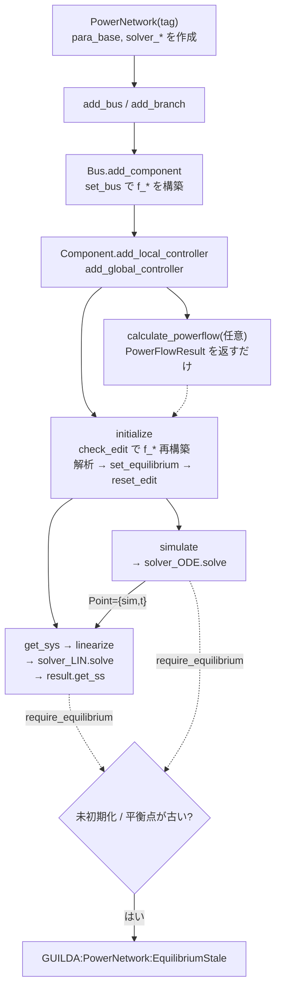

# `PowerNetwork.get_sys` 調査: ワークフロー・データ・編集・引数・一時データ

> 当時の調査記録です。調査の基準は `951800e` で、以後の変更は本文に反映していません(周波数と `f_*` の状態の名前だけは、現在の `get_Hz()` と `sct_edit.s_odefcn` に置き換えて書いています(当時は Dependent プロパティと論理値のフラグでした))。現状は [status.md](status.md) と [v4-migration.md](v4-migration.md) を見てください。

現行実装の調査メモです。改善案は後続の作業でこのノートを基に作成します。`odeLinearizer` 内部の数値計算(Kron / DAE / Feedback)は姉妹ノート `notes/get-sys-linearization.md`(ブランチ `docs/get-sys-linearization`)の範囲で、ここでは入出力だけを扱います。

## 読み方

- 調査対象: ブランチ `docs/get-sys-workflow`(分岐元 `951800e`)。ソースは変更していません。
- ラベル
  - **[事実]** コードを読んで確認したこと
  - **[実行]** MATLAB R2026a で実行して確認したこと(末尾の付録の実験番号 `E..` を添えます)
  - **[推測]** コードからの推論で、実行では確かめていないこと
  - **[未確認]** 調べていないこと
- 引用の起点: 先頭が `_GUILDAobject/`、`+DebugScript/`、`_GUILDAdoc/` のもの以外は `_GUILDAsystem/` からの相対パスです。例: `@PowerNetwork/get_sys.m:31`。
- `add_component` などの `.m` は GUILDA の起動時に `.template` から生成され、リポジトリにはテンプレートだけがあります。引用も `.template` の行番号です。

## 要点

1. **`net.get_sys` は薄いラッパーです。** `linearize` を呼び、その結果の `get_ss` を返します(`@PowerNetwork/get_sys.m:31-33`)。編集確認・入力解決・線形化はすべて `linearize` と `odeLinearizer.solve` の側にあります。
2. **編集の検査は `solve` の入口の1か所だけです。** `net.simulate` / `linearize` / `get_sys` は守られますが、`comp.get_sys` / `bus.get_sys` / `con.get_sys` には検査がなく、編集後も古いハンドルと古い平衡点で黙って答えを返します **[実行 E01]**。
3. **シミュレーションの一時データは残りますが、後の `get_sys` には影響しません。** 故障やトリップが有効なまま終わった実行、途中で失敗した実行の後でも `A` の差は 0 でした **[実行 E07, E08]**。
4. **検査をすり抜ける経路が実在します。** 特に重要なのは `initialize(Method="OPF")` です。OPF の配分が機器に渡らず、平衡点ではない点が「最新」として扱われます **[実行 E11]**。一覧は「観察された問題」にあります。

## 1. モデル構築から時間シミュレーションまで

### 1.1 全体の流れ



### 1.2 各段階の読み書き

| 段階 | 読むもの | 書くもの | 根拠 |
|---|---|---|---|
| `PowerNetwork(tag)` | `GUILDA.config("Model","Hz")` | `s_tag`、`para_base`(Hz、baseMVA=100)、`solver_PF/OPF/CPF/ODE/LIN` | `@PowerNetwork/PowerNetwork.m:120-124`, `@PowerNetwork/reset_solver.m:8-12` |
| `add_bus` | 既存タグ | `Bus` を作り `a_Bus` に追加、`Topology` を記録 | `@PowerNetwork/add_bus.m:38-45`, `@Bus/Bus.m:67-88` |
| `add_branch` | `a_Bus` | `Branch` を作り `a_Bus`/`a_PowerNetwork` を設定、`Topology` を記録 | `@PowerNetwork/add_branch.template:57-63` |
| `Bus.add_component` | `net` の Hz | 機器を作り `set_bus` で `f_*` を構築、`Topology` を記録 | `@Bus/add_component.template:54-59`, `@Component/set_bus.m:5-6` |
| `add_local_controller` | 機器の `sv_x/sv_u/sv_y` | 階層の接続、`iv_obsY/iv_obsX` の解決、`f_*` の構築、`Topology` を記録 | `@Component/add_local_controller.m:36-88`, `@LocalController/LocalController.m:148-201` |
| `add_global_controller` | 構築時の `net`、機器ハンドル | `controlledUnits`(ハンドル)、`a_PowerNetwork`、`f_*`、`Topology` を記録 | `@GlobalController/GlobalController.m:92-106`, `@PowerNetwork/add_global_controller.m:12-14` |
| `calculate_powerflow` | `solver_PF`、Y、`get_pf_condition`、`l_isSlack` | スラックが無ければ先頭母線を設定。それ以外は結果を返すだけ。`check_edit` は呼びません | `@PowerNetwork/calculate_powerflow.m:36-50`, `_auxiliary/@PowerFlowCalculation/solve.m:20-43` |
| `initialize` | 上記に加えパラメータ全般 | `f_*`(古いもののみ)、GC の平衡点、`c_Vequilibrium`、機器と制御器の平衡点、`local_LQR.K`、編集状態のリセット | `@PowerNetwork/initialize.m:47-99` |
| `get_sys` / `linearize` | `solver_LIN`、編集状態、`f_Jacobi*`、平衡点、Y | `f_*`(古いもののみ)。結果は `LinearizationResult` に入り、モデルには書きません | `@PowerNetwork/linearize.m:41-44`, `_auxiliary/@odeLinearizer/solve.m:22-113` |
| `simulate` | `solver_ODE`、編集状態、`f_*`、平衡点、Y、イベント | `f_*`(古いもののみ)と作業データ(第5節)。軌道は `odeSimulationResult` に入ります | `@PowerNetwork/simulate.m:53-58`, `_auxiliary/@odeSimulator/odeSimulator.m:167-319` |

### 1.3 `initialize` の順序

**[事実]** `@PowerNetwork/initialize.m` の処理は次の順です。

1. 旧引数を変換し、`Method` を取り出します(`:44-45`)。
2. `check_edit()` で古い `f_*` を作り直します。平衡点の確認はしません(`:47`)。
3. `Method` ごとの解析を実行します(`:49-80`)。
   - `"powerflow"`: 失敗かつ実行前にスラックが無かった場合、自動設定したスラックを戻します(`:51-67`)。
   - `"OPF"`: 利用者の指定の後ろに `"Method","AC OPF"` を付けて `calculate_optimal_powerflow` を呼びます(`:69`)。
   - `"equilibrium"`: 保持している機器の V/I から組み立て、キルヒホッフ則を確認します(`:136-187`)。
4. GC の平衡点を設定します(`:83-86`)。母線の平衡点より先です。
5. 母線ごとに `Bus.set_equilibrium` を呼びます(`:89-96`)。その中で、スラックの P 残差と NaN の Q を配分し、`Component.set_equilibrium` に渡します(`@Bus/set_equilibrium.m:17-65`)。さらに、機器の `get_equilibrium` の後で制御器の `get_equilibrium` が呼ばれます(`@Component/set_equilibrium.m:12-21`)。
6. `reset_edit()` で全階層の編集状態を消します(`:99`, `_auxiliary/@LayerPackage/reset_edit.m:5-8`)。

### 1.4 `get_sys` の呼び出し

**[事実]** 呼び出しの連なりは次のとおりです。

```text
net.get_sys(NV...)                         @PowerNetwork/get_sys.m:31
└─ net.linearize(NV...)                    @PowerNetwork/linearize.m:41-44
   ├─ take_call_options: Plot を分離       :52-66
   ├─ solver_LIN.get_options(c_nv)         _auxiliary/@odeLinearizer/odeLinearizer.m:80-84
   └─ solver_LIN.solve(net, sct_options)     _auxiliary/@odeLinearizer/solve.m
      ├─ net.require_equilibrium()         :22  → check_edit(RequireEquilibrium=true)
      ├─ NonUnit の範囲確認                 :27-31
      ├─ net.get_variable_map()            :33
      ├─ point_vector(net, Point)          :34
      ├─ Bus.get_sys("port","V2I")         :43 / :45(Point 指定時)
      │  └─ Component.get_sys              @Bus/get_sys.m:31,37
      │     ├─ LocalController.get_sys     @Component/get_sys.m:48,51
      │     └─ 機器本体(rec=false)        @Component/get_sys.m:55
      ├─ GlobalController.get_sys          :54 / :56
      ├─ net.get_admittance_matrix         :61
      └─ LinearizationResult(...)          :112-113
sys = result.get_ss(result.options.Algorithm)   @PowerNetwork/get_sys.m:32
output.result = result                          @PowerNetwork/get_sys.m:33
```

`solve` が使う設定は `NonUnit` と `Point` です。`Algorithm` は `result.options` に入り、`get_ss` で初めて効きます(`_auxiliary/@odeLinearizer/solve.m:27,34,92`)。

### 1.5 `simulate` の呼び出し

**[事実]** `odeSimulator.solve`(`_auxiliary/@odeSimulator/odeSimulator.m`)の主な流れです。

1. `require_equilibrium`(`:167`)
2. イベントが無ければ `NoAction` を補い、位相表を作ります(`:170-178`)。
3. `initialize_index` で作業用の添字を割り当てます(`:179`, `:340-409`)。
4. `ctx` に Y を計算して置きます(`:182-186`)。ローカル変数なのでモデルには残りません。
5. 位相ごとに次を繰り返します(`:208-293`)。
   - `set_gc_connect`(`:217`)
   - `setEventCondition`: `rv_Xoffset/rv_Uoffset` を設定(`:222`, `_auxiliary/@odeEventSet/odeEventSet.m:245,282`)
   - `getInitialCondition`: `l_isFault/l_isConnect` を設定し、`x0` と質量行列を作成(`:224`, `_auxiliary/@odeEventSet/odeEventSet.m:333,497`)
   - MATLAB `ode` オブジェクトの `solve`(`:248`)
   - `Event2State` で結果を保存(`:280`)
   - `getNextPhase`(`:290`)
6. `odeSimulationResult` を返します(`:319`)。

## 2. データ管理

### 2.1 所有者

| データ | 所有者 | 性質 | 根拠 |
|---|---|---|---|
| Hz、baseMVA(系統) | `PowerNetwork.para_base` | 正本。`Component` の `get_Hz()` は親をたどって読みます | `@PowerNetwork/PowerNetwork.m:97,177-180`, `_auxiliary/PowerSystemModel.m:21-23`, `_auxiliary/@LayerPackage/LayerPackage.m:90-100` |
| Y 行列 | どこにも保持しません | 呼び出しのたびに `Branch` と母線シャントから計算します | `@PowerNetwork/get_admittance_matrix.m:19-32` |
| V の平衡点 | `Bus.c_Vequilibrium` | 正本。機器と制御器は Dependent で読みます | `@Bus/Bus.m:43`, `@Component/Component.m:238-245`, `@LocalController/LocalController.m:256-282` |
| I の平衡点 | `Component.c_Iequilibrium` | 正本。`Bus.c_Iequilibrium` は Dependent の和です | `@Component/Component.m:90`, `@Bus/Bus.m:129-136` |
| X, U の平衡点 | 機器、ローカル制御器、GC の各 `rv_X/Uequilibrium` | `net.cv_*` は Dependent の集計です | `@Component/Component.m:88-89`, `@LocalController/LocalController.m:102-103`, `@GlobalController/GlobalController.m:70-71`, `@PowerNetwork/PowerNetwork.m:222-233` |
| パラメータ | 各層の `para_*`(`Parameter`、動的プロパティ) | `tab_parameter` は Dependent の表で、`set` は各値へ分解して代入します | `_auxiliary/@Parameter/Parameter.m:82-97`, `_auxiliary/@Parameter/add_entry.m:18-24`, `@Component/Component.m:256-281` |
| `f_*` ハンドル | 機器、ローカル制御器、GC | パラメータと Hz を**値で**閉じ込めたキャッシュです | `@Component/Component.m:169-196`, `@LocalController/LocalController.m:237-248`, `@GlobalController/GlobalController.m:159-170` |
| ソルバ設定 | `net.solver_*` | 各ネットワークが持つ既定値。結果は持ちません | `@PowerNetwork/PowerNetwork.m:52-89` |
| 変数の順序 | `get_variable_map`(都度計算) | 「ただ一つの定義」とされています | `@PowerNetwork/get_variable_map.m:4-6`, `_GUILDAdoc/developer/class-design.html:278` |
| 結果 | `AnalysisResult` | 計算値と使用した設定。`a_PowerNetwork` は生きた参照です | `_auxiliary/@AnalysisResult/AnalysisResult.m:49-54,78-81` |
| OPF の項 | 各層の `f_opfcost`・`f_opfconst`・`l_opfdefault` | 動的解析では使いません | `@PowerNetwork/PowerNetwork.m:141` |

### 2.2 タグと添字

**[事実]**

- 階層は handle クラスで、親子は直接参照です(`_auxiliary/@LayerPackage/LayerPackage.m:1`)。`net2 = net` は別名で、`Copyable` は使っていません(`git grep` で該当なし)。
- 変数の対応付けは主にタグを使います。`Label` 列は `get_sys` の名前と一致します(`@PowerNetwork/get_variable_map.m:17-21`)。
- 添字で指定するものもあります。`NonUnit` は `a_Bus` の添字です(`_auxiliary/@odeLinearizer/odeLinearizer.m:27-29`)。
- イベントの故障やトリップはタグで指定しますが、タグごとの状態数は**イベント作成時に**保存します(`_auxiliary/@odeEventSet/odeEventSet.m:102-122`)。
- タグは利用者が変更できますが、変更は編集記録に残りません(`_auxiliary/@LayerPackage/LayerPackage.m:167-170`)。**[実行 E20]** で `stale=0`、`log=0` を確認しました。

### 2.3 重複

| 重複 | 同期の方法 | 問題の有無 |
|---|---|---|
| パラメータと `f_*` の中の値 | `s_odefcn` と `check_edit` | 層別 `get_sys` では同期しません(E01) |
| Hz: `para_base` と `f_*` の中の値 | 全層に `mark_stale_odefcn` | `f_*` は同期しますが `local_LQR.K` は同期しません(E03) |
| P, Q: `para_powerflow` と平衡点の電流 | `Bus.set_equilibrium` | OPF の解とは同期しません(E11) |
| baseMVA: 系統の `para_base` と機器の `para_operation.baseMVA` | 同期しません。別の意味です(系統基準と機器定格) | 定格は Q 配分に使いますが、古くなる扱いではありません(E04) |
| 順序の定義: `get_variable_map` と `iv_ode*` | `odeSimulationResult` の `simulator_columns` で照合 | 2種類の順序が併存します。`iv_ode*` の並びは機器ごとに x, u が交互で、V の後に I が続きます(`_auxiliary/@odeSimulator/odeSimulator.m:398-407`, `:391-396`)。不一致は例外になります(`_auxiliary/@odeSimulationResult/odeSimulationResult.m:299-304`) |
| Y: 都度計算と `ctx.Ymat` / `sct_model.cm_Y` | 実行ごと、結果ごとのスナップショット | 実行中は変わらないので問題ありません |
| 機器の参照: `Bus.a_Component` と `GC.controlledUnits` | 同期しません | `replace_component` などで食い違います(E09) |

## 3. パラメータ変更時の動作

### 3.1 仕組み

**[事実]**

1. `Parameter` の各値に `PreSet` / `PostSet` リスナーがあります(`_auxiliary/@Parameter/add_entry.m:23-24`)。
2. `PostSet` は型を確認し、値が変わっていれば `log_edit` を呼びます(`_auxiliary/@Parameter/callbackPostSet.m:13-19`)。同じ値の再代入は記録されません **[実行 E02]**。
3. `log_edit` は `edit_effect` で影響を判定し(`_auxiliary/@LayerPackage/log_edit.m:17-18`、表は `_auxiliary/@LayerPackage/LayerPackage.m:130-159`)、次を行います。
   - `s_odefcn` を設定します。`base` のときは全層、それ以外は所有者だけです(`_auxiliary/@LayerPackage/log_edit.m:19-25`)。
   - 親へ順に伝えます(`_auxiliary/@LayerPackage/log_edit.m:37-39`)。
   - `PowerNetwork` に届くと、`s_editFlag`、`l_staleEquilibrium`、`tab_editLog` を更新します。**未初期化(`"unset"`)の間は記録しません**(`_auxiliary/@LayerPackage/log_edit.m:27-33`)。
   - `handle_edit` でスラックの一意性を保ちます(`_auxiliary/@LayerPackage/log_edit.m:36`, `@PowerNetwork/PowerNetwork.m:182-199`)。
4. `check_edit` は木をたどって古い層だけ `rebuild_odefcn` し、平衡点が有効かどうかを返します(`_auxiliary/@LayerPackage/check_edit.m:13-17`)。
5. `PowerNetwork.check_edit` は `RequireEquilibrium=true` のとき、無効なら `EquilibriumStale` を投げます(`@PowerNetwork/check_edit.m:17-32`)。**再構築はエラー判定より先に行われます**。そのため、失敗した `net.get_sys` の後は `comp.get_sys` の答えが変わります **[実行 E01]**。

呼び出し元は3か所だけです。

- `initialize`(`@PowerNetwork/initialize.m:47`)。平衡点は確認しません。
- `odeSimulator.solve`(`_auxiliary/@odeSimulator/odeSimulator.m:167`)
- `odeLinearizer.solve`(`_auxiliary/@odeLinearizer/solve.m:22`)

`calculate_powerflow`、OPF、CPF は呼びません。

### 3.2 編集の種類ごとの結果

**[実行 E02]** 3母線系統(AVR と AGC 付き)で `initialize` 後に各編集を行い、確認しました。`fcn` 列は機器 / AVR / AGC の `s_odefcn` です。

| 編集 | fcn | 平衡点 stale | `log` 行数 | `net.get_sys` |
|---|---|---|---|---|
| 機器 dynamics(`para_dynamics`、`tab_parameter` どちらも) | 1/0/0 | 1 | 1 | EquilibriumStale |
| AVR `para_dynamics` | 0/1/0 | 1 | 1 | EquilibriumStale |
| AGC `para_dynamics` | 0/0/1 | 1 | 1 | EquilibriumStale |
| 線路 R | 0/0/0 | 1 | 1 | EquilibriumStale |
| 母線 Gshunt | 0/0/0 | 1 | 1 | EquilibriumStale |
| 母線 powerflow V、機器 powerflow P | 0/0/0 | 1 | 1 | EquilibriumStale |
| 母線 powerflow V0(初期推定値のみ) | 0/0/0 | 1 | 1 | EquilibriumStale(保守的) |
| 機器 operation.baseMVA、OPF、graph、線路 operation | 0/0/0 | 0 | 1 | 通過 |
| 系統 Hz | 1/1/1 | 0 | 1 | 通過 |
| 系統 baseMVA | 1/1/1 | 1 | 1 | EquilibriumStale |
| スラック変更 | 0/0/0 | 1 | 2(解放と設定) | EquilibriumStale |
| `add_component`, `remove_component`, `add_bus`, `add_branch`, `remove_branch`, `remove_global_controller` | 0/0/0 | 1 | 1 | EquilibriumStale |
| `set_opffcn` | 0/0/0 | 0 | 1 | 通過 |
| `solver_PF.Method`, `solver_LIN.Algorithm` | 0/0/0 | 0 | 0 | 通過 |
| 同じ値の再代入 | 0/0/0 | 0 | 0 | 通過 |

その他の確認結果です。

- **[実行 E02]** `avr.tab_parameter = ...` と `agc.tab_parameter = ...` は `MATLAB:class:noSetMethod` で失敗します。`LocalController` と `GlobalController` には `set.tab_parameter` がありません(`Component`、`Bus`、`Branch`、`PowerNetwork` にはあります)。制御器の編集は `para_dynamics` を直接使います。
- **[実行 exp3]** 型の違う値の代入は例外になりません。リスナー内のエラーは MATLAB の警告に変わり、値は元に戻され、記録もされません(`_auxiliary/@Parameter/callbackPostSet.m:13-15`)。
- **[事実]** `local_LQR` の `Q`, `R`, `V0` は `Parameter` ではなく通常のプロパティで、`set` メソッドから `log_edit` を呼びます(`_GUILDAobject/+controller/local_LQR.m:97-108,203-208`)。`Parameter` ではないので `s_odefcn` は立ちませんが、`initialize` で `K` と一緒に作り直されます(`:156-157`)。
- **[実行 E22]** `calculate_powerflow`、`calculate_optimal_powerflow`、CPF は、初期化済みのネットワークの編集状態を変えず、その後の `get_sys` にも影響しません(`A` の差 0)。

### 3.3 すり抜ける経路

| # | 経路 | 結果 | 根拠 |
|---|---|---|---|
| a | 編集後に `comp.get_sys` / `bus.get_sys` を呼ぶ | 古い `f_*` と古い平衡点で黙って返します | **[実行 E01]**。これらの `get_sys` は `check_edit` を呼びません(`@Component/get_sys.m:125-130`, `@Bus/get_sys.m:30-31`)。`con.get_sys`、`gc.get_sys` も同じ構造です **[事実]** |
| b | `initialize(Method="OPF")` | `V` は OPF、`P` は設定値のままになり、KCL 残差 0.39 です。stale は立ちません | **[実行 E11]**。詳細は問題 1 |
| c | powerflow 編集後に `initialize(Method="equilibrium")` | KCL 確認は古い電流で通ります。その後、新しい P から電流を作るので残差 0.196 になります。stale は解除されます | **[実行 E21]**, `@PowerNetwork/initialize.m:172-176`, `@Bus/set_equilibrium.m:24,63` |
| d | Hz 編集と `local_LQR` | `K` は古い Hz のまま、stale 無しで通ります。`initialize` し直すと `K` が 5.16 変わります | **[実行 E03]**。`K` の設計は `initialize` の中だけです(`_GUILDAobject/+controller/local_LQR.m:138-157`) |
| e | 機器 `operation.baseMVA` の編集 | 複数機器の NaN Q の配分が変わるのに stale になりません | **[実行 E04]**, `@Bus/set_equilibrium.m:52-53` |
| f | OPF で初期化した後の `operation` / `OPF` の編集 | OPF 解が変わる編集でも stale になりません | **[推測]** `edit_effect` が初期化方法を区別しないため(`_auxiliary/@LayerPackage/LayerPackage.m:156-157`)。ただし b のとおり、現状は OPF 解自体が機器に渡りません |
| g | `.mat` の保存と読み込み | 読み込むと**母線も線路も空**です | **[実行 E05, exp4]**。問題 5 |

逆に、保護が効いている経路もあります。

- **[実行 E17]** `initialize` が途中(LQR の重みサイズ)で失敗すると、一部の母線の V と機器の X が書き換わったまま残ります。編集で stale が立っていたので `get_sys` は止まります。
- **[推測]** stale が立っていない状態で `set_equilibrium` が途中で失敗すると、混在した平衡点のまま通ります。`reset_edit` の前でも flag は「有効」のままだからです。再現条件は作っていません(`Method` の違いで解が変わり、`local_LQR` の `abs(V - V0) < 1e-9` に当たるような場合)。

## 4. 実行時引数

### 4.1 シグネチャと Name-Value

| メソッド | シグネチャ | Name-Value と既定値 | 根拠 |
|---|---|---|---|
| `get_sys` | `[sys, flag, output] = get_sys(obj, varargin)` | `linearize` と同じ | `@PowerNetwork/get_sys.m:1,14-17` |
| `linearize` | `[result, flag, output] = linearize(obj, varargin)` | `Algorithm`("Feedback")、`NonUnit`(`zeros(1,0)`)、`Point`(`[]`)、`Plot`(false、呼び出し単位) | `@PowerNetwork/linearize.m:1,17-23`, `_auxiliary/@odeLinearizer/odeLinearizer.m:25,29,38,45-48` |
| `simulate` | `[result, flag, output] = simulate(obj, time, events..., NV...)` | `Solver`("ode15s")、`SolverOptions`(ODE15s)、`Tolerance`(1e-4)、`AbsoluteTolerance`(1e-6)、`SeparateComplexParts`("off")、`TimeLimit`(10)、`Progress`("dialog")、`Verbose`(false)、`Plot`(false)、`Export`(false、呼び出し単位)。Tolerance、AbsoluteTolerance、SeparateComplexParts、Progress、TimeLimit の初期値は `GUILDA.config("TimeSimulation")` で上書きされます | `@PowerNetwork/simulate.m:1,19-28`, `_auxiliary/@odeSimulator/odeSimulator.m:28-59,68-77,95-105` |
| `initialize` | `[result, flag, output] = initialize(obj, varargin)` | `Method`("powerflow" / "OPF" / "equilibrium")。他は解析へそのまま渡します。"equilibrium" は他の指定でエラーです | `@PowerNetwork/initialize.m:1,11-21,74-78` |
| `calculate_powerflow` | `[result, flag, output] = calculate_powerflow(obj, varargin)` | `Method`, `Tolerance`, `MaxIteration`, `Verbose`, `Plot`, `Export` | `@PowerNetwork/calculate_powerflow.m:13-18`, `_auxiliary/@PowerFlowCalculation/PowerFlowCalculation.m:61-65` |

`simulate` の `time` についての確認結果です。

- **[実行 E15]** `simulate(ev)` は `MATLAB:validation:UnableToConvert` です。`time` は位置引数で必須に近く、イベントだけ渡す場合は `simulate([], ev)` です。
- **[実行 E24]** `simulate()` は `time=[]` で t=10 まで走ります(`_auxiliary/@odeEventSet/private/getTimeSpan.m:7-11`)。
- **[実行 E24]** `time` に3要素以上を渡すと、1, 2番目だけが使われます。`[0,0.1,0.2,0.3]` で `tEnd=0.1` でした(`_auxiliary/@odeEventSet/private/getTimeSpan.m:5,13,15`)。

### 4.2 設定の解決

**[事実]** `tools.resolve_options(solver, sct_map, nv)`(`+tools/resolve_options.m`)の動作です。

1. `sct_map`(各ソルバの `OptionMap`)の各項について、保存値を読みます(`:52-71`)。
2. 呼び出しの Name-Value を上書きします。名前は大文字小文字を区別せず、同じ名前は後が勝ちます。未知の名前は `UnknownName` です(`:75-92`)。
3. ソルバオブジェクトには書きません。`sct_options` は別の struct です。

ソルバごとの違いがあります。

| | `odeLinearizer` | `odeSimulator` | `PowerFlowCalculation` |
|---|---|---|---|
| `sct_options` の中身 | `OptionMap` の項目だけ | 公開設定の全て(Hidden 等を除く) | 公開設定の全て |
| 根拠 | `_auxiliary/@odeLinearizer/odeLinearizer.m:80` | `_auxiliary/@odeSimulator/odeSimulator.m:124-137` | `_auxiliary/@PowerFlowCalculation/PowerFlowCalculation.m:98-110` |
| `Plot` | 呼び出し単位(保存されません) | ソルバの保存設定 | 呼び出し単位 |
| `Export` | なし | 呼び出し単位 | 呼び出し単位 |

**[実行 E15]**

- `net.get_sys(algorithm="Kron")` は通り、`solver_LIN.Algorithm` は変わりません。
- `Algo=`(部分一致)は `UnknownName`、奇数個の引数は `InvalidPairs` です。
- `solver_LIN.Algorithm="Kron"` を保存すると次の `get_sys` で使われ、`reset_solver` で戻ります。
- `get_ss` の `Coordinate` は `net.get_sys` からは渡せません(`UnknownName`)。`get_sys(Algorithm="DAE")` は常に既定の `"theta&rho"` です(`_auxiliary/@LinearizationResult/get_ss.m:31`, `@PowerNetwork/get_sys.m:32`)。
- `solver_ODE.SolverOptions` は値クラスで、実行後に `OutputFcn` は書き戻されません(handle=0)。

`Point` を `solver_LIN.Point` に保存した場合は `output.l_equilibrium=false` になり、以降の呼び出し全てに効きます。変数の数が変わると `PointSize` です **[実行 E18]**。古い `{sim,t}` も、トポロジ変更後は `UnknownVariable` で止まります **[実行 E18]**。`Point` を指定しても `require_equilibrium` は省略されません(`_auxiliary/@odeLinearizer/solve.m:22`)。

### 4.3 戻り値

| メソッド | `result` | `flag` | `output` |
|---|---|---|---|
| `get_sys` | descriptor `ss`(`get_ss` の結果) | logical: Jacobian が全て有限 | `message, l_equilibrium, n_x, n_v, n_u, rcond_Avv, result` **[実行 E15]** |
| `linearize` | `LinearizationResult` | 同上 | `result` 以外の同じ項目 |
| `simulate` | `odeSimulationResult` | 1 完了 / 0 TimeLimit / -1 ソルバ停止 | `message, tEnd, phases, nPhases, nPhasesDone` |
| `initialize` | `PowerFlowResult` / `OPFResult` | 正の値のみ(失敗はエラー) | 解析の詳細 |
| `calculate_powerflow` | `PowerFlowResult` | fsolve の exitflag など。失敗でも返ります(`WhenFailed` 次第) | 詳細 |

### 4.4 層による `get_sys` の違い

| 層 | シグネチャ | 既定の点 | 入出力 | `check_edit` | 根拠 |
|---|---|---|---|---|---|
| `PowerNetwork` | `[sys,flag,output] = get_sys(NV)` | `solver_LIN.Point` | 入力 u、出力 x(Algorithm 依存) | あり | `@PowerNetwork/get_sys.m`, `_auxiliary/@LinearizationResult/get_ss.m:10-17` |
| `Bus` | `sys = get_sys(port, full, con, Point)` | 平衡点 | `[V;u] → [I;y]` または I2V。`full`, `con` は無視 | なし | `@Bus/get_sys.m:19-25` |
| `Component` | `[sys,x名,入力名,出力名] = get_sys(x,V,I,u, port, full, tag, con, rec, Point)` | 平衡点 | `[V;u;制御器u] → [I;y;制御器y]` または I2V | なし | `@Component/get_sys.m:31-43` |
| `LocalController` | `[sys,...] = get_sys(x,V,I,u, full, tag)` | 平衡点 | `[V;u] → y` | なし | `@LocalController/get_sys.m:13-21` |
| `GlobalController` | `sys = get_sys(x,V,I,u, full)` | 平衡点 | `u → y`、`full` は未使用 | なし | `@GlobalController/GlobalController.m:114-156` |

細かい違いです。

- **[実行 E12]** `comp.get_sys("con",false)` も `comp.get_sys("full",true)` も、制御器付きなら結果は同じです(状態 9、出力 4)。`rec=true` の経路が `opt.con`, `opt.full` を使わないためです(`@Component/get_sys.m:53-55`)。`opt.con` の説明(`:40`)とは合いません。
- **[実行 E12]** `[a,b] = bus.get_sys()` は `TooManyOutputs` です。`Component` と違い名前を返しません。
- **[実行 E23]** 初期化前の `comp.get_sys` / `bus.get_sys` は `MATLAB:badsubscript` で止まります。理由が分かる案内はありません。
- **[事実]** `x,V,I,u` を明示すると、機器だけがその点になり、制御器は平衡点のままです(`@Component/get_sys.m:20-25,47-48`)。

## 5. 一時データと作業データ

### 5.1 一覧

| データ | 置き場所 | 設定 | 解除 | 読むもの |
|---|---|---|---|---|
| `iv_odeX/U/Y/I` | 機器、制御器、母線、GC | `initialize_index`(実行ごと)。`_auxiliary/@odeSimulator/odeSimulator.m:340-409` | **解除しません** | シミュレータ、`odeEventSet`、結果の構築 |
| `l_isFault` | `Bus` | 位相ごと。`_auxiliary/@odeEventSet/odeEventSet.m:333` | **解除しません**(次の実行で上書き) | `getNextPhase` のみ(`:679`) |
| `l_isConnect`(機器、ローカル制御器) | 各オブジェクト | 位相ごと。`_auxiliary/@odeEventSet/odeEventSet.m:497` | **解除しません**(次の実行で上書き) | `get_dx_algebraic`, `getNextPhase`, AGC の `u_connect` |
| `l_isConnect`(GC) | `GlobalController` | 位相ごと。`_auxiliary/@odeSimulator/odeSimulator.m:217` | `onCleanup` で戻します(`:180`) | `getODEFunction`, `getODEJacobian`, `getNextPhase` |
| `rv_Xoffset`, `rv_Uoffset` | 機器(公開の Hidden)。ローカル制御器は既定値のまま | 位相ごと。`_auxiliary/@odeEventSet/odeEventSet.m:245,282` | **解除しません**(クロージャを保持) | `getODEFunction`, `getXM`, `getInitialCondition` |
| `iv_CPFV`, `iv_CPFX`, `f_PQ2Bus` | 母線、機器 | CPF の `build_layout` | 解除しません | CPF のみ |
| `ctx`, `tab_phase`, `x0`, `Mass`, `odeProg` | `solve` のローカル変数 | 実行ごと | 関数の終了時 | シミュレータのみ |
| `odeIteration` など | `odeEventSet` | 位相ごと | イベントを再利用すると上書き | イベントのみ |
| `sct_options` | ローカル、結果の `options` | 実行ごと | ソルバには残りません | 結果 |

**[事実]** `l_isConnect`, `l_isFault`, `rv_*offset`, `iv_ode*` は、`git grep` の範囲では `linearize` の経路(`odeLinearizer`, `Bus.get_sys`, `Component.get_sys`, `point_vector`)から読まれません。

### 5.2 実行後の状態

**[実行 E07]** 故障、トリップ、オフセット、入力イベントが有効なまま終わった実行の後:

- `l_isFault=1`, `l_isConnect=0`, `Uoff(0.1)=[0.01 0]`, `iv_odeX(1:2)=[9 10]` が残りました。
- `get_sys` の `A` の差 0、平衡点の差 0、`tab_editLog` 0 行、stale 0 でした。
- 次のイベントなしの実行は `flag=1`、`max|omega|=3e-18` で、残留の影響はありません。

**[実行 E08]** 位相の途中で失敗した実行(`GUILDA:odeSimulator:UnfeasibleDAE`)の後も同じでした。`l_isFault=1`, `l_isConnect=0` が残り、`get_sys` の差は 0、次の実行も正常です。

### 5.3 実行が後の `get_sys` に影響するか

**結論: 通常の経路では影響しません [実行 E07, E08, E19]。** 注意点が3つあります。

1. **制御器付き発電機のトリップは、現状ではトリップの次の位相で例外になります** **[実行 E06]**。`getNextPhase` が `[x0(v_LC1), ~] = a_LC1.get_equilibrium(...)` と2出力で呼びますが(`_auxiliary/@odeSimulator/odeSimulator.m:661`)、AVR の `get_equilibrium` は出力を持たず、自分の `rv_X/Uequilibrium` に書く関数です(`_GUILDAobject/+controller/+avr/@AVR_ST1/AVR_ST1.m:66,92-93`)。
   - 例外が出ているので、平衡点は書き換わっていません(差 0)。
   - **[推測]** 出力の数だけを直すと、トリップ中の電圧で `rv_Xequilibrium` が上書きされ、stale も立たず、**ここで初めて実行が後の `get_sys` に影響します**。修正するときの要注意点です。
2. **過去の実行の `iv_ode*` が切り離された機器に残り、GC から読まれます** **[実行 E09]**。問題 7 を参照してください。
3. **`LinearizationResult` と `odeSimulationResult` は生きたネットワークへの参照を持ちます**(`a_PowerNetwork`)が、行列と変数表はスナップショットです(`_auxiliary/@LinearizationResult/LinearizationResult.m:91-98`)。古い `sim` を `Point` に使うと、変数が合わなければ止まります **[実行 E18]**。**[未確認]** 変数表が同じで平衡点が変わった場合に古い `sim` を使う動作は止まらないと読めますが、実行していません。

## 6. その他

### 6.1 性能

**[実行 E25]** 参考値です(初回実行、1回測定)。

| 系統 | `initialize` | `linearize` | `get_ss` Kron / Feedback / DAE | `get_variable_map` | Y |
|---|---|---|---|---|---|
| IEEE9bus(`n_x`=27) | 0.10 s | 0.25 s | 0.020 / 0.062 / 0.011 s | 0.026 s | 0.041 s |
| IEEE68bus(`n_x`=144) | 0.80 s | 2.12 s | 0.025 / 0.544 / 0.007 s | 0.210 s | 0.081 s |

IEEE68bus の `linearize` のプロファイル(合計 4.9 s、プロファイラのオーバーヘッド込み)です。

- `get_variable_map` が 2.07 s(約 42%)で最大です。1回の `linearize` で `PowerNetwork.get_variable_map` が3回、`Bus.get_variable_map` が272回、`table` の構築が1835回呼ばれます。呼び出し元は `_auxiliary/@odeLinearizer/solve.m:33`, `_auxiliary/@odeLinearizer/point_vector.m:28,78` です。
- `Bus.get_sys` が 1.51 s です。
- `Component.get_sys` は機器51台で102回呼ばれます。**[事実]** `rec=true` と `rec=false` の両方が先頭で制御器の `get_sys` を計算しており(`@Component/get_sys.m:46-52`)、内側の結果は捨てられます。

**[事実]** シミュレーション側の構造です。`getODEFunction` / `getODEJacobian` は毎回の評価で母線と機器をループし、ヤコビアンは密行列です(`_auxiliary/@odeSimulator/odeSimulator.m:453-482,495`)。

### 6.2 `get_sys` の呼び出し元

| 呼び出し元 | 内容 | 状態 |
|---|---|---|
| `_GUILDAobject/+controller/local_LQR.m:138` | `initialize` の途中で `comp.get_sys(..., "rec", false)` を呼びます。内部オプションの外部利用です | 使用中 |
| `_auxiliary/@odeLinearizer/solve.m:43-56` | `Bus.get_sys`, `GlobalController.get_sys` | 使用中 |
| `_GUILDAobject/+controller/+modeling/get_environment.m:25-50` | `net.get_sys_area`, `net.a_bus`, `get_sys_polar` など v2 の API を呼びます | **[推測]** 動きません。リポジトリに `get_sys_area` の定義はありません(`git grep`) |
| `_GUILDAobject/+controller/local_LQR_retrofit.m:52,65` | `obj@LocalController(net, idx, idx)`, `net.a_bus{idx}.component.get_sys4retrofit()` | **[推測]** 動きません。現在の親コンストラクタは `tag` の1引数です(`@LocalController/LocalController.m:124`) |
| `+DebugScript/test_F7_linearization.m` | 主要な検証(`get_sys|linearize` 95行) | テスト |
| `+DebugScript/test_F3_edit_handling.m` | 編集の検証(17行)。`net` 層のみで、層別 `get_sys` の stale は対象外です | テスト |
| `+DebugScript/test_F6_simulation.m`, `+DebugScript/test_F8_utilities.m` | 補助的な使用 | テスト |
| `+DebugScript/+helper/linearize_v3.m` | v3 との一致確認用の複製 | テスト補助 |

`_GUILDAtutorial` には `get_sys` / `linearize` の使用はありません(`git grep`)。

### 6.3 v3 互換(`_VersionSupport`)

**[事実]**

- `get_sys` 専用の変換はありません。旧 `[sys, lin] = net.get_sys()` は例外も警告も出さず、`lin` が logical の `flag` になります **[実行 E15]**。意図された仕様で、移行ガイドに記載があります(`notes/v4-migration.md:32`)。
- `odeLinearizer(net, ...)` は `GUILDA:Deprecated:OdeLinearizerConstructor` で止まります(`_VersionSupport/v3_linearizer_constructor.m`)。
- `initialize` は `v3_initialize_args`、`simulate` は `v3_simulate_args` で旧名を変換します(`@PowerNetwork/initialize.m:44`, `@PowerNetwork/simulate.m:54`)。
- `comp.para_base` と `comp.tab_parameter.base` は `ComponentBaseView` で互換を保ちます(`@Component/Component.m:255,263,269,271`)。
- `Bus.get_sys` の `full`, `con` は「古い呼び出しのために残した無視される引数」です(`@Bus/get_sys.m:22-23`)。

### 6.4 ドキュメントとコードの差

| 記述 | 実際 | 根拠 |
|---|---|---|
| `initialize`: 操作点を平衡点に設定する(OPF を含む)`@PowerNetwork/initialize.m:4,13-14` | OPF では V だけが反映され、P は設定値です | E11 |
| `initialize`: 失敗時は以前の平衡点と記録を保つ `@PowerNetwork/initialize.m:23-26` | 解析の失敗では正しいです。`set_equilibrium` 段階の失敗では部分的に書き換わります | E17 |
| 編集の表: Hz は handle のみ、`operation` は影響なし `_GUILDAdoc/developer/class-design.html:259-266` | `local_LQR` の Hz と、`operation.baseMVA` の Q 配分が例外です | E03, E04 |
| `linearize` の `flag`: Jacobian が有限なら true `@PowerNetwork/linearize.m:38` | NaN の点では `dss` が例外を投げ、`flag=false` に到達しません | E13, E19 |
| `Component.get_sys` の `opt.con`: 「制御器を含める」`@Component/get_sys.m:40` | 外部からの指定は無視されます | E12 |
| `PowerNetwork.rv_Xequilibrium`(公開 Dependent)`@PowerNetwork/PowerNetwork.m:93` | 読むと必ずエラーです。`Bus` に `rv_Xequilibrium_all` がありません(`:229`) | E10 |
| GC: 入力は「被制御機器の出力」`@GlobalController/GlobalController.m:5` | シミュレータと `gc_input` は `sv_x == sv_u` の**状態**を読みます(`_auxiliary/@odeSimulator/odeSimulator.m:386`, `_auxiliary/@odeLinearizer/solve.m:123`)。`gc.get_sys` の入力名は `sv_y` です(`@GlobalController/GlobalController.m:150`) | 事実 |
| `replace_component`: 平衡点はプレースホルダー `@Bus/replace_component.template:66-69` | 初期化前は `c_Iequilibrium=[]` のため例外になります | E16 |
| `log_edit` の宣言 `_auxiliary/@LayerPackage/LayerPackage.m:86` | 実体は引数が異なります(`_auxiliary/@LayerPackage/log_edit.m:1`)。動作には影響しません | 事実 |
| API の表: `simulate` は「Changes net: No」`_GUILDAdoc/developer/api-design.html:247` | 作業データは書き込みます。ただし解析結果には影響しません | E07 |

## 観察された問題

重要度の高い順です。改善案ではなく、証拠の一覧です。

1. **`initialize(Method="OPF")` は平衡点になりません。** `Bus.set_equilibrium` は機器の P, Q を `para_powerflow` から読み、OPF の配分を使いません(`@Bus/set_equilibrium.m:24,28-34,63`)。
   - IEEE9bus: B002 の OPF 解 1.0508 に対し機器は 1.63 です。`max|YV-I|`=0.392 でした。
   - 外乱なしの5秒シミュレーションで V1 成分が 2.998 ずれます(潮流で初期化した場合は 4.7e-14)。
   - `net.linearize` と `get_sys` は stale 無しで通ります。
   - テストは V の一致だけを確認しています(`+DebugScript/test_F3_initialize.m:197-201`)。**[実行 E11]**
2. **`initialize(Method="equilibrium")` が powerflow 編集の stale を解除します。** 残差 0.196 のまま `get_sys` が通ります **[実行 E21]**。
3. **Hz 編集で `local_LQR.K` が古いまま通ります。** **[実行 E03]**
4. **層別の `get_sys` に編集の検査がありません。** 古いハンドルと古い平衡点で黙って返します。`get_hessian` も既定の点は同じ構造です(`@Component/get_hessian.m:28-30`)**[実行 E01]**。
5. **`.mat` からの読み込みでネットワークが黙って空になります。** 警告はありません。探査用コピーで `set.a_Bus` が `load` から呼ばれることを確認しました(スタック `PowerNetwork.set.a_Bus<-exp4`)。原因は `dbstack` による呼び出し元検査(`@PowerNetwork/PowerNetwork.m:248-268`)が例外を投げ、`load` がそれを無視するためと考えられます。**[実行 E05, exp4]** 原因の結びつきは **[推測]** です。
6. **AVR / PSS 付き発電機のトリップが、次の位相で `TooManyOutputs` になります。** IEEE9bus でも再現します(`_auxiliary/@odeSimulator/odeSimulator.m:661,669`)。既存のテストは AVR を別の機器に付け、AVR の無い `SG1B002` をトリップしており、この経路を通りません(`+DebugScript/test_F6_simulation.m:317-319`)。単純に直すと平衡点が上書きされます(5.3節)。**[実行 E06]**
7. **`Bus.replace_component` / `remove_component` で GC の `controlledUnits` が古いままです。** `remove_bus` には確認があります(`@PowerNetwork/remove_bus.m:34-42`)が、`Bus` の側にはありません。**[実行 E09]**
   - `get_sys` は `GlobalControllerPort` で止まります。
   - 実行歴なしの `simulate` は `MATLAB:badsubscript` です。
   - 実行歴ありだと、**切り離された機器の古い添字で動き始めます**。`gen-1axis` への置換では AGC の `iv_odeY=15` に対し新機器の `iv_odeU=[12 13]` で、出力先がずれていました。この実行は `flag=-1` で止まりました(原因との結びつきは **[推測]**)。
8. **`operation.baseMVA` が Q 配分に効くのに stale になりません。** **[実行 E04]**
9. **`net.rv_Xequilibrium` は常にエラーです。** **[実行 E10]**
10. **NaN を含む点で `linearize` / `get_sys` が例外を投げます。** `flag=false` の経路に届きません。トリップ中の `Point={sim,t}` が該当します(トリップ機器の状態は NaN です。`_auxiliary/@odeEventSet/odeEventSet.m:418-420`)。**[実行 E13, E19]**
11. **作成済みのイベントはトポロジ変更後に分かりにくいエラーになります。** `MATLAB:innerdim` です。イベントが作成時の状態数を保持するためです(`_auxiliary/@odeEventSet/odeEventSet.m:118-122,352-354`)。**[実行 E14]**
12. **`replace_component` は初期化前に `MATLAB:innerdim` で失敗します。** **[実行 E16]**
13. **`initialize` の途中失敗で平衡点が混在します。** 編集で stale が立っていれば止まりますが、そうでない経路は残ります **[実行 E17]、[推測]**。
14. **`Component.get_sys` の `con`, `full` は外部指定が効かず、`rec` は内部用なのに `local_LQR` が使っています。** 制御器のモデルも二重に計算されます。**[実行 E12, E25]**
15. **`get_variable_map` の反復が `linearize` の最大の負荷です。** **[実行 E25]**
16. **作業データの後始末が不揃いです。** GC の `l_isConnect` だけが `onCleanup` で戻り、機器の `l_isConnect` と母線の `l_isFault` は残ります。解析結果への影響は確認されませんでした。**[実行 E07, E08]**
17. **制御器の `tab_parameter` だけ代入できません。** 他の層と使い方が異なります。**[実行 E02]**
18. **`get_environment` と `local_LQR_retrofit` は v2 の API を前提にしています。** **[推測]**
19. **タグ変更が編集記録に残りません。** 影響は確認されていません。**[実行 E20]**

## 付録: 実行した検証

環境: MATLAB R2026a(26.1.0)、`-batch`、macOS。リポジトリを一時フォルダへコピーして実行し、リポジトリには何も生成していません。スクリプトはコミットしていません。

| 番号 | 系統 | 内容 |
|---|---|---|
| E01 | 3母線 | 編集後の `comp` / `bus.get_sys`、失敗した `net.get_sys` の前後 |
| E02 | 3母線 + AVR + AGC | 編集の種類ごとの stale フラグ、記録、`net.get_sys`。`tab_parameter` の代入 |
| E03 | 3母線 + `local_LQR` | Hz 編集後の `K` と `A` |
| E04 | 3母線、同一母線に発電機2台 | `operation.baseMVA` と Q 配分 |
| E05, exp4 | 3母線 | `save` / `load` |
| E06 | 3母線 + AVR、IEEE9bus | 制御器付き発電機のトリップ |
| E07 | 3母線 | 4種類のイベントが有効なまま終了した後の状態 |
| E08 | 3母線 | 位相の途中で失敗した後の状態 |
| E09 | 3母線 + AGC | `replace_component`, `remove_component` |
| E10 | 3母線 | `net.rv_Xequilibrium` |
| E11 | IEEE9bus | `initialize(Method="OPF")` の KCL 残差とシミュレーション |
| E12 | 3母線 + AVR | `comp.get_sys` の `con`, `full`、`bus.get_sys` の出力数 |
| E13 | 3母線 | NaN を含む `Point` |
| E14 | 3母線 | トポロジ変更前に作ったイベント |
| E15 | 3母線 | 引数の解決、保存設定、`SolverOptions` の書き戻し |
| E16 | 3母線 | 初期化前の `replace_component` |
| E17 | 3母線 + `local_LQR` | `initialize` の途中失敗 |
| E18 | 3母線 | 保存した `Point`、古い `{sim,t}` |
| E19 | 3母線 | トリップ中とトリップ後の `Point={sim,t}` |
| E20 | 3母線 | タグの変更 |
| E21 | 3母線 | `Method="equilibrium"` と各編集 |
| E22 | IEEE9bus | PF, OPF, CPF の後の `get_sys` |
| E23 | 3母線 | 初期化前の層別 `get_sys` |
| E24 | 3母線 | `simulate()` と3要素以上の `time` |
| E25 | IEEE9bus, IEEE68bus | 実行時間とプロファイル |
| exp3 | 3母線 | 型の違う値の代入 |

既存テストの実行結果: `DebugScript.run_all` の F3, F6, F7 を同じコピーで実行し、110 件すべて PASS でした(F3: 42, F6: 37, F7: 31)。つまり、上の問題の多くは既存テストでは検出されません。他の機能のテストは実行していません。
