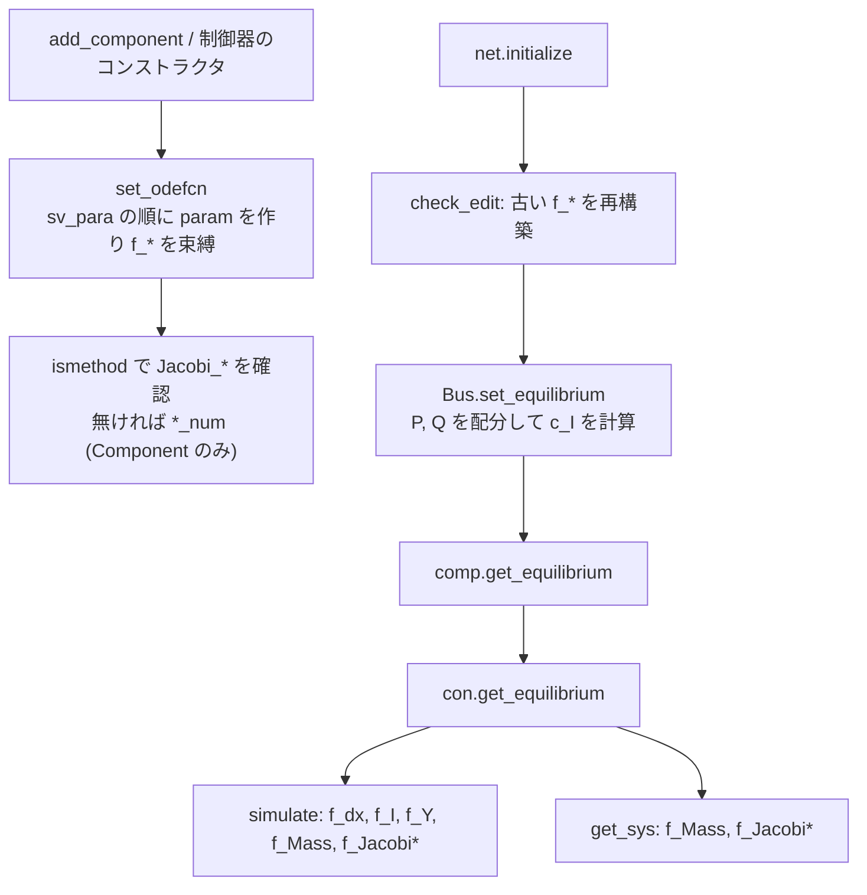

# 新しいモデルクラスの実装方法(現状調査)

> 当時の調査記録です。調査の基準は `df3f709` で、以後の変更は本文に反映していません。現状は [status.md](status.md) と [v4-migration.md](v4-migration.md) を見てください。

`Component`、制御器、`Branch`、ネットワークテンプレートを新しく実装する手順と、実際に実装したときの摩擦の記録です。改善案は後続の作業で作成するので、ここには書きません。既存クラスから系統を組み立てる手順は姉妹ノート `notes/model-building-workflow.md`(ブランチ `docs/model-building-workflow`)の範囲です。

## 読み方

- 調査対象: ブランチ `docs/model-building-extension`(分岐元 `df3f709`)。ソースは変更していません。
- ラベル
  - **[事実]** コードを読んで確認したこと
  - **[実行]** MATLAB R2026a で実行して確認したこと(付録の番号 `M..` を添えます)
  - **[推測]** コードや実行結果からの推論で、確定していないこと
  - **[未確認]** 調べていないこと
- 引用の起点: 先頭が `_GUILDAobject/`、`+DebugScript/`、`_GUILDAdoc/`、`_GUILDAtutorial/`、`@GUILDA/` のもの以外は `_GUILDAsystem/` からの相対パスです。
- `SIM` は `_auxiliary/@odeSimulator/odeSimulator.m` の略です。
- 規約の参照先: `_GUILDAdoc/developer/class-design.html`、`naming-conventions.html`、`class-documentation.html`、`folder-structure.html`。

## 要点

1. **最小の実装量は少なく済みます。** 機器は定数5個と `get_equilibrium`、静的関数4個で動きます。ヤコビアンは省略でき、数値微分に置き換わります。下の発電機と負荷は 3 母線系統で `initialize`、`simulate`、`get_sys` まで動きました **[実行 M01, M02]**。
2. **制御器は機器と同じ形ではありません。** ヤコビアンが必須で、`get_equilibrium` は戻り値を持たず自分のプロパティに書きます。プロパティの属性も異なり、同じ書き方では読み込めません **[実行 M03, M15, M16]**。
3. **クラスの追加だけでは使えません。** `add_component` は起動時に生成されるキー一覧で検証します。パス上のリポジトリ外クラスは拒否され、GUILDA の再実行も必要です。読み込めないクラスは一覧から黙って消えます **[実行 M05, M47, M48]**。
4. **書き間違いの多くが検出されません。** 平衡点の誤りは `initialize` を通り、制御器の入力名の誤りは開ループのまま完走し、`key` の誤りは制御器が付かないまま終わります **[実行 M06, M12, M13]**。
5. **契約の一部はコードに宣言されていません。** `fcn_Mass` は状態に依存できません。`getCompPQ` は連続潮流の設定によって必須です。`get_equilibrium` の `r_P, r_Q` はトリップ時に省略されます **[実行 M09, M28, M31]**。

## 1. モデルの種類と契約

### 1.1 比較表

**[事実]** 列は本体の宣言です。実際の呼び方は 1.2 以降に示します。

| 項目 | `Component` | `LocalController` | `GlobalController` | `Branch` | ネットワーク |
|---|---|---|---|---|---|
| 基底の宣言 | `@Component/Component.m:32-63` | `@LocalController/LocalController.m:32-58` | `@GlobalController/GlobalController.m:24-44` | `@Branch/Branch.m:22-35` | `PowerNetwork` を継承 |
| `key` の役割 | `add_component` の種類名 | 接続位置: `"avr"`, `"pss"`, `"local"` | 説明のみ | `add_branch` の種類名 | なし |
| `key`, `sv_*` の属性 | `Abstract, Constant` | `Abstract, SetAccess=protected, Hidden` | `Abstract, Constant, Hidden` | `key`, `header` のみ `Abstract, Constant` | なし |
| 作成 | `Bus.add_component` | 利用者が作り `add_local_controller` | 利用者が作り `add_global_controller` | `net.add_branch` | コンストラクタ |
| 出力関数の名前 | `fcn_Y` | `fcn_y` | `fcn_y` | なし | なし |
| ヤコビアン | 任意。無ければ数値微分 | **必須**(`Abstract`) | **必須**(`Abstract` ではないが直接呼びます) | なし | なし |
| 平衡点 | `[x,u] = get_equilibrium(obj,c_V,c_I,r_P,r_Q)` | `get_equilibrium(obj,V,u)`。出力なしで自分に書く | `[x,u] = get_equilibrium(obj)` | なし | `initialize` |
| 平衡点の呼び出し元 | `@Component/set_equilibrium.m:12` | `@Component/set_equilibrium.m:20`、PSS へは親が転送 | `@PowerNetwork/initialize.m:85` | なし | なし |
| `get_equilibrium` の宣言 | `Abstract`(`Component.m:44`) | **宣言なし** | **宣言なし** | なし | なし |
| 入力の接続 | イベントと制御器 | 名前(第4節) | `sv_x == sv_u` の**状態**(`SIM:386`) | なし | なし |
| 出力の接続 | 電流 `I`、`Y` | 同名の入力を置き換え | `sv_u == sv_y` の入力に加算(`SIM:387,450`) | `get_admittance_matrix` | なし |
| `set_odefcn` の呼び出し | 発電機、負荷は親が実行。`Component` 直接なら子が実行 | **各クラスが実行**(`AVR_ST1.m:63`) | **各クラスが実行**(`broadcast_PI_AGC.m:75`) | なし | なし |

### 1.2 `Component`

**[事実]**

- 必須の定数は `key`, `sv_x`, `sv_u`, `sv_y`, `sv_para` です(`@Component/Component.m:32-38`)。検証 `(:,1) string` が定数にも効きます。`[]` は `string` の `0x1` に、行ベクトルは列に変わります **[実行 M34]**。
- 必須のメソッドは `get_equilibrium` と `fcn_dx`, `fcn_I`, `fcn_Y`, `fcn_Mass` です(`Component.m:44,53-62`)。
- 任意のメソッドは `Jacobi_dx`, `Jacobi_I`, `Jacobi_Y`, `Hessian_dx`, `Hessian_I`, `Hessian_Y`, `getCompPQ` です。

| 引数 | 形 | 単位・意味 |
|---|---|---|
| `t` | スカラー | [s]。ただし `fcn_Mass` には `[]` が来ることがあります(1.5節) |
| `x`, `u` | 列 | `sv_x`, `sv_u` の順 |
| `V`, `I` | `[re; im]` | [pu]。`I` は母線へ注入する向き。`P + jQ = V conj(I)` |
| `param` | **行ベクトル**(`Component.m:171`) | `sv_para` の順に並べ替えた `para_dynamics` |
| `omega0` | スカラー | **[Hz]**。モデル側で `2*pi` を掛けます(`class-design.html:332`) |

戻り値は `fcn_dx`, `fcn_Y` が列、`fcn_I` が**複素スカラー**(`class-design.html:344`)、`fcn_Mass` が `M dx/dt = fcn_dx` の `M` です。単位の規約は pu(系統基準)、rad、s です。

`Bus.add_component` は `mkInst(str_index, para, opt)` を呼びます(`@Bus/add_component.template:54`)。`opt` は `P`, `Q`, `baseMVA` などの構造体で、`Component` のコンストラクタはこれを必要とします(`Component.m:134`)。

| 親クラス | タグ | パラメータの扱い | 根拠 |
|---|---|---|---|
| `component.generator.abstract` | `"SG"+index` | `table` か `"NGT2"`, `"NGT6"`, `"NGT8"`、既定は `parameter.csv` の1行目。`Q` の既定は NaN | `_GUILDAobject/+component/+generator/@abstract/abstract.m:38-56` |
| `component.load.abstract` | `"L"+tag` | 親は何もしません。第2引数を受けないので子のコンストラクタが必須 | `_GUILDAobject/+component/+load/@abstract/abstract.m:21-28`, **[実行 M04]** |
| `Component` 直接 | 自由 | 子が `add_entry` と `set_odefcn` を呼びます | **[実行 M49]** で追加、平衡点、simulate、get_sys、CSV 出力、OPF、トリップまで動作 |

### 1.3 `LocalController`

**[事実]**

- `key`, `sv_x`, `sv_u`, `sv_y`, `sv_para`、`fcn_dx`, `fcn_y`, `fcn_Mass`, `Jacobi_dx`, `Jacobi_Y` が必須です(`@LocalController/LocalController.m:32-58`)。
- `sv_*` は `Constant` にできません。`MATLAB:class:AbstractPropertyInconsistentAccess` になります **[実行 M15]**。AVR は入力名を親クラスの既定値で持ち、コンストラクタで設定します(`_GUILDAobject/+controller/+avr/@AVR_ST1/AVR_ST1.m:57-61`)。
- ヤコビアンが無いと作成できません。数値微分の代替はありません **[実行 M16]**。
- `f_*` は `f_dx(t,x,V,I,u)` の形です(`LocalController.m:241-246`)。`param` は**列ベクトル**です(`:239`)。
- `get_equilibrium(obj,V,u)` の `V` は**複素数**、`u` は**機器の入力の平衡点**です。自分の `rv_Xequilibrium`, `rv_Uequilibrium` に書き、`a_LocalController` へ自分で転送します(`AVR_ST1.m:92-95`)。

### 1.4 `GlobalController`

**[事実]**

- コンストラクタの引数は `(net, tag, 被制御機器...)` で、`net` の中から機器を探します(`@GlobalController/GlobalController.m:85-109`)。
- シミュレータは `sv_x == sv_u` の状態を入力に使い、`sv_u == sv_y` の入力に出力を加えます(`SIM:386-387,450`)。**出力ではなく状態です。** 文書の「outputs Y を読む」(`class-design.html:202`, `GlobalController.m:5`)とは異なります(`notes/get-sys-workflow.md` 6.4節と同じ指摘です)。
- `V`, `I` の実引数は、シミュレーションでは `[]` です(`SIM:449-450,514-515`)。`GlobalController.m:35` は `zeros(2,1)` と書いています。
- `param` は被制御機器1台につき1行の行列です(`GlobalController.m:161,192-194`)。

### 1.5 暗黙の契約

**[実行]** 宣言にはありませんが、実際には守る必要があります。

| 契約 | 破った結果 | 根拠 |
|---|---|---|
| `fcn_Mass` は `t, x, V, I, u` を使えません | `simulate` は `MATLAB:badsubscript`。`get_sys` は通ります | M09。`_auxiliary/@odeEventSet/odeEventSet.m:500` が `f_Mass([],[],[],[],[])` と呼びます |
| `get_equilibrium` の `r_P, r_Q` は省略可能にします | トリップで `MATLAB:minrhs`、`validate` の未初期化経路も同じ | M31。`SIM:655`, `@Component/validate.m:21` は2引数です |
| `fcn_dx`, `fcn_I`, `fcn_Y` は `I` に依存させません | `simulate` は通り、`get_sys` が `CurrentDependence` | M10, M11。`@Component/get_sys.m:137-140` |
| `sv_u` に `Vre`, `Vim`, `Ire`, `Iim` を使いません | `get_sys("port","I2V")` が `DuplicateFieldName` | M50 |
| `getCompPQ(obj,x,V,u,para)` を用意します(`V` は `[abs; angle]`) | `UseInternalState=true` の連続潮流で `noSuchMethodOrField` | M28, M29。`_auxiliary/@ContinuationPowerFlow/private/build_layout.m:131` |
| 発電機ならば状態 `omega` を持ちます(AGC を使う場合) | `SIM:386` で `singleSubscriptNumelMismatch` | M27 |
| 制御の階層は機器 → 1個 → 1個です | シミュレータは `a_LocalController{1}` と2段だけを扱います | **[事実]** `@Component/get_dx_algebraic.m:27`, `@LocalController/get_dx_algebraic.m:23`, `SIM:550-606` |
| 1機器の制御器は1系統です | `avr` と `local` は同じ枠を争い、AVR と調速機を同時に付けられません | M51。`@Component/add_local_controller.m:39-62` |

## 2. 動特性が解析に届く経路



### 2.1 `set_odefcn`

**[事実]**

- `set_odefcn(obj, omega0)` がパラメータと周波数を**値で**閉じ込めます(`@Component/Component.m:169-196`)。
- 再構築は `rebuild_odefcn` が `set_odefcn(obj.r_Hz)` を呼びます(`Component.m:198-201`)。`set_bus` と `LocalController.set_parent` が `rebuild_odefcn_tree` を呼ぶので(`@Component/set_bus.m:6`, `@LocalController/LocalController.m:152`)、接続時に作り直されます。
- 制御器のコンストラクタの `set_odefcn` は、接続時に作り直されるので不要な可能性があります **[推測]**。
- パラメータ以外の値に依存するクラスは自分で上書きします。`local_LQR` は `K` のために `set_odefcn` を上書きし、`get_equilibrium` の中で呼び直します(`_GUILDAobject/+controller/local_LQR.m:157,181-199`)。

### 2.2 手書きと自動

| 作業 | `Component` | 制御器 |
|---|---|---|
| 状態方程式、出力 | 手書き | 手書き |
| 質量行列 | 手書き | 手書き |
| ヤコビアン | 任意(数値微分: `@Component/private/Jacobi_*_num.m`、刻み `1e-5`) | **手書き** |
| ヘシアン | 任意。無ければ `HessianNotSupported` **[実行 M35]** | 同じ |
| 平衡点 | **手書き** | **手書き** |
| 変数の順序、線形モデルの結線、ラベル | 自動(`get_variable_map`, `get_sys`) | 自動 |
| タグの付与 | 親クラスとバス | コンストラクタ |
| 編集の追跡 | `Parameter` が自動 | `Parameter` が自動。それ以外は `log_edit` を手書き(`local_LQR.m:97-108,203-208`) |
| キー登録 | 起動時に自動 | 不要 |

**[実行 M42]** 数値微分のシミュレーション時間は、3母線で 0.103 s(`gen-simple`)、解析的ヤコビアンの `gen-classical` は 0.090 s でした(1回測定、参考値)。

### 2.3 平衡点

**[事実]** 平衡点は電力潮流の結果から各クラスが解析的に求めます。共通のソルバはありません。

1. `Bus.set_equilibrium` がスラックの P と NaN の Q を配分し、`c_I` を作ります(`@Bus/set_equilibrium.m:28-34,37-56,59-65`)。
2. `Component.set_equilibrium` が `get_equilibrium` を呼び、結果を保存します(`@Component/set_equilibrium.m:12-17`)。
3. 制御器の `get_equilibrium(c_V, u)` を呼びます(`:19-21`)。

**[実行 M06]** 検査はありません。`delta` を 0.1 ずらしても `initialize` の `flag=1` です。

```text
bad_eq initialize flag=1 |dx|=0.404972 |I-Ieq|=0.402971
bad_eq sim flag=1 drift=0.068
bad_eq get_sys flag=1 no error
validate catches: dx=[0 0.405]
```

`comp.validate` なら検出できますが、自動では呼ばれません。

## 3. 最小の実装例

すべて MATLAB R2026a で実行した本文そのものです。一時コピーに置き、リポジトリには入れていません。**[実行 M01-M03]**

配置規則は `_GUILDAobject/+<package>/` です。小さいモデルは classdef 1ファイルでも構いません(`_GUILDAdoc/developer/folder-structure.html:191`)。

### 3.1 発電機: `_GUILDAobject/+component/+generator/simple_sg.m`

リアクタンス `Xs` の背後の電圧源と動揺方程式です。`Xs` は `parameter.csv` に無いので、`table` の指定が必須です。

```matlab
classdef simple_sg < component.generator.abstract
% Generator with a constant-magnitude source E behind the reactance Xs.
    properties (Constant)
        key     = "gen-simple"
        sv_x    = ["delta";"omega"]
        sv_u    = ["Pmech";"Vfield"]
        sv_y    = "omega"
        sv_para = ["M";"D";"Xs"]
    end
    methods
        function [x, u] = get_equilibrium(obj, c_V, c_I, r_P, r_Q)
            arguments
                obj
                c_V
                c_I
                r_P = real(c_V*conj(c_I))
                r_Q = imag(c_V*conj(c_I)) %#ok
            end
            c_E = c_V + 1j*obj.para_dynamics.Xs*c_I;
            x   = [angle(c_E); 0];
            u   = [r_P; abs(c_E)];
        end
    end
    methods (Static)
        function dx = fcn_dx(t, x, V, I, u, p, omega0) %#ok
            c_E = u(2)*exp(1j*x(1));
            c_I = (c_E - [1,1j]*V)/(1j*p(3));
            dx  = [2*pi*omega0*x(2); -p(2)*x(2) - real(c_E*conj(c_I)) + u(1)];
        end
        function c_I = fcn_I(t, x, V, I, u, p, omega0) %#ok
            c_I = (u(2)*exp(1j*x(1)) - [1,1j]*V)/(1j*p(3));
        end
        function y = fcn_Y(t, x, V, I, u, p, omega0) %#ok
            y = x(2);
        end
        function M = fcn_Mass(t, x, V, I, u, p, omega0) %#ok
            M = diag([1, p(1)]);
        end
    end
end
```

### 3.2 負荷: `_GUILDAobject/+component/+load/current.m`

電流の大きさと、電圧から見た角度を一定に保つ負荷です。状態もパラメータもありません。

```matlab
classdef current < component.load.abstract
% Constant-current load: |I| and the angle of I from V are the inputs [Imag; Iarg].
    properties (Constant)
        key     = "load-current"
        sv_x    = strings(0,1)
        sv_u    = ["Imag";"Iarg"]
        sv_y    = strings(0,1)
        sv_para = strings(0,1)
    end
    methods
        function obj = current(index, ~, varargin)
            obj@component.load.abstract("CI"+index, varargin{:})
        end
        function [x, u] = get_equilibrium(~, c_V, c_I, ~, ~)
            c_r = c_I*abs(c_V)/c_V;
            x   = zeros(0,1);
            u   = [abs(c_r); angle(c_r)];
        end
    end
    methods (Static)
        function dx = fcn_dx(t, x, V, I, u, p, omega0) %#ok
            dx = zeros(0,1);
        end
        function c_I = fcn_I(t, x, V, I, u, p, omega0) %#ok
            c_V = [1,1j]*V;
            c_I = u(1)*exp(1j*u(2))*c_V/abs(c_V);
        end
        function y = fcn_Y(t, x, V, I, u, p, omega0) %#ok
            y = zeros(0,1);
        end
        function M = fcn_Mass(t, x, V, I, u, p, omega0) %#ok
            M = zeros(0,0);
        end
    end
end
```

**[実行 M52]** 最初は `I` の実部と虚部を入力にしました。この負荷は全機器の回転に対して不変ではなく、`get_sys` の最大実部は +0.91 で、3方式とも一致しました。不安定の理由は固定座標の電流だと考えています **[推測]**。上の版に変えると最大実部は 7.35e-06 です。

### 3.3 `Branch` とネットワーク

`Branch` は定数2個とメソッド1個だけです。**[実行 M01]** タグは `ER001` でした。

```matlab
classdef rl < Branch
% Series R + jX branch without shunt.
    properties (Constant)
        header = "ER"
        key    = "rl"
    end
    methods
        function Ymat = get_admittance_matrix(obj)
            y    = 1/(obj.para_dynamics.R + 1j*obj.para_dynamics.X);
            Ymat = [y, -y; -y, y];
        end
    end
end
```

ネットワークは `PowerNetwork` の子クラスです。規約の配置は CSV ですが(`folder-structure.html`)、`network.Tutorial3bus` と同じようにコードでも書けます。

```matlab
classdef Mini3bus < PowerNetwork
% Three buses built in code: two gen-simple machines and a load-current load.
    methods
        function obj = Mini3bus()
            para = table(100, 10, 0.3, 'VariableNames', ["M","D","Xs"]);
            obj.add_bus("V",1.00);
            obj.add_bus("V",1.02);
            obj.add_bus();
            obj.add_branch("rl", [1,2], "R",0.010, "X",0.085);
            obj.add_branch("rl", [2,3], "R",0.017, "X",0.092);
            obj.a_Bus{1}.add_component("gen-simple", "parameter",para);
            obj.a_Bus{2}.add_component("gen-simple", "P",0.5, "Q",nan, "parameter",para);
            obj.a_Bus{3}.add_component("load-current", "P",-1.0, "Q",-0.2);
            obj.initialize;
        end
    end
end
```

### 3.4 実行と結果(機器)

```matlab
GUILDA;                         % キー一覧を作り直す (第5節)
net = network.Mini3bus;
net.solver_ODE.Progress = "none";
gen = net.a_Bus{2}.a_Component{1};
ld  = net.a_Bus{3}.a_Component{1};
[sim0, f0] = net.simulate([0,5]);
ev = odeEventSet("fault", net, "TimeSpan", [1,1.05], "FaultBus", "B003");
[sim1, f1, o1] = net.simulate([0,10], ev);
[sys, f2, o2] = net.get_sys();
```

```text
SG1B002 x=[0.075602 0] u=[0.5 1.2094]
LCI1B003 u=[1.0408 2.9442]
branch ER001
[警告: 閉ループ モデルは、特異な代数ループのためプロパーではない可能性があります。]
simulate flag=1 drift=0.00e+00 | fault flag=1 phases=3 | get_sys flag=1 n_x=4 size=4x6 maxRe=7.35e-06
Jacobian error gen=5.3e-10 load=2.1e-10
gen.get_sys in=Vre_SG1B002_B002_PowerNetwork,Vim_...,Pmech_...,Vfield_... out=Ire_...,Iim_...,Y_omega_...
ld.get_sys nx=0 in=Vre_LCI1B003_B003_PowerNetwork,Vim_...,Imag_...,Iarg_... out=Ire_...,Iim_...
```

`gen-simple` を `Xd = Xq = Xs` の `gen-classical` と比べると、固有値の差のノルムは 9.91e-11 でした(`gen-1axis` と `load-power` の3母線) **[実行 M01]**。

**[実行 M02]** 警告は `Feedback` の `connect` から出ます。`Kron` と `DAE` では出ません。

### 3.5 制御器(AVR): `_GUILDAobject/+controller/+avr/simple_avr.m`

```matlab
classdef simple_avr < LocalController
% First-order AVR: Te*dVfd/dt = -Vfd + Ka*(Vref + Vpss - |V|), Vfield = Vfd.
    properties (SetAccess=protected, Hidden)
        key     = "avr"
        sv_x    = "Vfd"
        sv_u    = ["Vref";"Vpss"]
        sv_y    = "Vfield"
        sv_para = ["Ka";"Te"]
    end
    methods
        function obj = simple_avr(tag, opt)
            arguments
                tag (1,1) string
                opt.Ka (1,1) double = 30
                opt.Te (1,1) double = 0.05
            end
            obj@LocalController("CA"+tag)
            obj.para_dynamics.add_entry("Ka", opt.Ka, "double", "Te", opt.Te, "double");
            obj.set_odefcn(obj.r_Hz)
        end
        function get_equilibrium(obj, V, u)
            Ka = obj.para_dynamics.Ka;
            obj.rv_Xequilibrium = u(2);
            obj.rv_Uequilibrium = [u(2)/Ka + abs(V); 0];
            cellfun(@(c) c.get_equilibrium(V, u), obj.a_LocalController);
        end
    end
    methods (Static)
        function dx = fcn_dx(t, x, V, I, u, p, omega0) %#ok
            dx = -x + p(1)*(u(1) + u(2) - norm(V));
        end
        function y = fcn_y(t, x, V, I, u, p, omega0) %#ok
            y = x;
        end
        function M = fcn_Mass(t, x, V, I, u, p, omega0) %#ok
            M = p(2);
        end
        function [Axx,Bxv,Bxi,Bxu] = Jacobi_dx(t, x, V, I, u, p, omega0) %#ok
            Axx = -1;
            Bxv = -p(1)*V.'/norm(V);
            Bxi = zeros(1,2);
            Bxu = [p(1), p(1)];
        end
        function [Cyx,Dyv,Dyi,Dyu] = Jacobi_Y(t, x, V, I, u, p, omega0) %#ok
            Cyx = 1;
            Dyv = zeros(1,2);
            Dyi = zeros(1,2);
            Dyu = zeros(1,2);
        end
    end
end
```

```matlab
net = network.Mini3bus;
gen = net.a_Bus{2}.a_Component{1};
avr = controller.avr.simple_avr("a", Ka=30, Te=0.05);
pss = controller.pss.PSS1("p");
gen.add_local_controller(avr, pss);
net.initialize;                 % 接続後は initialize しないと EquilibriumStale
```

```text
GUILDA:PowerNetwork:EquilibriumStale      ← initialize の前の simulate
avr x=1.2094 u=[1.0603 0]; pss obsY=1 obsX=0 parent=CAa
simulate flag=1 drift=3.32e-15 | fault flag=1 | get_sys flag=1 n_x=8 maxRe=4.87e-06
avr Jacobian error 5.0e-09
states=delta_SG1B002_B002_PowerNetwork,omega_...,Vfd_CAa_SG1B002_...,xiWS_CPp_CAa_SG1B002_...,xi1_...,xi2_...
eig vs AVR_ST1+PSS1 max rel diff 1.7e-06 (counts 8/8)
```

`AVR_ST1(kap=30, tap=0.05)` は同じ一次遅れなので、固有値の比較が検証になります。

### 3.6 制御器(調速機): `_GUILDAobject/+controller/simple_gov.m`

名前の解決を確かめる例です。`omega` は機器の `sv_y` から読み、`Pref` はどれにも一致しないので平衡値のままです。AVR の `Vref` と同じ仕組みです。

```matlab
classdef simple_gov < LocalController
% First-order governor: Tg*dPm/dt = -Pm + Pref - Kg*omega, Pmech = Pm.
% omega is read from the component by name; Pref matches nothing and stays at its equilibrium.
    properties (SetAccess=protected, Hidden)
        key     = "local"
        sv_x    = "Pm"
        sv_u    = ["omega";"Pref"]
        sv_y    = "Pmech"
        sv_para = ["Kg";"Tg"]
    end
    methods
        function obj = simple_gov(tag, opt)
            arguments
                tag (1,1) string
                opt.Kg (1,1) double = 20
                opt.Tg (1,1) double = 0.5
            end
            obj@LocalController("CG"+tag)
            obj.para_dynamics.add_entry("Kg", opt.Kg, "double", "Tg", opt.Tg, "double");
            obj.set_odefcn(obj.r_Hz)
        end
        function get_equilibrium(obj, V, u) %#ok
            obj.rv_Xequilibrium = u(1);
            obj.rv_Uequilibrium = [0; u(1)];
        end
    end
    methods (Static)
        function dx = fcn_dx(t, x, V, I, u, p, omega0) %#ok
            dx = -x + u(2) - p(1)*u(1);
        end
        function y = fcn_y(t, x, V, I, u, p, omega0) %#ok
            y = x;
        end
        function M = fcn_Mass(t, x, V, I, u, p, omega0) %#ok
            M = p(2);
        end
        function [Axx,Bxv,Bxi,Bxu] = Jacobi_dx(t, x, V, I, u, p, omega0) %#ok
            Axx = -1; Bxv = zeros(1,2); Bxi = zeros(1,2); Bxu = [-p(1), 1];
        end
        function [Cyx,Dyv,Dyi,Dyu] = Jacobi_Y(t, x, V, I, u, p, omega0) %#ok
            Cyx = 1; Dyv = zeros(1,2); Dyi = zeros(1,2); Dyu = zeros(1,2);
        end
    end
end
```

```text
gov x=0.5 u=[0 0.5] sv_u=omega,Pref obsY=[1 0] obsX=[0 0]
simulate flag=1 drift=0.00e+00 | fault flag=1 | get_sys flag=1 n_x=5 maxRe=3.69e-06 jac=2.9e-11
```

**検証時の注意 [実行 M53]** 上の結果は `Mini3bus` のものです。`gen-1axis` 2台と `load-power` の3母線系統は、制御器が無くても最大実部が +0.27366 で、`B003` の故障は `flag=-1` で止まります。別の機種で新しい制御器を試すときは、この土台の不安定と混同しないように比較が必要です。

## 4. 制御器の接続

### 4.1 入力の解決

**[事実]** `resolve_observe` が `add_local_controller` のときに解決します(`@LocalController/LocalController.m:155-201`)。`sv_u` の各名前を次の順に探します。

| 順 | 条件 | 読むもの | 根拠 |
|---|---|---|---|
| 1 | 入力名が `"Xall"` | 機器の全状態に展開。`set_inputs` の上書きが必須 | `:180-181,190-191,215-220` |
| 2 | 入力名が `"Yall"` | 機器の全出力に展開。`set_inputs` の上書きが必須 | `:182-183` |
| 3 | 機器の `sv_y` にある | 出力(同名の状態より優先) | `:193,196`, `@LocalController/get_dx_algebraic.m:19` |
| 4 | 機器の `sv_x` にある | 状態 | `:194`, `get_dx_algebraic.m:20` |
| 5 | 入れ子の制御器の `sv_y` にある | その出力 | `get_dx_algebraic.m:27-28` |
| 6 | どれでもない | `rv_Uequilibrium` のまま | `get_dx_algebraic.m:15` |

- `"X"`, `"Y"` は `GUILDA:LocalController:ReservedInput` です(`:163-166`) **[実行 M18]**。
- `"Xall"` を使って `set_inputs` を上書きしないと、分かりやすいエラーで止まります(`:218-219`) **[実行 M17]**。
- `resolve_ports` は機器に依存する入出力を決めるフックです。`local_LQR` は `sv_y` をここで決めます(`_GUILDAobject/+controller/local_LQR.m:162-175`)。

### 4.2 出力の扱いの違い

**[事実]** 出力は機器の同名の入力を置き換えます(`@Component/get_dx_algebraic.m:29-30`)。線形モデルでは加算です(`@Component/get_sys.m:15-16`)。シミュレーションの `iv_odeY` は名前で引きます(`SIM:359,366`)。

### 4.3 入れ子

**[事実]**

- `avr` と `local` は機器に直接付きます(`@Component/add_local_controller.m:39-62`)。
- `pss` は `avr` の下にだけ付きます(`:64-84`)。`local` の下には付きません **[実行 M37]**。エラーの文は「AVR が無い」で、識別子は空です。
- PSS の親は AVR ですが、**観測は機器**です(`observed_component`, `LocalController.m:222-232`)。**[実行 M03]** `pss obsY=1`、`parent=CAa` です。
- PSS の出力 `Vpss` は名前で AVR の入力に入ります。
- 制御器を置き換えると警告が出ます(`GUILDA:Component:ReplaceController`) **[実行 M51]**。

### 4.4 局所と大域の違い

| 観点 | `LocalController` | `GlobalController` |
|---|---|---|
| 観測 | 名前(出力優先)、`Xall`, `Yall` | `sv_x == sv_u` の状態だけ |
| 駆動 | 置き換え | 加算 |
| 状態の持ち主 | 機器の下 | ネットワーク |
| `V` | 親の電圧 | なし(`[]`) |
| 機器の指定 | 機器が持つ | 構築時に `net` の中から探す |
| 被制御機器の種類 | 問わない | **発電機以外は未対応**。`isa(..., 'component.generator.abstract')` 以外はタグに変換されません(`@GlobalController/GlobalController.m:97`) |

**[実行 M25]** `gen-simple` への AGC は動きます(`omega` を持つため)。**[実行 M26]** 負荷を渡すと、エラーメッセージの読み込みで `GlobalController.xml` が無いという `FileNotFound` になります(`GlobalController.m:103`)。

## 5. クラスを使えるようにする手順

**[事実]**

1. `_GUILDAobject/+<package>/` に置きます。`ListPath.txt` のフォルダがパスに入ります(`@GUILDA/config/ListPath.txt`)。
2. `GUILDA` を実行します。`UpdateKeyMap=true` なら `update_class_signature` が走ります(`@GUILDA/GUILDA.m:71-73`)。
3. `GUILDA.dictionary` が `dir` でリポジトリ内を走査します(`@GUILDA/dictionary.m:65`)。`.key` を `eval` で読みます(`@GUILDA/private/update_class_signature.m:39`)。
4. 空でないキーを `.template` に埋め込み、`@Bus/add_component.m`、`replace_component.m`、`@PowerNetwork/add_branch.m` を生成します(`update_class_signature.m:14-20`)。これらは git の対象外です(`.gitignore:40`)。

**[実行]**

- **M47** 同じセッションでも、新しいクラスは `GUILDA` の再実行で使えるようになります。再実行の前は `mustBeMember` です。
- **M05** パス上のリポジトリ外のクラスは、`GUILDA` の後も `mustBeMember` で拒否されます。一方、文書生成はパス上の外部クラスも対象にします(`@GUILDA/private/find_doc_classes.m:14-18`, `_GUILDAdoc/developer/class-documentation.html:155`)。
- **M48** クラス定義にエラーがあると、`superclasses` の失敗を握りつぶすので(`@GUILDA/dictionary.m:113-120`)、一覧から黙って消えます。`add_component` は `mustBeMember` と言うだけです。
- **M54** 新しいコピーの最初の起動では、`GUILDA` の直後の `add_component` が `MATLAB:class:undefinedMethod` です。`rehash path` で解消します。次のセッションでは起きません。
- **M01** 一覧には `'test-hessian-stub'` も入ります(`+DebugScript/+helper/HessianStub.m:9`)。実際に使うと `TooManyInputs` です。

## 6. 既存実装の比較

### 6.1 発電機と負荷

| クラス | `sv_x` | `sv_u` | `sv_y` | 構成 | 関数の形 | `getCompPQ` | 備考 |
|---|---|---|---|---|---|---|---|
| `generator.classical` | delta, omega | Pmech, Vfield | omega | `@` フォルダ、関数ごとに1ファイル | インスタンス | あり | 宣言の `get_equilibrium` は3引数、実体は5引数(`classical.m:54`, `get_equilibrium.m:1`) |
| `generator.one_axis` | +Eq | 同上 | omega | 同上 | インスタンス | あり | `sv_para` は `;` 区切り |
| `generator.two_axis` | +Ed | 同上 | omega | 同上 | インスタンス | あり | |
| `generator.park` | +psiq, psid | 同上 | omega | 同上 | インスタンス | あり | |
| `generator.droop` | delta | 同上 | なし | 同上 | インスタンス | **なし** | `omega` が無く AGC 不可 **[実行 M27]** |
| `load.impedance` | なし | R, X | なし | 同上 | インスタンス | **なし** | `Z` を公開プロパティに保持 |
| `load.power` | なし | Pload, Qload | なし | 同上 | インスタンス | あり | `PQ_st` を保持。`Prefix` は他に例がありません(`power.m:47`) |

**[事実] 重複**

- 各 `@` フォルダは9ファイルで、ヘッダのコメントがほぼ同じです。例: `@classical/fcn_I.m:6-14`, `@classical/fcn_Mass.m:6-14`。
- 平衡点の `arguments` は全クラスで繰り返します(`@classical/get_equilibrium.m:8-18`, `@impedance/get_equilibrium.m:8-20`)。
- 発電機の `sv_u` は全クラス同じで、親クラスにはありません。
- 発電機の `sv_para` は `parameter.csv` の列名に縛られます(`@abstract/abstract.m:44-49`)。
- `get_equilibrium` の中で読む方法が2通りあります(`obj.tab_parameter.dynamics{:,'Xd'}` は `@classical/get_equilibrium.m:23`、`local_LQR` は別プロパティ)。例では `obj.para_dynamics.Xs` を使いました。

**[事実] 宣言の違い**

- `Component.m:46-63` は `Abstract, Static` で第1引数が `obj` ですが、実装はインスタンスメソッドです(`one_axis.m:59-64`)。ヤコビアンは `Static` です(`one_axis.m:65-69`)。例の静的メソッドも動きます **[実行 M01]**。文書は Static と書きます(`class-design.html:194`)。
- 発電機の親のコンストラクタは `Access={?Component}` なので子の暗黙のコンストラクタが公開になり、負荷は `Access={?Bus}` です。**[実行 M41]** `component.generator.classical("1X",nan,o)` は作成できて、`component.load.power` は `MethodRestricted` です。
- 発電機の親には機能しない部品が残っています。`avr`, `pss`, `governor` は `SpecificControllers` を読み(`abstract.m:93-95`)、`set_avr` などは実体がありません(`:84-92`) **[実行 M23, M24]**。

### 6.2 制御器

| クラス | 親 | `key` | `sv_x` の設定 | 関数の形 | 備考 |
|---|---|---|---|---|---|
| `avr.AVR_ST1`, `AVR_DC1` | `avr.abstract` | `"avr"` | コンストラクタで代入 | `Static` | `Sealed`。`set_PSS` は未使用に見えます **[推測]** |
| `pss.PSS1` | `pss.abstract` | `"pss"` | コンストラクタで代入 | `Static` | 宣言は `fcn_dx(obj,t,x,V,I,u,...)`(`PSS1.m:79`)、実体は `fcn_dx(t,x,V,I,u,...)`(`@PSS1/fcn_dx.m:1`) |
| `local_LQR` | `LocalController` | `"local"` | 既定値 | `Static`、1ファイル | `Xall`, `resolve_ports`, `set_inputs`, `set_odefcn` を上書き。内部の `comp.get_sys(...,"rec",false)` を使います(`:138-139`) |
| `agc.broadcast_PI_AGC` | `GlobalController` | `"agc"` | `Constant` | `Static` | タグの接頭辞なし。`param` は行列 |
| `local_LQR_retrofit` | `LocalController` | なし | なし | v2 の形 | 抽象メソッド未実装(クラスのコメント)。**使えません** **[推測]** |

**[事実] 不整合**

- `avr.abstract.set_PSS` は存在しない `controller.pss.base` を参照します(`_GUILDAobject/+controller/+avr/abstract.m:46`)。
- `pss.abstract` の `fcn_dx` などはインスタンスメソッドで `I` がありません(`_GUILDAobject/+controller/+pss/abstract.m:40-66`)。基底の宣言(`LocalController.m:45-51`)の形です。実際の呼び方(`:241-243`)と合いません。
- **[実行 M22]** `AVR_ST1` の範囲外エラーは `msg('GUILDA:AVR_DC1:InvalidValueRange')` です(`AVR_ST1.m:83`)。`AVR_DC1.xml` が無く(`_auxiliary/SystemTools/GUILDA/en/`)、`The ID specification is invalid.` になります。
- PSS のパラメータの順は `add_entry` と `sv_para` で異なります(`PSS1.m:48-55,61`)。`sv_para` で並べ替えるので動作に問題はありません。

### 6.3 `Branch`

| クラス | `header` | 備考 |
|---|---|---|
| `branch.pi`, `T` | `"EL"` | |
| `branch.pi_transformer`, `two_winding_transformer` | `"ET"` | |

**[事実]** パラメータは全種類に共通の `R, X, C, tap, phase` で、基底で固定です(`@Branch/Branch.m:92-96`)。追加のパラメータを増やす手段は親のコンストラクタにありません。`add_branch` の引数も固定です(`@PowerNetwork/add_branch.template:19-31`)。

### 6.4 ネットワークテンプレート

| クラス | 構成 | フォルダ | `initialize` | 備考 |
|---|---|---|---|---|
| `IEEE14bus`, `_NoTap`, `_lossless` | `import_csv` のみ | branch, bus, component | `import_csv` が実行 | コメント以外はクラス名を除き同じ(md5 一致) **[実行]** |
| `TEST31bus`, `Txt3Bus` | `import_csv` のみ | 同上 | 同上 | |
| `IEEE9bus`, `IEEE68bus` | `import_csv` + `add_avr_pss` | + controller, network | コンストラクタ | `add_avr_pss` は同一(`diff` で確認) **[実行]**。`LocalController` 引数あり |
| `Ishizaki6Bus` | CSV を加工して `import_csv` | + `branch_origin` | `import_csv` | **[実行 M44]** 構築時に `branch/parameter.csv` を上書きします(`Ishizaki6Bus.m:67`) |
| `Tutorial3bus` | コードで構築、1ファイル | なし | コンストラクタ | `ver` なし |

規約は `network/` を求めますが(`folder-structure.html`)、IEEE9bus と IEEE68bus 以外にはありません。`import_csv` は無くても受け付けます(`@PowerNetwork/import_csv.m:12`)。

**[実行 M43, M33]** 新しいキーの機器を含むネットワークも `export_csv`、`import_csv` を通ります。出力先は `component/<key>/` です。

### 6.5 未完成と退避

| 場所 | 状態 | 根拠 |
|---|---|---|
| `_GUILDAobject/+component/未+GFM/` | **v1/v2 の形。動きません [推測]**。`Inverter` は `Component` を継承しますが `get_nx`, `naming_state`, `obj.parameter`, `obj.Tag` を使います。`component.GFM.*` を参照しますが、フォルダ名が `未+` なのでパッケージになりません | `Inverter.m:1,27-28,35-41,46-65`、**[実行 M45]** `which("Inverter")` は空。最終更新 2026-07-25 |
| `_GUILDAobject/+component/未+farm/` | 同上。`solar`, `wind` は `obj.parameter` を使います。`omega0` などを自分で持ちます | `solar.m:1,14-22`, `wind.m:1,27-36` |
| `_GUILDAobject/+component/+load/history/` | 旧負荷クラス。`Component` の引数なしコンストラクタを呼びます。**`dictionary` に名指しの除外があります** | `+load/history/@abstract/abstract.m`、`@GUILDA/dictionary.m:61` |
| `_GUILDAobject/+component/+ConstSource/power.m` | v1 の形。`key` などを持たず作成できません(クラスのコメントのとおり) | `:1-12`。`dictionary` には出ますが一覧からは除かれます **[実行 M40]** |
| `_GUILDAobject/+network/archive/` | データ保管。`IEEE68bus_v2.m` は `network.build` を呼びますが存在しません | `IEEE68bus_v2.m:1-8` |
| `_GUILDAobject/+controller/local_LQR_retrofit.m`, `+modeling/get_environment.m` | v2 の API | `notes/get-sys-workflow.md` 6.2節 |
| `_GUILDAobject/+component/+load/validate.m`, `+controller/validate.m` | Symbolic Math Toolbox の開発用スクリプト。パッケージの中です | 各 `:1-2`。`+load/validate.m:37-38` は存在しない呼び方です **[推測]** |
| `@GUILDA/未実装newclass.m` | `GUILDA.newclass` は help に載っていますが **[実行 M39]** `undefinedMethod` です | `@GUILDA/GUILDA.m:16` |

**[事実]** `folder-structure.html:249` は `history`, `_origin` を使わないと定めていますが、`+load/history`、`@Ishizaki6Bus/branch_origin` が残っています。

## 7. 作者が他に用意するもの

### 7.1 文書

**[事実]** 規約は `_GUILDAdoc/developer/class-documentation.html` です。

- クラス: H1 行、説明、`See also`。公開メンバーには H1 が必要です。
- 単位: コメント先頭の `[pu]`。
- タグは3種類だけです: `<@Examples>`, `<@Deprecated>`, `<@Type>`。
- 既存モデルの慣習: `**States**`, `**Inputs**`, `**Outputs**`, `**Parameters**`, `**Equations**` の見出し(`one_axis.m:7-34`)。規約にはありません。
- `GUILDA.doc` が生成します。**[実行 M55]** 上の例は例外なく出力され、`simple_sg` 5件、`current` 6件、`simple_avr` 7件、`simple_gov` 7件の警告でした。**[未確認]** 全体の「1 error」が試験用クラスによるものかは確かめていません。

**[事実] 命名**: `naming-conventions.html` は `[type][size]_[description]` です。ただし契約そのものが `key`, `header`, `t, x, V, I, u` を使い、既存モデルも `Z`, `PQ_st`, `para`, `param` が混在します。基底の宣言は `rr_param`(`Component.m:53`)です。

### 7.2 テスト

**[事実]** 新しいモデルを自動で試験する仕組みはありません。キーは手書きの列挙です。

| 場所 | 内容 |
|---|---|
| `+DebugScript/test_F1_model_building.m:11-12,124` | キーとクラス名の一覧。F1 は `add_component` を試します |
| `+DebugScript/test_F7_linearization.m:132,156,291` | ヤコビアンの誤差、3方式の固有値。キーの一覧を繰り返します |
| `+DebugScript/test_F7_linearization.m:146-150` | 制御器のヤコビアン。インスタンスの一覧 |
| `+DebugScript/+helper/jacobian_error.m` | 平衡点から少しずらした点で比較します。例でも使えました |
| `+DebugScript/+helper/build_3bus.m` | 発電機か負荷を1台含む系統。パラメータを渡す引数はなく、**`Xs` のような独自パラメータの発電機は使えません** |
| `+DebugScript/+helper/ObserveStub.m`, `HessianStub.m` | 最小クラスの実例です。`HessianStub` は `opt` を全部手書きします(`:18-22`) |
| `+DebugScript/test_F9_environment.m:46-49` | キー生成の確認 |

**[実行 M56]** 上の例を追加した状態でも F1, F7 は 60 件すべて PASS でした。**新しいクラスは試験されていないので、これは回帰の確認にしかなりません。**

**[実行 M19, M20, M21]** `validate` の状態です。

| 呼び出し | 結果 |
|---|---|
| `comp.validate` 初期化後、`Jacobi_*` なし | `dx` と `I` だけ確認。ヤコビアンは比べません(`@Component/validate.m:61,74,82`) |
| `comp.validate` 未初期化 | 乱数の点で動きます。`dx` は 0 ではありません(0.84) |
| `con.validate` | **`noSuchMethodOrField`**。`JacobiAxx` などの旧 API を呼びます(`@LocalController/validate.m:57-62`)。`set_equilibrium`(`:17`)も存在しません |

### 7.3 チュートリアル

**[事実]** `_GUILDAtutorial/ClassManual` は7ファイルで、実装方法の説明はありません。`sv_x`, `fcn_dx`, `get_equilibrium` は全ファイルで0件です(文字列を検索)。

| ファイル | 状態 |
|---|---|
| `Component_Load.mlx` | 「`get_dx_constraint` の実装が必須」と書いています。現在の契約ではありません |
| `Bus_variety.mlx` | `get_constraint` を説明しています。現在はありません |
| `Controller_AGC.mlx` | `port_input`, `port_observe` の旧プロパティです |
| `Component_Generator.mlx` | モデルの数式。`IEEE_ST1`, `sadamoto2019` の旧名があります |
| `Controller_Retrofit.mlx` | 「(現在実装中)」だけです |
| `Step2_AddController.mlx` | 「自分でコントローラを作る: `Controller_Abstract` を参照」とありますが、**そのファイルはありません** |

`_GUILDAdoc/developer/` にも、`class-design.html:194` の1行以外に新モデルの手順はありません。

## 8. UX 定義シートとの差

**[事実]** `GUILDA_主機能UX定義シート.xlsx`(データとして読み、コミットしていません)に、**モデルの実装についての定義はありません**。シートは横断ルール7件(メソッド名、入力、戻り値、順序、前提条件、副作用、共通オプション)と解析機能13件で、決定の列は空欄です。

| シートの記載 | 現状 | 関係 |
|---|---|---|
| 「エネルギー関数のヘシアン: 新規、未実装」 | クラスごとの `get_hessian` の契約はあります(`@Component/get_hessian.m:12-17`)。実装クラスは `HessianStub` だけです | 作者に関係します |
| 「グラフプロット」など | `import_csv` などの入口は変わっています | シートの「現在の入口」が古い記述です(`Continuation_Power_Flow`, `CsvNetHandler`) |

## 観察された問題

重要度の高い順です。改善案ではなく証拠の一覧です。**確定**は実行またはコードで確認したもの、**推測**はそこからの解釈です。

### 検出されない誤り

1. **`key` の誤りで制御器が黙って付きません。** 確定: `switch` に `otherwise` がなく(`@Component/add_local_controller.m:38-85`)、`key="governor"` でエラーも警告もなく `n_LC=0` です **[実行 M12]**。
2. **入力名の誤りが開ループになります。** 確定: `"omegaa"` は `obsY=0, obsX=0` のまま `simflag=1` です(`@LocalController/LocalController.m:193-198`) **[実行 M13]**。推測: 正しい名前の省略と区別ができないので、検査するには宣言が必要です。
3. **`get_equilibrium` の誤りを `initialize` が通します。** 確定: `|dx|=0.405` で `flag=1`、`get_sys` も通り、外乱なしで 0.068 ずれます(`@Component/set_equilibrium.m:12-17`) **[実行 M06]**。
4. **読み込めないクラスが黙って消えます。** 確定: `@GUILDA/dictionary.m:113-120`。`add_component` は `mustBeMember` だけです **[実行 M48]**。
5. **`Feedback` が入力を黙って減らします。** 確定: `V` に依存しない電流の負荷で、`Kron` は `6x6`、`Feedback` は `6x4` です。`output.n_u=6` のままです(`_auxiliary/@LinearizationResult/get_ss.m:172-177`) **[実行 M50]**。コメントのとおり意図された消去です。

### 分かりにくいエラー

6. **`get_equilibrium` の戻り値のサイズ誤りが後で出ます。** 確定: `initialize` は通り、`simulate` の `getXM`(`_auxiliary/@odeEventSet/odeEventSet.m:498`)で `sizeDimensionsMustMatch` です **[実行 M07]**。
7. **`fcn_I` を `[re; im]` で返すと一般的なエラーです。** 確定: `PhaseFailed` と「配列のサイズが適合しません」だけです **[実行 M08]**。
8. **出力名の誤りは `get_sys` を通り、`simulate` で `badsubscript` です。** 確定: `SIM:359-360` **[実行 M14]**。
9. **パラメータの不足は MATLAB の表のエラーです。** 確定: 既定の `parameter=NaN`、`"NGT6"`、列の足りない `table` はいずれも `table 変数名 'Xs' が認識されません` です(`_GUILDAobject/+component/+generator/@abstract/abstract.m:42-49`) **[実行 M01a]**。
10. **負荷の子クラスにコンストラクタが無いと `TooManyInputs` です。** 確定: 発電機は不要、負荷は必須と親で異なります **[実行 M04]**。
11. **メッセージの定義が欠けています。** 確定: `GlobalController.xml`, `AVR_DC1.xml` が無く、本来のエラーの代わりに `FileNotFound` と `ID specification is invalid` が出ます(`@GlobalController/GlobalController.m:103`, `_GUILDAobject/+controller/+avr/@AVR_ST1/AVR_ST1.m:83`) **[実行 M22, M26]**。

### 契約の非対称と暗黙の前提

12. **機器と制御器で同じ名前の形が異なります。** 確定: `fcn_Y`/`fcn_y`、`get_equilibrium` の引数と戻り値、属性(`Constant` か否か)、`param` の向き(行と列、`Component.m:171`, `LocalController.m:239`)、ヤコビアンの要否。文書は「意図的」と説明しています(`class-design.html`)。
13. **基底の宣言と実際の呼び方が合いません。** 確定: `Component.m:53-62`(`Static` に `obj`)、`LocalController.m:45-51`(`I` なし)、`PSS1.m:79-81`、`classical.m:54`。
14. **`fcn_Mass` の制約が宣言されていません。** 確定: `odeEventSet.m:500`。`get_sys` は状態を渡すので通ります **[実行 M09]**。
15. **`r_P, r_Q` の省略可能が宣言されていません。** 確定: `SIM:655`, `@Component/validate.m:21`。`Component.m:44` は5引数です **[実行 M31]**。
16. **`getCompPQ` が任意か必須か宣言されていません。** 確定: `build_layout.m:131`。`droop`, `impedance` にありません(実行は発電機の `gen-simple`, `gen-droop` のみ) **[実行 M28, M29]**。
17. **`isa` による機種の分岐が枠組みにあります。** 確定: `Component.m:143`, `@Component/build_opf_problem.m:41`, `@GlobalController/GlobalController.m:97`, `SIM:652`, `@PowerNetwork/export_csv.m:190-191`, `+tools/network_to_mpc.m:59`。`_GUILDAsystem` は `_GUILDAobject` に依存しないとの規約(`folder-structure.html`)と異なります。`Component` を直接継承した機器はこれらの分岐から外れます。
18. **発電機の親のパラメータ読み込みが `parameter.csv` に結合しています。** 確定: `abstract.m:44-49`。既定値を持てないのは `sv_para` が CSV の列にない場合です。
19. **1機器1系統の枠です。** 確定: AVR と調速機を同時に付けられません **[実行 M51]**。`local` の下に PSS も付きません **[実行 M37]**。AGC は `Pmech` を駆動しますが、局所の調速機は別枠なので共存の形が異なります。推測: 拡張には `key` の意味の見直しが要ります。
20. **`pss` などの名前が枠組みに固定です。** 確定: `add_local_controller.m:38-85`。

### 登録の手順

21. **新しいクラスに `GUILDA` の再実行が必要です。** 確定: `@GUILDA/GUILDA.m:71-73` **[実行 M47]**。
22. **リポジトリ外のクラスは使えず、文書生成とは範囲が異なります。** 確定: `@GUILDA/dictionary.m:65`、`find_doc_classes.m:14-18` **[実行 M05]**。
23. **最初の起動で `add_component` が見つかりません。** 確定 **[実行 M54]**。
24. **試験用の `test-hessian-stub` がキー一覧に入ります。** 確定 **[実行 M01]**。

### 検証の道具

25. **`con.validate` は動きません。** 確定 **[実行 M19]**。
26. **`comp.validate` は `Jacobi_*` が無いと比較しません。** 確定: 数値微分の機器では、平衡点の `dx` と `I` だけの確認になります **[実行 M20]**。
27. **新モデルの試験はキーの手書きです。** 確定(7.2節)。
28. **`build_3bus` が独自パラメータを渡せません。** 確定。

### 文書と保守

29. **実装方法を説明する文書がありません。** 確定(7.3節)。`Controller_Abstract` の参照先が欠けています。
30. **チュートリアルが旧 API を説明しています。** 確定: `Component_Load.mlx`, `Bus_variety.mlx`, `Controller_AGC.mlx`。
31. **`GUILDA.newclass` が help に載っていますが実体がありません。** 確定 **[実行 M39]**。
32. **発電機の親に機能しない旧 API が残っています。** 確定: `abstract.m:65-96` **[実行 M23, M24]**。
33. **機能しないクラスが `_GUILDAobject` に混在します。** 確定: 6.5節。`dictionary` は `+load/history` だけ名指しで除外します(`@GUILDA/dictionary.m:61`)。
34. **ボイラープレートが多くなっています。** 確定: 各 `@` フォルダの9ファイル、`IEEE14bus` 系の同一コンストラクタ、`add_avr_pss` の複製。
35. **`Ishizaki6Bus` が構築時にソースの CSV を書き換えます。** 確定: `Ishizaki6Bus.m:67` **[実行 M44]**。
36. **`Branch` のパラメータが固定です。** 確定: `Branch.m:92-96`, `add_branch.template:19-31`。推測: 新しい種類でパラメータを増やすには枠組みの変更か、コンストラクタの工夫が要ります。**[未確認]** 子のコンストラクタで `add_entry` を追加する形は試していません。
37. **`network/` の規約と既存テンプレートが一致しません。** 確定: 6.4節。

### 新モデルとは別の観察

38. **発電機バスの故障で `UnfeasibleDAE` のメッセージが的外れです。** 確定: `gen-classical` など既存の機種でも `B001`, `B002` の故障で起き、「ode15s への 1 番目の引数が関数ハンドルの場合、tspan と y0 の引数が与えられなければなりません」と出ます(`SIM:265`)。`ans = 0` も表示されます **[実行 M57]**。推測: `CalculateInitialCondition` の失敗経路(`_auxiliary/@odeSimulator/private/CalculateInitialCondition.m:24-30`)の問題で、新モデルの作者が自分のモデルの誤りと誤解しやすいものです。

## 付録: 実行した検証

環境: MATLAB R2026a(26.1.0.3203278)、`-batch`、macOS。リポジトリを一時フォルダへコピーして実行し、リポジトリには何も生成していません。例も試験用クラスもコミットしていません。

| 番号 | 内容 | 結果 |
|---|---|---|
| M01 | `gen-simple`、`rl`、`Mini3bus`、キー一覧、`gen-classical` との比較 | 第3節 |
| M01a | `gen-simple` に `parameter` を渡さない、`"NGT6"`、列不足 | `MATLAB:table:UnrecognizedVarName` |
| M02 | `load-current` | 第3節 |
| M03 | `simple_avr` + `PSS1`、`simple_gov`、`AVR_ST1` との比較 | 第3節 |
| M04 | コンストラクタの無い負荷 | `MATLAB:TooManyInputs` |
| M05 | パス上のリポジトリ外のクラス | `MATLAB:validators:mustBeMember` |
| M06 | 平衡点の誤り | 2.3節 |
| M07 | `x` のサイズの誤り | `initialize` 通過、`simulate` で `sizeDimensionsMustMatch`(`getXM:498`) |
| M08 | `fcn_I` が `[re; im]` | `GUILDA:odeSimulator:PhaseFailed` |
| M09 | `fcn_Mass` が `x` を使用 | `simulate` は `badsubscript`(`getXM:500`)、`get_sys` は通過 |
| M10, M11 | `fcn_dx` が `I` を使用 | `simulate` 通過、`get_sys` は `CurrentDependence` |
| M12 | `key="governor"` | 無言。`n_LC=0`、親は空 |
| M13 | 入力名 `"omegaa"` | 無言。`simflag=1` |
| M14 | 出力名 `"Vfiled"` | `get_sys` 通過、`simulate` は `badsubscript`(`initialize_index:360`) |
| M15 | 制御器の `Constant` 定数 | `AbstractPropertyInconsistentAccess` |
| M16 | ヤコビアンの無い制御器 | `MATLAB:class:abstract` |
| M17 | `Xall` で `set_inputs` なし | `ReservedInput`(説明つき) |
| M18 | 入力名 `"X"` | `ReservedInput`(説明つき) |
| M19 | `simple_avr.validate` | `noSuchMethodOrField: JacobiAxx` |
| M20 | `gen-simple.validate`(初期化後) | `dx=[0 0]`, `I=[5.55e-17 2.22e-16]`、項目は `dx, I` のみ |
| M21 | `gen-1axis.validate`(未初期化) | 全項目あり。`dx` の最大 0.84 |
| M22 | `AVR_ST1(Vap_max=0.01)` | `The ID specification is invalid.` |
| M23, M24 | `gen.avr`, `gen.set_avr` | `SpecificControllers` なし、`undefinedMethod` |
| M25 | AGC + `gen-simple` | `sim=1`、`get_sys` 通過 |
| M26 | AGC に負荷 | `FileNotFound: GlobalController.xml` |
| M27 | AGC + `gen-droop` | `singleSubscriptNumelMismatch`(`initialize_index:386`) |
| M28, M29 | `UseInternalState=true`、`gen-simple`, `gen-droop` | `getCompPQ` なし |
| M31 | `r_P, r_Q` を必須にした機器のトリップ | `MATLAB:minrhs`。`validate` も同じ。省略可能なら `flag=1` |
| M33, M43 | `export_csv`, `import_csv` | 通過 |
| M34 | 定数の型 | `load.power.sv_x` は `string [0 1]`、`classical.sv_para` は `string [4 1]`、`droop.sv_y` は `string [0 1]` |
| M35 | `get_hessian` | `HessianNotSupported`(説明つき) |
| M36 | `gen-simple`, 自作負荷で OPF | `flag=1` |
| M37 | `simple_gov` の下に `PSS1` | `You are attempting to connect a PSS even though there is no AVR.`(識別子なし) |
| M39 | `GUILDA.newclass` | `undefinedMethod` |
| M40 | `GUILDA.dictionary` | `ConstSource.power` と `HessianStub` を含みます。`未+GFM` は含みません |
| M41 | コンストラクタの公開範囲 | `classical` は作成可、`load.power` は `MethodRestricted` |
| M42 | 数値微分と解析的の実行時間 | 0.103 s / 0.090 s(1回、`gen-simple` / `gen-classical`) |
| M44 | `Ishizaki6Bus(1,line="None")` | `branch/parameter.csv` が変更されました |
| M45 | `which("Inverter")`, `exist` | 空、0 |
| M47 | セッション中にクラスを追加 | 再実行前は `mustBeMember`、再実行後は受理 |
| M48 | クラス定義のエラー(`key` を `Abstract` で再宣言) | `superclasses` が失敗、一覧に現れません。`dictionary` は表示しません |
| M49 | `Component` を直接継承 | 追加、平衡点、`simulate`、`get_sys`、CSV、OPF、トリップがすべて通過 |
| M50 | `sv_u=["Ire";"Iim"]` の負荷、および `V` に依存しない負荷 | `I2V` は `DuplicateFieldName`。`Feedback` は `6x4`、`Kron`, `DAE` は `6x6` |
| M51 | AVR の後に調速機 | `ReplaceController` の警告、`n_LC=1` |
| M52 | 固定座標の電流負荷 | 最大実部 +0.91(`D`, `M`, `P` を変えても正)、3方式で一致 |
| M53 | `gen-1axis` 2台 + `load-power` | 最大実部 +0.27366、`B003` の故障は `flag=-1`(t=2.94) |
| M54 | 新しいコピーの最初のセッション | `undefinedMethod`、`rehash path` で解消 |
| M55 | `GUILDA.doc("update",true,"open",false)` | 第7.1節 |
| M56 | `DebugScript.run_all("Features",["F1","F7"])` | 60 件 PASS(F1: 29, F7: 31) |
| M57 | 発電機バス `B001`, `B002` の故障、`gen-simple`, `gen-classical`, `gen-1axis` | `UnfeasibleDAE`(`gen-1axis` の `B001` だけ `flag=1`) |

**[未確認]**

- `AVR_DC1`、`two_axis`、`park` での新しい制御器の組み合わせ。
- `I` に依存する機器の、`simulate` の結果の正しさ。
- 上で動いた例の GUI 関連(`draw_diagram` など)と、`replace_component` での新しいキー。
- `F1`, `F7` 以外のテストに新しいクラスが与える影響。
