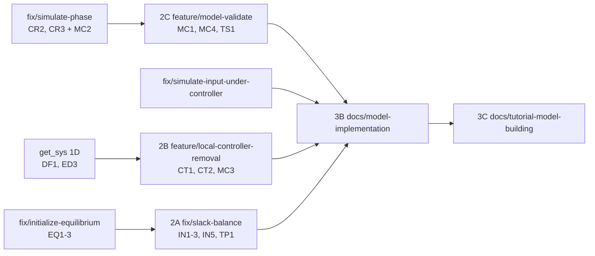

# モデル構築の改善案

> 当時の調査記録です。調査の基準は `86af385` で、以後の変更は本文に反映していません。採否は §8、現状は [status.md](status.md) と [v4-migration.md](v4-migration.md) を見てください。

調査ノート [model-building-workflow.md](model-building-workflow.md)(以下 **WF**)と [model-building-extension.md](model-building-extension.md)(以下 **EX**)を基にした提案です。採否は保守者が決めます。ソースと HTML ドキュメントは変更していません。問題番号は「WF 1」「EX 25」のように両ノートの番号で示します。

**根拠の区別**

- **[事実]** コードを読んで確認
- **[再現]** 現行コードのコピーで実行して確認
- **[試作]** コピーに試作を当てて実行(コミットなし)
- **[見積]** 判断による推定で、計測していない
- **[未確認]** 調べていない

**パス** 先頭が `_GUILDAobject/`、`+DebugScript/`、`_GUILDAdoc/`、`@GUILDA/` 以外は `_GUILDAsystem/` からの相対パスです。`SIM` は `_auxiliary/@odeSimulator/odeSimulator.m` です。他のノートの ID(EQ、ED、CR など)は [get-sys-improvements.md](get-sys-improvements.md) と [simulate-improvements.md](simulate-improvements.md) のものです。

## 1. 結論

**推奨する方向: クラス構造と既存のモデル契約は変えず、構築時の検査と診断を足します。** 大きな再設計は不要です。組み込み9系統の機器と制御器の平衡点の残差は最大 1.5e-13 で、現行の枠組みは正しいモデルには正しく動きます。問題は、間違った構成や間違ったモデルが無言で通ることです。多くは検査を数行足せば止まり、試作を全部当てても既存テストで不合格になったのは4件だけでした。その4件は、原因をすべて説明できます(§6)。

**今回の検討で新たに分かった重要な点**

1. **スラックの自動選択でも無言の残差が起きます。** 第1母線が負荷だと、自動選択された負荷のスラックで KCL 残差 0.0345 のまま成功します **[再現]**。WF 問題 1 は明示指定で調べたものですが、スラックを指定しなくても起きます(IN2)。
2. **スラックの電力は負荷も引き受けます。** 同じ母線に負荷、発電機の順で追加すると、負荷が `P=+0.201`(発電)になり、発電機は設定値のままです。CSV を往復すると機器の順序が変わり、発電機 `P=0.501`、負荷 `P=-0.2` と**運転点が変わります** **[再現]**(IN3)。
3. **タグの往復は、WF の指摘より広く壊れます。** `B1000` は `B11000` になり(WF の推測を確認)、欠番も `B001,B002,B004 → B001,B002,B003` と詰まります **[再現]**。タグで書いたイベントが別の母線を指す恐れがあります(TG1)。
4. **EQ3 の KCL 検査は EQ1 と分けて入れられません。** EQ1 なしで入れると、既存テストの OPF 初期化が残差 0.283 と 0.204 で止まります **[試作]**(§3)。
5. **負荷に付けた AVR は `simulate` で必ず失敗します。** 現行は追加と `get_sys` が通り、`simulate` で `MATLAB:badsubscript` です **[再現]**。追加時にエラーにしても、動いていた計算は失われません(MC3)。

**最初に行う 6 件**

| 順 | ID | 内容 | 根拠となる結果 |
|---|---|---|---|
| 1 | IN1, IN2 | 残りの電力を引き受ける機器がないスラックをエラーにする。自動選択は発電機のある最初の母線にする | F11, S01 の無言の残差 → 原因を示すエラー。F07 は成功に変わる |
| 2 | CT1, CT3 | `replace_component` と `export_csv` が制御器を落とすときに警告する | 無言で `nx` が変わる → 警告。組み込み系統の構築に影響なし |
| 3 | CT2 | `comp.remove_local_controller(tag)` を追加する | `nx` 17 → 14 → 12 で正しく戻る。外した制御器も再利用できる |
| 4 | MC3 | `key` と出力名の誤りを追加時にエラーにする | 無言や `simulate` の内部エラー → 追加時の明示エラー |
| 5 | IN5, MC1 | `initialize` がモデルの残差を調べ、`validate` が契約を調べる | 不正モデル6種すべてを検出。組み込みの残差は最大 3.9e-14 で誤検知なし |
| 6 | TP2, TP3, TP5 | ブランチ、CSV、パラメータの型の検査 | MATLAB の生のエラーや無言の無視 → 修正方法を示すエラーか警告 |

**前提:** IN4 は [get-sys-improvements.md](get-sys-improvements.md) の EQ1-EQ3(ブランチ `fix/initialize-equilibrium`)そのものです。これが無言の誤りを止める土台なので、先に統合してください。

## 2. 調査ノートの再確認

引用された挙動のうち、提案が依存するものはコードと実行で再確認しました。

| 元の記述 | 再確認の結果 | 根拠 |
|---|---|---|
| WF §6 推測: `B1000` の接頭辞は `B1` になる | **確認。** 再読み込みで `B11000` | `@PowerNetwork/export_csv.m:103` **[再現]** |
| WF §3.3: 機種をまたいだ行の順は保存されない | **影響が大きいです。** スラック母線では運転点が変わります(IN3) | `@PowerNetwork/import_csv.m:133`, `@Bus/set_equilibrium.m:28-34` **[再現]** |
| WF 問題 19 / A10: 負荷に AVR が付く | 付きますが、`simulate` は `badsubscript` です | `SIM:359-360` **[再現]** |
| WF 問題 24: `add_branch.m` は追跡されている | 削除して `GUILDA` を実行すると、**バイト単位で同じ内容**が生成されます | **[再現]** |
| EX 問題 36 [未確認]: 子のコンストラクタで `add_entry` | **動きます。** `Kx` を足した `Branch` の子で `tag=EX003`, `Kx=2`, `initialize` 成功。`add_branch` の引数からは渡せず、既定値か構築後の編集です | **[試作]** |
| EX 問題 23: 最初の起動で `add_component` が見つからない | 更新関数の最後の `rehash path` で解消します | **[試作]** |
| WF 問題 13: 型の誤りが警告になる | リスナーでは止められません。動的プロパティの `SetMethod` なら止まりますが、**無名関数で包むと `recursionLimit`** です。入れ子関数のハンドルで動きます | **[試作]** |

**新しい指摘**

- **[再現]** 第1母線が負荷のときの自動スラックによる残差(IN2)、スラックの P の引き受け先と往復での変化(IN3)、タグの欠番の喪失(TG1)。
- **[事実]** `Component.validate` の未初期化経路は、`c_I` を `rv_V/norm(rv_I)` で作り、比較には別の `rv_I` を使います(`@Component/validate.m:18-20`)。EX M21 の残差 0.84 の少なくとも一部はこの不一致による可能性があります(原因の切り分けはしていません)。試作では `I` の残差が消えました。
- **[事実]** `local_LQR` には駆動する入力の専用検査があり(`GUILDA:local_LQR:UnknownInput`)、F1 がその ID を固定しています。MC3 の汎用検査と重なります。

## 3. `get_sys` と `simulate` の提案との関係

**重複する問題は参照だけにします。**

| 問題 | 既存の提案 | 本案での扱い |
|---|---|---|
| WF 問題 1, 2 の最後の防護、`Method="OPF"` と `"equilibrium"` の残差(X10, X11) | EQ1, EQ2, EQ3(= CR6) | 参照。IN1 は原因を説明するメッセージを足す |
| GC の対象の削除と置換(S05)、WF 問題 12 の一部 | ED3, CR7 | 参照。CT4 は追加時の所属検査だけを足す |
| 層別 `get_sys` の未検査(F04, S18) | ED1 | 参照 |
| `a_Bus` などの setter のエラー、WF 問題 16 | ED4 | 参照 |
| 古いイベント(X16) | EV1 | 参照 |
| `Feedback` が入力を減らす(EX 問題 5) | SH2 | 参照 |
| 発電機バスの `UnfeasibleDAE`(EX 問題 38) | CR3, TS1 | 参照。CR3 の後に再確認する |
| 制御器の `set.tab_parameter`(simulate WF M9、MS L2) | AR3 | 参照 |
| GC は状態を読むという文書の誤り(EX §1.4) | SH6, ST4 | 参照 |
| `local_LQR_retrofit`, `get_environment` | DU2 | 参照 |
| トリップ中の制御器(EX 問題 19 とは別) | CR2 / EQ6 | 参照 |

`simulate-improvements.md` §2.2 が「モデル構築の課題」として残した項目は、WF M3 を CT4、WF M8 を CT1、WF M6 を ER1 で扱います。

**注意が必要な点と矛盾**

| # | 内容 | 判断 |
|---|---|---|
| 1 | **EQ3 は EQ1, EQ2 なしでは入れられません。** KCL 検査だけを当てると `InitializeWithOPF` が 0.283、`DeprecatedMethodsOptionAndValuesWarn` が 0.204 で不合格です **[試作]**。`get-sys-improvements.md` §8 は KCL 検査を未実装としており、これは今回初めて確認しました | 同じブランチで入れる。元の段階 1A の構成のままで問題ありません |
| 2 | **CR8(LC 配下の入力を加算に)** と `class-design.html`, `add_local_controller` の help の「replace」は矛盾します。CR8 の採否で DC1 の文面が変わります | DC1 は CR8 の決定後に書く |
| 3 | `simulate-improvements.md` §7 は `test_F11`-`F14` を予約しています | 本案のテストは `test_F15` 以降にする |
| 4 | `get-sys-improvements.md` の段階 1D が `@Bus/replace_component.template`, `@Bus/remove_component.m`, `@Component/Component.m` を触ります | 本案の 2B はその後に行う |
| 5 | MC2 の `SIM:655` の変更は `SIM` に触ります | simulate の `fix/simulate-phase` に含める(§7) |
| 6 | `api-design.html` の Power flow は「first bus becomes the slack bus」です。IN2 はこの定義を変えます | Q2 で判断。採るなら文書も直す |
| 7 | **テストファイル名:** `get-sys-improvements.md` の段階 1A は `test_F3_initialize.m`、本案の 2A は `test_F3_edit_handling.m` を挙げます。**両方とも実在する別のファイルで、矛盾ではありません。** 前者は OPF と KCL の試験、後者は 2A で直す `LocalControllerAddAndReplaceMakeTheEquilibriumStale` を含みます | 名前はこのまま。2A は `test_F3_initialize.m` を変更しない |
| 8 | `class-design.html:166` の「exactly one」と実装の「at most one」(WF 問題 28) | IN1 で「`initialize` の後は exactly one」になるよう文書を直す(DC4) |

## 4. 提案一覧

**種別:** (a) 仕様判断が不要な修正、(b) 保守者の判断が必要な変更、(c) 整理。**工数**(S: 半日以内、M: 1〜2 日、L: 3 日以上)は [見積] です。**優先**は利用者への影響と、工数とリスクの比較で決めました。

### 4.1 低リスクの修正(判断不要)

| ID | 内容 | 解決する問題 | 影響 | 工数 | 互換の影響 | 優先 |
|---|---|---|---|---|---|---|
| IN1 | 引き受け手のないスラックをエラーに | WF 1, 2, 28 | 高 | S | 無言の誤りがエラーに | 1 |
| CT3 | `export_csv` の警告 | WF 5 | 高 | S | 警告のみ | 1 |
| CT2 | `remove_local_controller` | WF 4 | 高 | S | 追加のみ | 1 |
| MC3 | `key`、出力名の検査 | EX 1, 8, WF 19 | 高 | S | 下記 | 1 |
| CT4 | 制御器の二重接続、GC の所属とポート | WF 11, 12, 19, EX 17(一部) | 中 | S | 無意味な構成がエラーに | 2 |
| TP2 | `add_branch` の検査 | WF 19, 29 | 中 | S | 自己ループがエラーに | 2 |
| TP3 | CSV の未知の列と行番号 | WF 9, 10 | 中 | S | 警告、エラー | 2 |
| TP5 | パラメータの型の誤りを本当のエラーに | WF 13 | 中 | S | 警告がエラーに | 2 |
| ER1 | 残りのメッセージと ID の修正 | WF 14, 15, 29, EX 9-11 | 中 | S | ID の追加 | 2 |
| TP4 | 発電機の Q 無視の警告 | WF 7 | 低 | S | 警告のみ | 2 |
| MC4 | 制御器のヤコビアンを任意に | EX 12(一部) | 中 | S | 追加のみ | 2 |
| RG2 | `rehash path` と読み込み失敗の警告 | EX 4, 23 | 中 | S | 警告のみ | 2 |
| RG3 | テスト用スタブをキー一覧から除く | WF 25, EX 24 | 低 | S | なし | 3 |
| CL1 | `add_branch.m` の追跡をやめる | WF 24 | 低 | S | なし | 3 |
| CL2 | `Ishizaki6Bus` がソースを書き換えない | WF 26, EX 35 | 低 | S | なし | 3 |
| CL3 | 宣言と実装の不一致を直す | WF 27, EX 13 | 低 | S | なし | 3 |

### 4.2 保守者の判断が必要な変更

| ID | 内容 | 解決する問題 | 影響 | 工数 | 互換の影響 | 優先 | 質問 |
|---|---|---|---|---|---|---|---|
| IN2 | 自動スラックの選び方 | WF 14、新規 | 高 | S | F07 が成功に変わる | 1 | Q1 |
| IN3 | スラックの P を発電機が引き受ける | 新規 | 高 | S | 数値が変わる場合あり | 1 | Q2 |
| IN5 | モデルの残差を `initialize` で検査 | EX 3, 6, 7 | 高 | S | 警告かエラー | 1 | Q3 |
| CT1 | `replace_component` の制御器 | WF 3 | 高 | S | 警告。任意で引き継ぎ | 1 | Q4 |
| TP1 | 島の診断 | WF 6 | 高 | S | 島で警告 | 1 | Q5 |
| MC1 | `validate` の拡張 | EX 2, 7, 14, 15, 25, 26 | 高 | M | 戻り値に項目を追加 | 1 | Q6 |
| MC2 | 暗黙の契約の扱い | EX 14-16 | 中 | S | 低 | 2 | Q7 |
| TG1 | CSV に完全なタグを保存 | WF 8、新規 | 中 | M | 列の追加 | 2 | Q8 |
| TG2 | 改名の扱い | WF 18 | 低 | S | 低 | 3 | Q9 |
| TG3 | 添字の扱い | WF 17 | 低 | S | なし | 3 | Q10 |
| RG1 | リポジトリ外のクラス | EX 21, 22 | 中 | M | 追加のみ | 2 | Q11 |
| MC5 | 1機器1系統と非対称の扱い | EX 12, 17, 19, 20 | 中 | L | **変更しない** | 保留 | Q12 |
| CL4 | 未完成クラスの整理 | EX 31-33 | 低 | S | 共同開発者次第 | 3 | Q13 |

### 4.3 文書と整理

| ID | 内容 | 解決する問題 | 工数 | 依存 |
|---|---|---|---|---|
| DC1 | 新モデルの実装ページ | EX 29, 30 の一部 | M | MC1-MC4, CR8 |
| DC2 | 保留中のチュートリアルブランチの確認 | WF 20, 21, EX 30 | M | 仕様の確定 |
| DC3 | 取り込みと編集のチュートリアル | WF 22, EX 29 | M | DC2 |
| DC4 | 開発者文書の修正 | WF 28, EX 37 | S | 各段階 |
| CL5 | 重複の整理 | EX 34 | M | 保留を推奨 |
| TS1 | 全キーを自動で試験する | EX 27, 28 | S | MC1 |

### 4.4 変更を勧めないもの

| 問題 | 理由 |
|---|---|
| WF 30(値を戻しても stale) | 「編集は記録だけ」という原則の結果です。比較の仕組みを足す利点より複雑さが勝ります。`initialize` で解消します |
| EX 18(発電機の `parameter.csv` 結合) | MissingParameter のメッセージ(ER1)で足ります。既定値の仕組みは新機能なので不要です |
| WF 23(起動前に `add_component` がない) | 生成方式の結果です。RG1 の検討でも生成を維持します。文書に書きます |
| EX 36(`Branch` の追加パラメータ) | コンストラクタの `add_entry` で動きます **[試作]**。文書に書きます |

## 5. 提案の詳細

### 5.1 `initialize` の無言の誤った平衡点

#### IN1: 引き受け手のないスラック

**問題 [事実]:** スラックの P は第1機器へ、Q は `Q=NaN` の機器へ配分されます(`@Bus/set_equilibrium.m:28-41`)。機器がないか、`Q=NaN` がなければ残差の行き先がありません。`l_isSlack=true` の検査は指定時だけです(`@Bus/Bus.m:168-170`)。

| 案 | 内容 | 利点 | 欠点 | 失敗する条件 |
|---|---|---|---|---|
| **A(推奨)** | `initialize` で潮流計算の後に検査 | 順序によらず1か所で済む。編集は「記録だけ」のまま | エラーが後になる | なし |
| B | `l_isSlack` の代入と `remove_component` で検査 | 早く分かる | 後から `Q` を編集する経路が漏れる。編集で止める設計は原則に反する | Q の編集、機器の置換 |
| C | 別の母線へ自動で移す | 止まらない | 利用者の指定を無言で変える | 運転点が変わる |
| D | EQ3 だけに任せる | 追加なし | 「KCL 残差 0.104」では原因が分からない | — |

```matlab
% @PowerNetwork/initialize.m: powerflow の後
b = obj.a_Bus{find(lv_slack,1)};
if isempty(b.a_Component) || ~any(cellfun(@(c) isnan(c.para_powerflow.Q), b.a_Component))
    error('GUILDA:PowerNetwork:SlackCannotBalance', ...)   % 発電機を足すか別の母線を指定するよう案内
end
```

**結果 [試作]**

| ケース | 現行 | 試作 |
|---|---|---|
| F11 負荷をスラックに | 無言、KCL 0.104 | `SlackCannotBalance`: `No component of slack bus B003 has Q = NaN...` |
| S01 スラックの機器を削除 | 無言、KCL 0.0044 | `SlackCannotBalance`: `Slack bus B001 has no component...` |
| 組み込み9系統 | — | エラーなし |

**互換:** 無言で誤っていた計算がエラーになります。`Component` を直接継承し `Q=0` の機器をスラックにしている共同開発者のモデルがあれば止まるので、`Q=nan` の指定を案内します。**[未確認]** 共同開発者のモデルでの発生。F3 の `LocalControllerAddAndReplaceMakeTheEquilibriumStale` は偶然この経路を使っており、スラックを移す修正が必要です。

**テスト:** `+DebugScript/test_F20_initialize_checks.m`。

#### IN2: 自動スラックの選び方

**問題 [再現]:** 第1母線が負荷だと、それをスラックにして `kcl=0.03449` で成功します。第1母線に機器がなければ、他に発電機があっても `BUS001` のエラーです(F07)。

| 案 | 内容 | 利点 | 欠点 | 失敗する条件 |
|---|---|---|---|---|
| **A(推奨)** | `Q=NaN` の機器がある最初の母線 | F07 も負荷の場合も正しく動く。第1母線が発電機なら不変 | 文書の「first bus」と違う | 発電機がない系統(エラーで案内) |
| B | 第1母線のまま。IN1 でエラーにする | 定義が不変 | 動くはずの系統が止まる | F07 |
| C | 自動選択をやめる | 明快 | 組み込み7系統が CSV の `Slack` 指定を要する | 既存スクリプト |

**結果 [試作]:** F07 は成功、F05 は `NoBus`、F09 は `NoSlackCandidate` で、文は原因ごとに分かれます。F1-F10 に影響ありません。

**テスト:** `test_F20_initialize_checks.m`。

#### IN3: スラックの P の引き受け先

**問題 [再現]:**

| 構成 | 現行 | 試作 |
|---|---|---|
| 同じ母線に `load-power(P=-.2)`, `gen-park(P=.1)` の順 | 負荷 `+0.201`, 発電機 `0.1` | 負荷 `-0.2`, 発電機 `0.501` |
| 同じ系統を CSV で往復 | 発電機 `0.501`, 負荷 `-0.2`(**値が変わる**) | 発電機 `0.501`, 負荷 `-0.2`(同じ) |

| 案 | 内容 | 利点 | 欠点 | 失敗する条件 |
|---|---|---|---|---|
| **A(推奨)** | `Q=NaN` の最初の機器が引き受ける。なければ第1機器 | 順序に依存しない。負荷が発電しない | 文書と `SetSlack` の文の変更 | 複数の発電機の配分は従来どおり先頭のみ |
| B | 文書化だけ | 変更なし | 往復で運転点が変わる | — |
| C | CSV に順序を保存 | 往復は直る | 負荷の発電は残る | — |

**互換:** 第1機器が発電機の系統は不変です。スラック母線の負荷が先頭の系統は数値が変わるので、`v4-migration.md` の silent change 欄に載せます。**テスト:** 同上(追加順を入れ替えて同じ値)。

#### IN4: 最後の KCL 検査

EQ3 を採用します。本案で足すものはありません(§3 の注意 1)。試作の残差は全系統で最大 7.9e-11 です **[再現]**。

#### IN5: モデルの残差の検査

**問題 [再現]:** KCL は `c_Iequilibrium` を使うので、モデルの誤りを見ません。EX M06 の `|dx|=0.405` は EQ3 を通ります。

**測定 [再現]:** 既存のモデルの残差です(`f_dx`、`f_I - c_I`、制御器の `f_dx`、制御器の出力と機器の入力の差)。

| 系統 | KCL | 機器 dx | 機器 I | 制御器 dx | 検査時間(1回) | `initialize` |
|---|---:|---:|---:|---:|---:|---:|
| IEEE9 | 6.4e-15 | 2.2e-15 | 1.2e-15 | 4.4e-16 | 12.9 ms | 500 ms |
| IEEE14 | 5.7e-13 | 1.3e-15 | 2.3e-15 | 0 | 6.9 ms | 301 ms |
| IEEE68 | 1.6e-13 | 3.9e-14 | 1.5e-13 | 1.7e-14 | 90.9 ms | 976 ms |
| TEST31 | 7.9e-11 | 8.9e-16 | 2.6e-15 | 0 | 16.6 ms | 738 ms |
| IEEE14 + AVR/PSS | — | 1.3e-15 | 2.3e-15 | 3.3e-15 | — | — |
| IEEE14 + LQR | — | 1.3e-15 | 2.3e-15 | 0 | — | — |

残りの系統(`_NoTap`, `_lossless`, `Ishizaki6Bus`, `Txt3Bus`, `Tutorial3bus`)も機器の残差は 3e-15 以下です。`1e-6`(既存の `"equilibrium"` の許容値)に対して十分な余裕があります。時間は他のセッションと並行した1回の値で、目安です。

| 案 | 内容 | 利点 | 欠点 | 失敗する条件 |
|---|---|---|---|---|
| **A(推奨)** | しきい値 `1e-6` で**警告**(ID つき)。サイズの誤りだけエラー | 共同開発者のモデルが止まらず、気づける | 警告を見落とせば通る | ログを読まない自動実行 |
| B | エラー | rule 5 に完全に合う | 近似の平衡点を使うモデルが止まる | リミッタや `t=0` 依存のモデル |
| C | `validate` だけ | 変更なし | 呼ばなければ気づかない | EX M06 の現状 |

**推奨の理由:** 共同開発者のモデルの残差を確認できていません **[未確認]**。確認後に B へ上げることを勧めます。

**結果 [試作]**(試作の `initialize` は機器のみを検査。制御器の検査は測定スクリプトで確認)

| 不正モデル | 現行(EX) | 試作の `initialize` |
|---|---|---|
| `x` に 0.1 を足す(M06) | 無言 | `EquilibriumResidual` の警告 |
| `x` のサイズの誤り(M07) | `simulate` で `sizeDimensionsMustMatch` | `GUILDA:Component:EquilibriumSize` のエラー |
| `fcn_I` が `[re; im]`(M08) | `PhaseFailed` | `EquilibriumResidual` の警告 |
| `fcn_dx` が `I` に依存(M10) | `get_sys` で `CurrentDependence` | `EquilibriumResidual` の警告(この例では残差が出るため) |

**テスト:** `test_F20_initialize_checks.m`。不正モデルは `+DebugScript/+helper/` にスタブとして置きます。

### 5.2 構築時の検査とトポロジの診断

#### TP1: 島の診断

**問題 [再現]:** 孤立と島はすべて「収束せず」で、メッセージはソルバーの設定変更を勧めます。収支の合う島は成功します(G01, X05)。

| 案 | 内容 | 利点 | 欠点 | 失敗する条件 |
|---|---|---|---|---|
| **A(推奨)** | `initialize` の内部で `conncomp` を実行。失敗時はメッセージに島の一覧を追記し、成功時は `NetworkIsland` の警告 | 公開 API が増えない。島の計算自体は数学的に有効なので止めない | 警告だけでは止まらない | 島を意図する利用では警告が煩わしい(ID で無効化可) |
| B | 島をエラーに | 単純 | 意図的な島の解析ができない | 収支の合う島を使う研究 |
| C | 公開の `net.check_model()` を追加 | 構築中に呼べる | 呼ばなければ効かない。同じ内容の入口が増える | — |
| D | 構築時に検査 | 早い | 組み立て途中は必ず島 | 全部の構築手順 |

**結果 [試作]:** 組み込み9系統で誤検知なし(すべて島1個、自己ループ0)。G01 は `NetworkIsland`、G03 は `InitializePowerflowFailed` のままです。時間は 2-40 ms です(初回の 132 ms を除く)。**未確認:** 文面は先頭が改行で、実行ログの行抽出に出なかったため、目視していません。

**テスト:** `test_F20_initialize_checks.m`(G01-G06, X04, X05)。

#### TP2: `add_branch`

`@PowerNetwork/add_branch.template` に次を足します。すべて **[試作]** で確認しました。

| ケース | 現行 | 試作 |
|---|---|---|
| A01, A02 添字が範囲外 | `MATLAB:badsubscript` | `BranchBusIndex`: `Bus index [1 2] is out of range: the network has 0 buses...` |
| A04 自己ループ | 無言 | `BranchSelfLoop`(シャントの指定を案内) |
| A05 `R=X=0` | 潮流で `UsrObjUndefAtX0` | `BranchZeroImpedance` |

**互換:** 自己ループをシャントの代わりに使うデータは止まります。組み込み系統に該当はありません **[再現]**。**テスト:** `test_F15_build_checks.m`。

#### TP3: CSV の検査

| ケース | 現行 | 試作 |
|---|---|---|
| C4 列名の誤り | 無言 | `GUILDA:import_csv:UnknownColumn` の**警告** |
| C8 `To` の範囲外 | `badsubscript` | `GUILDA:import_csv:BusRow`(行番号を示す) |

| 案(未知の列) | 利点 | 欠点 |
|---|---|---|
| **警告(推奨)** | メモ用の列を持つ共同開発者の CSV が止まらない | 見落とせる |
| エラー | 誤りを確実に止める | 既存 CSV が止まる恐れ |

組み込み系統で警告は出ません **[試作]**。`Bus` 列の範囲検査(C9)は同じ形で書けます [未試作]。`Network=` の失敗で途中まで追加される問題(WF 10)は、**先に全部の表を検査してから追加する**順序で小さくできますが、潮流の失敗は残ります。完全な巻き戻しは採らず、help に「失敗後は作り直す」と書きます [見積]。**テスト:** `test_F16_csv_io.m`。

#### TP4: 発電機の Q

| 案 | 内容 | 利点 | 欠点 |
|---|---|---|---|
| **A(推奨)** | NaN でも 0 でもない Q で `GeneratorQIgnored` の警告 | 仕様は不変。組み込みは `main.csv` が NaN なので出ない **[試作]** | 既定の 0 は判別できない。負荷から発電機への置換でも出る [見積] |
| B | Q を尊重して PQ 発電機を許す | 表現が増える | 母線の型の定義、MATPOWER、OPF に波及する大きな仕様変更 |
| C | 文書だけ | 変更なし | 無言のまま |

置換での誤報は、`replace_component` が Q を NaN にして渡せば防げます。**テスト:** `test_F19_model_constructor.m`。

#### TP5: パラメータの型

**問題 [事実]:** `PostSet` リスナー内の `error` を MATLAB が警告に変えます(`_auxiliary/@Parameter/callbackPostSet.m:13-15`)。

| 案 | 内容 | 利点 | 欠点 | 失敗する条件 |
|---|---|---|---|---|
| **A(推奨)** | 動的プロパティの `SetMethod` で代入前に検査 | 本当のエラーになり、値も記録も変わらない | 代入が遅くなる | **無名関数で包むと再帰**(入れ子関数が必須) |
| B | 文書化のみ | 変更なし | rule 5 に合わない | — |

**結果 [試作]:** `V="x"` は `GUILDA:Parameter:ClassNameMismatch`。代入の時間は 920 → 1397 μs(各 1 回の計測、2000 回平均)で、編集の頻度を考えれば問題ありません [見積]。F1-F10 に影響なし。**テスト:** `test_F17_parameter_type.m`。

### 5.3 制御器の保持と削除

#### CT1: `replace_component`

| 案 | 内容 | 利点 | 欠点 | 失敗する条件 |
|---|---|---|---|---|
| **A(推奨)** | 既定は落とす + 警告。`Controllers="keep"` で引き継ぐ | 既存の数値が不変。意図を明示できる | 引き継ぎが既定でない | 警告の見落とし |
| B | 既定で引き継ぐ | 発電機モデルの差し替えが自然 | 無言で `nx` が変わる(silent change)。負荷への置換の扱いが要る | 既存スクリプト |
| C | 制御器があればエラー | 最も安全 | 既存スクリプトが止まる | 同左 |

**結果 [試作]**

| 手順 | 結果 |
|---|---|
| 既定 | `GUILDA:Bus:ControllersDropped`: `The controllers CAa1, CPp1 of SG1B001 were not carried over...`、LC=0 |
| `gen-park` → `gen-1axis`、AVR + PSS、`keep` | LC=1, PSS=1, `simulate` flag=1, 変動 1.2e-9 |
| IEEE14、LQR、`keep` | `nx` 30 → 27、`K` `[2 6]` → `[2 3]`、flag=1、変動 1.3e-11 |
| AVR 付きを負荷へ、`keep` | `ControllersNotKept` で**何も変わらない**(機器、LC=1、`flag=initialized`) |

**GC:** ED3(Q7)の「拒否」はそのまま有効です。**テスト:** `test_F21_controller_editing.m`。

#### CT2: `remove_local_controller`

```matlab
comp.remove_local_controller("CPp1");                    % PSS だけ
comp.remove_local_controller("CAa1", RemoveNested=true); % AVR と PSS
```

`remove_bus` の `RemoveBranches` に揃え、PSS の残った AVR は既定でエラーにします。LocalController の内部用の同名メソッド(`Access` 制限、引数なし)はそのままにします。公開されないので、利用者から見て同名異義にはなりません。

| 案 | 利点 | 欠点 |
|---|---|---|
| **タグ指定(推奨)** | 他の `remove_*` と同じ。タグが永続 ID という原則に合う | タグを調べる必要 |
| インスタンス指定 | `add_local_controller` と対称 | 他の `remove_*` と異なる |
| 引数なしで全部外す | 単純 | PSS だけ外せない |

**結果 [試作]:** `nx` は基準 12、AVR + PSS 17、PSS を外して 14、全部外して 12 です。タグの誤りは `ControllerNotFound`、記録は `Topology`、外した後に新しい AVR を付けて `nx=14` です。**互換:** 追加のみです。**テスト:** `test_F21_controller_editing.m`。

#### CT3: `export_csv`

| 案 | 内容 | 利点 | 欠点 | 失敗する条件 |
|---|---|---|---|---|
| **A(推奨)** | 警告のみ | 仕様不変 | 制御器は戻らない | 再読み込みで付け直しを忘れる |
| B | 制御器も保存 | 往復が完全 | コンストラクタの形が揃っていない(`AVR_ST1(tag,param)`, `local_LQR(tag,opt)`, `broadcast_PI_AGC(net,tag,comps)`)ので、**全クラスに新しい契約が必要** | 共同開発者のクラス |
| C | AVR / PSS だけ保存(`IEEE9bus/controller/` と同じ形式) | 実用上の多くを賄う | LQR と GC の扱いが半端に残る | — |

**結果 [試作]:** IEEE9 で `ControllersNotSaved`: `6 local and 0 global controllers are not written`。**B は大きな仕様変更なので勧めません。C は要望があれば後で足せます。テスト:** `test_F16_csv_io.m`。

#### CT4: 接続の検査

| 問題 | 現行 | 試作 |
|---|---|---|
| A12, WF M3 AVR の共有 | 無言。`get_sys` で `connect6`、`simulate` で DAE 指数 | `GUILDA:Component:ControllerAttached` |
| A13 別ネットの GC | 無言 | `GUILDA:PowerNetwork:GconOtherNetwork` |
| M27 `omega` のない機器の AGC | `simulate` で `singleSubscriptNumelMismatch` | `GUILDA:PowerNetwork:GconPorts` |
| M26 負荷の AGC | `GlobalController.xml` の `FileNotFound` | 検出。ただし試作の文の組み立てが `strings(0,1)` で失敗(`MATLAB:string:MissingNotSupported`)。実装では `strjoin` を使う |
| A15 不明なタグ | `FileNotFound` | `GUILDA:GlobalController:InvalidComponent` のコードに変更(このケースは未実行)。`Component` を `isa` で判定(`_GUILDAobject` への依存を1つ除く) |

通常の AGC は `flag=1` のままです。**[未確認]** 共同開発者の GC は `sv_u` を状態に持たない形だと止まります。SIM の現行の `:386` では動かない形なので、損失はないと考えます。**テスト:** `test_F18_global_controller.m`。

### 5.4 タグと添字

#### TG1: CSV に完全なタグを保存

| 案 | 内容 | 利点 | 欠点 | 失敗する条件 |
|---|---|---|---|---|
| **A(推奨)** | 新しい列 `FullTag` を母線、ブランチ、機器に追加。無ければ従来どおり | 古い CSV も古い `Tag`(接頭辞)も動く。欠番と改名が残る | 列が増える | 手で編集して重複(`validate_tag` が変更して Info を出す) |
| B | `Tag` の意味を完全なタグへ変更 | 列が増えない | 既存 CSV の `B` が `B`(番号なし)に変わる | 全既存データ |
| C | 接頭辞の抽出だけ直す | 最小 | 欠番が詰まる問題は残る | イベントのタグ |

```matlab
% export_csv: Tag は数字以外の部分、FullTag は完全なタグ
Tag(i) = regexprep(string(char_tag), '\d+$', '');
```

**結果 [試作]**(母線のみ)

| ケース | 現行 | 試作 |
|---|---|---|
| `B1000` | `B11000` | 同じ処理で解消 [見積: 接頭辞の抽出のみ確認] |
| `BX,B003,B004` | `BX` で失敗 (X07)、欠番は詰まる | `BX,B003,B004`。機器は `SG1BX` |
| `B001,B002,B004` | `B001,B002,B003` | 保存される |

**機器とブランチの `FullTag` は未試作です。** 機器のタグは番号とヘッダーと母線タグから作られるので、機種の順序が変わる現状では `LPQ1,SG2 → SG1,LPQ2` になります。これも `FullTag` で解消できるはずです [見積]。

**互換:** 列を読まない古いコードへの影響はありません。TP3 の未知の列の一覧には `FullTag` を入れます。**テスト:** `test_F16_csv_io.m`(改名、欠番、4桁、機種をまたぐ順序)。

#### TG2: 改名(WF 18)

| 案 | 内容 | 利点 | 欠点 |
|---|---|---|---|
| **A(推奨)** | 記録だけ追加(stale にしない)。機器タグは追従しない | 永続 ID の意味を保つ。結果のラベルが変わることを追跡できる | 名前のずれは残る |
| B | 機器タグへ伝播 | 名前が揃う | 機器の ID が変わり、保存済みのイベントが壊れる。ID の原則に反する |
| C | 改名を禁止 | 明快 | `F3` などの既存の使い方が止まる [未確認] |

`_auxiliary/@LayerPackage/LayerPackage.m:167-170` の変更です [未試作]。PF1 の案 B(変数表のキャッシュ)を採らない理由とも整合します。

#### TG3: 添字(WF 17)

`add_branch` の数値指定と CSV の行番号は**残します**。Tutorial, v3, 共同開発者のデータが使っているからです。同じファイル内の行番号は古くならないので、「添字を保存しない」原則の実害は `add_branch` を削除の後に使う場合だけです。

| 案 | 内容 | 判断 |
|---|---|---|
| 文書でタグを勧める | help とチュートリアルの例をタグへ | **推奨** |
| CSV の `From`/`To`/`Bus` にタグも許す | 手書きが楽になる。`add_branch` は既に受ける | 要望があれば [未試作] |
| 数値を非推奨に | 互換の損失が大きい | 勧めない |

### 5.5 エラーメッセージ(rule 5)

#### ER1

`msg` の辞書に載せ、**修正方法を書きます**。既存の決定どおり、`ID` を必ず付けます。

| 問題 | 現行 | 変更 | 状態 |
|---|---|---|---|
| WF 14 `BUS001` の固定文 | ID なし、3 原因が同文 | `NoBus`, `NoSlackCandidate` | [試作] |
| WF 15 `remove_branch` | 無言 | `BranchNotFound`(`remove_bus` と同じ) | [試作] |
| WF 15 `remove_component`, `replace_component` | ID なし | `ComponentNotFound` | 未試作 |
| EX 11, WF 11 `GlobalController.xml` | ファイルがない | XML を追加 | 試作は文を直書き |
| EX 11, WF M6 `AVR_DC1` | `The ID specification is invalid` | `AVR_ST1.xml` と ID を修正 | 未試作 |
| EX 9, A07 パラメータの不足 | `UnrecognizedVarName` | `GUILDA:Component:MissingParameter`(足りない列を示す) | [試作] |
| A08 `parameter="NGT9"` | `UnequalVarLengths` | 許される名前を示す | 未試作 |
| EX 10 負荷の子にコンストラクタなし | `TooManyInputs` | 親が受けて動かす。タグは `L2B003` | [試作] |
| EX M37 `local` の下の PSS | ID なし、文が「AVR がない」 | 親の key を示す | 未試作 |

**互換:** `remove_branch` の無視は help に明記された動作です(`@PowerNetwork/remove_branch.m:4`)。エラーへの変更は他の `remove_*` に揃えるものですが、該当するスクリプトは止まります。テストでは F1 も含めて不合格はありませんでした **[試作]**。**テスト:** `test_F15_build_checks.m`、表の行ごとに ID と文の一部を確かめます。

**msg の注意 [事実]:** `msg` は呼び出し元のクラスと ID の第2要素を照合します(`_auxiliary/SystemTools/msg.m`)。AVR_ST1 が `AVR_DC1` の ID を使うので、XML を足すだけでは直りません。

### 5.6 新しいモデルの契約と検証

#### MC1: `validate` の拡張

**方針:** 新しいクラスや入口を作らず、既にある `comp.validate` と `con.validate` を直します(同名同義)。既存の `flag` の項目は残し、`flag.contract` と `flag.inputs` を足します。

| 案 | 内容 | 利点 | 欠点 | 失敗する条件 |
|---|---|---|---|---|
| **A(推奨)** | `validate` に契約の項目を足し、`+DebugScript` から全キーで実行 | 入口が増えない。利用者もテストも同じものを使う | 戻り値の項目が増える | `flag` のフィールドを順に処理するコード |
| B | 新しい `tools.check_model(cls)` | 自由に作れる | 同じ役割の入口が2つ | — |
| C | 抽象クラスに検査を書く | 自動で走る | 既存クラスのコンストラクタに波及 | 共同開発者のクラス |

**検査項目 [試作]**: `x, u` のサイズ、`get_equilibrium(V,I)` の省略、`fcn_dx` / `fcn_Y` のサイズ、`fcn_I` が複素スカラー、`fcn_Mass` が定数で正方、`I` への非依存、`sv_u` にポート名がない、`getCompPQ` の有無(情報のみ)。

**結果 [試作]:** 組み込み7機種と `gen-simple` で FAIL は 0 件です。不正モデルは次のとおりです。

| モデル | `validate` が示す FAIL | 残差 |
|---|---|---:|
| 平衡点に 0.1(M06) | 契約は pass | `dx=0.333` で検出 |
| `x` のサイズ(M07) | `x, u sizes(x 3 (sv_x 2)...)` | — |
| `fcn_I` が実 2 要素(M08) | `fcn_I complex scalar([2 1])` | — |
| `fcn_Mass` が `x` を使う(M09) | `fcn_Mass constant and square(... badsubscript)` | 0 |
| `r_P, r_Q` が必須(M31) | `get_equilibrium(V,I) without P,Q(MATLAB:minrhs)` | 0 |
| `fcn_dx` が `I` に依存(M10) | `no dependence on I(0.001)` | 0.001 |

**`con.validate`:** 旧 API の呼び出しをやめ、接続と初期化を前提に書き直します **[試作]**。未接続は `ValidateNotAttached`、`simple_avr` の残差 2.4e-15、ヤコビアンの差は `Axx` 6.6e-12、`Bxv` 3.9e-10、`Bxu` 2.0e-10、`AVR_ST1`, `PSS1` も 2e-10 以下です。

**限界:** `I` への依存の検査は、`I` に依存する機器が有効かという未決事項があるので FAIL ではなく警告にする案もあります。数値微分の機器のヤコビアンの比較は、同じものの比較になるので引き続き行いません(EX 問題 26)。

#### MC2: 暗黙の契約

| 契約 | 案 | 推奨 | 結果 |
|---|---|---|---|
| `r_P, r_Q` の省略可能(EX 15) | A: 枠組みが常に 4 引数で呼ぶ(`SIM:655`, `validate`) / B: 文書で要求 | **A。** 契約を1つ消せる。既存クラスに影響しない | **[試作]** 必須の機器でトリップが `flag=1`(現行 `minrhs`、M31) |
| `fcn_Mass` は定数(EX 14) | A: 文書と `validate` / B: `EVT:500` で実の値を渡す | **A。** B は状態依存の質量を約束することになり、ode15s の設定とヤコビアンに波及する | MC1 で検出 |
| `getCompPQ`(EX 16) | A: 任意と宣言し、エラーを案内つきにする / B: 必須に | **A。** `droop`, `impedance` に実装がない | 未試作 |
| LC, GC の `get_equilibrium`(EX §1.1) | `Abstract` 宣言を追加 | **追加。** 無いクラスは今でも `initialize` で失敗する | 未試作 |

**テスト:** `test_F22_model_contract.m`。

#### MC3: `key`、入力名、出力名

| 問題 | 変更 | 結果 [試作] |
|---|---|---|
| EX 1 `key` の誤り | `add_local_controller` の `switch` に `otherwise` | `InvalidControllerKey` |
| EX 8 出力名の誤り | `sv_y` が接続先の `sv_u` に含まれることを確認 | `ControllerOutput`: `Output "Vfiled" ... matches no input of SG1B001 (inputs: Pmech, Vfield)` |
| A10 負荷の AVR | 同上 | `ControllerOutput`。現行も `simulate` で失敗するので損失なし **[再現]** |

**LQR の検査との関係:** 汎用の検査が `local_LQR:UnknownInput` より先に出ます。試作では F1 の期待 ID を変えました。

| 案 | 利点 | 欠点 |
|---|---|---|
| **ID を汎用に統一(推奨)** | 検査が1か所。`UnknownInput` を消せる | F1 の期待値の変更 |
| LQR の検査を先に実行 | ID が不変 | 親の設定後に検査するので、失敗時に戻す処理が必要 |

**入力名の誤り(EX 2)は自動では検出できません。** `Vref`(意図して接続しない)と `Vppss`(誤り)は同じ形です。

| 案 | 内容 | 利点 | 欠点 | 失敗する条件 |
|---|---|---|---|---|
| **A(推奨)** | `con.validate` の `flag.inputs` で各入力の接続元を示す | 契約が増えない | 見なければ気づかない | **[試作]** `Vppss=equilibrium (not connected)` と出るが FAIL ではない |
| B | 任意の宣言 `sv_uFree = "Vref"` を追加し、宣言したクラスだけ未接続をエラーに | 確実 | 新しい契約。未宣言のクラスには効かない | 既存クラスへの追記が必要 |
| C | 追加時に未接続の入力を INFO で表示 | すぐ見える | AVR を付けるたびに毎回出る | — |

#### MC4: 制御器のヤコビアンを任意に

`Component` と同じ数値微分を制御器にも用意します。`LocalController.m` の `Abstract` から `Jacobi_dx`, `Jacobi_Y` を外し、`set_odefcn` で `ismethod` により切り替えます。

**結果 [試作]:** ヤコビアンのない AVR と解析的な AVR の固有値の差は 1.07e-11、`simulate` は `flag=1` です。既存クラスは解析的な実装を持つので不変です。「Controllers keep their own contract」には反しません(必須が任意になるだけです)。文書を直します。**テスト:** `test_F22_model_contract.m`。

#### MC5: 非対称と枠の制約(変更を勧めません)

| 問題 | 判断 | 理由 |
|---|---|---|
| EX 12 `fcn_Y`/`fcn_y`、`get_equilibrium`、`param` の向き | **統一しない。** 文書に対照表を載せる(DC1) | `class-design.html` が意図的と決めている。既存の全制御器と共同開発者のモデルに影響する |
| EX 12 `sv_*` の `Constant` の違い | 統一しない | AVR がコンストラクタで設定しており、変えると同様に広く波及する |
| EX 19, 20 1機器1系統、`pss` の固定 | **今は変えない** | シミュレータが `a_LocalController{1}` と2段を前提にしています(`SIM:550-606`)。`get_sys`、変数表、`simulate` に波及し、**証拠が大きな再設計を求めるほどではありません**。AVR と調速機の同時使用の要望が具体化したら別に検討します |
| EX 17 `isa` の分岐 | GC だけ直す(CT4)。他は個別に | `SIM:652` は ST3、OPF と CSV の分岐は機能の定義に関わる |

### 5.7 クラスの登録と外部クラス

#### RG1: リポジトリ外のクラス

| 案 | 内容 | 利点 | 欠点 | 失敗する条件 |
|---|---|---|---|---|
| **A(推奨)** | 利用者ごとの `@GUILDA/user/ModelPath.txt`(`.gitignore` 済み)のフォルダをキー生成に含める | 生成方式を保つ。CSV の往復も動く。共同開発者の私的なモデルをリポジトリに置かずに済む | `GUILDA` の再実行は必要(EX 21) | 複数人で同じ生成ファイルを共有する配置 |
| B | `add_component(@pkg.cls, ...)` でクラスを直接受ける | 登録が不要 | `export_csv` のキーを読み戻せない [見積] | 往復 |
| C | 生成をやめ実行時に探す | `GUILDA` の再実行が不要 | 起動時間とキーの競合。テンプレートの作り直し | 大きな変更 |

**結果 [試作]:** 外部フォルダの `extm.simple_sg` で `add_component` 成功、`simulate` `flag=1`、`export_csv` → `import_csv` の往復も成功です。読み取り専用の配置は **[未確認]** です。**テスト:** `test_F9_environment.m` と同じ場所では共有ファイルになるので、`test_F23_external_model.m` にします。

#### RG2, RG3

- **RG2 [a]:** `update_class_signature` の最後に `rehash path`。`@GUILDA/dictionary.m:113-120` の `catch` で `GUILDA:dictionary:ClassNotLoaded` の警告。**[試作]** 新しいコピーの最初のセッションで `add_component` 成功。壊れたクラスで `Class component.generator.broken_sg could not be loaded...: <元の理由>` と出ます。組み込みの起動で誤報はありません。
- **RG3 [a]:** `dictionary` が `+DebugScript` を走査しないようにします。**[試作]** キー一覧から `test-hessian-stub` が消え、F7 は直接作るので合格です。**[未確認]** `+DebugScript` がリリースに含まれるか。

### 5.8 文書とチュートリアル

- **DC1:** `_GUILDAdoc/developer/` に「Model Implementation」のページを足します。内容は EX 第3節の最小例、契約表、対照表、`validate` の使い方です。CR8 の結果と MC2-MC4 の後に書きます。HTML は状態を書かず、カードの順序は既存の規則に従います。
- **DC2:** `docs/tutorial-steps-1-3-v4`、`docs/tutorial-steps-4-6-v4`、`docs/tutorial-classmanual-v4` は保留中で、統合先より 226 コミット古いです。**WF 20, 21 と EX 30 は、これらで解決される可能性があるので、重複して直しません。** 再開時に確認する呼び出しは WF U01-U08、`Component_Load.mlx`、`Bus_variety.mlx`、`Controller_AGC.mlx` です。**[未確認]** 3 ブランチの `.mlx` の内容は開いていません(`.mlx` はバイナリで、差分は確認できません)。
- **DC3:** `Step` に CSV、MATPOWER、編集(`remove_*`, `replace_component`, `remove_local_controller`)を足します。`Controller_Abstract` への参照(EX 29)は DC1 のページへ直します。
- **DC4:** `class-design.html:166`(WF 28)、`folder-structure.html` の `network/` の規約(EX 37。必須でなく任意にする)、`api-design.html` の自動スラック。`@GUILDA/GUILDA.m:16` の `newclass` の記述は CL4 で消します。
- **`notes/v4-migration.md`:** 各ブランチでは編集せず、統合時に反映します。

### 5.9 リポジトリの整理

- **CL1 [c]:** `git rm --cached _GUILDAsystem/@PowerNetwork/add_branch.m`。**[再現]** 再生成の結果は同一です。`add_component.m` と同じ扱いになります。
- **CL2 [a]:** `Ishizaki6Bus` は一時フォルダへ書いて `import_csv` します。**[試作]** `Ishizaki6Bus(0.1,line="None")` の Y の差は 0 で、ソースの CSV は変わりません。別案の「読み込み後に `remove_branch` と編集」は `R` の更新が増えます。追跡されている `branch/` は基準値として残します。
- **CL3 [c]:** `add_bus`, `add_branch` の宣言(WF 27)、`Component.m:53-62`、`LocalController.m:45-51`、`PSS1.m:79-81`、`classical.m:54` の宣言を実体に合わせます(EX 13)。動作は変わりません。
- **CL4 [b]:** `未+GFM`, `未+farm`, `+load/history`, `ConstSource/power.m`, `+load/validate.m`, `+controller/validate.m`, `未実装newclass.m`, 発電機の親の `avr`, `pss`, `governor`, `set_*`(`abstract.m:65-96`)。**共同開発者の作業中の可能性があるので、確認してから移動か削除してください。** DU2 と同じ扱いです。
- **CL5 [c]:** `add_avr_pss` の複製と `IEEE14bus` 系の同一コンストラクタ、`@` フォルダのコメントの繰り返し(EX 34)は、動作に関係せず履歴を追いにくくするので**今は行いません**。

### 5.10 テスト

- **TS1:** `+DebugScript/+helper/check_model_contract.m` を作り、`GUILDA.dictionary` の全キーで `validate` を実行します。手書きのキー一覧(`test_F1_model_building.m:11-12`, `test_F7_linearization.m:132`)に頼らずに新しいクラスが試験されます(EX 27)。`build_3bus` に `parameter` 引数を足します(EX 28)。
- 不正モデルのスタブは `+DebugScript/+helper/` に置き、`dictionary` の対象外なので(RG3)キー一覧に出ません。登録を要する試験は `test_F23` だけにします。
- `refactor/design-alignment` の `run_all` は `opt.Features` の既定が空です(`+DebugScript/run_all.m:32`)。空のときは `testsuite("DebugScript")` が見つけた `test_F*.m` と `test_I*.m` をすべて実行するので(`:74-75`)、`test_F15` 以降の登録は不要です。`simulate-improvements.md` §7.2 の登録の記述はこの変更より前のものです。

## 6. 既存テストへの影響

`DebugScript.run_all`(R2026a)の結果です。テストの追加はしていないので、**合格は既存の動作を壊していないことだけを示します。**

| 版 | 内容 | 合計 | PASS | FAIL | SKIP |
|---|---|---:|---:|---:|---:|
| 現行 | `86af385` | 234 | 233 | 0 | 1 |
| 試作 | 下記を全部 | 234 | 229 | 4 | 1 |

試作の内容: IN1, IN2, IN3, IN5, EQ3 の KCL 検査(EQ1 なし), TP1-TP5, CT1-CT4, TG1(母線), ER1 の一部, MC1, MC2(`SIM:655`), MC3, MC4, RG1-RG3, CL2。

| 不合格 | 原因 | 判断 |
|---|---|---|
| F3 `InitializeWithOPF`(KCL 0.283) | EQ1 なしの KCL 検査 | EQ1 と同時に入れれば解消する見込み。§3 の注意 1 |
| F3 `DeprecatedMethodsOptionAndValuesWarn`(KCL 0.204) | 同上 | 同上 |
| F3 `LocalControllerAddAndReplaceMakeTheEquilibriumStale` | 試験の手順がスラックの機器を消して `initialize` する。WF S01 と同じ無言の誤りを偶然通っていた | テストを直す |
| F1 `AddLocalControllerLQR` | 汎用の出力検査が `UnknownInput` より先に出る | MC3 の判断どおり期待 ID を変える |

**確認:** 上記の見込みのとおり KCL 検査を `Method="powerflow"` に限り、テスト 2 件を直したコピーで F1 と F3 を再実行し、**71 件すべて合格**でした。F2, F4-F10 は修正前の全体実行で不合格なしです。**EQ1 と KCL 検査を合わせた実行はしていません。**

## 7. ロードマップ

### 7.1 依存関係



### 7.2 段階とブランチ

同じ段階の並行ブランチは同じファイルを触りません。テストは新しいファイルに分けます。

| 段階 | ブランチ | 案 | 触るファイル | 前提 |
|---|---|---|---|---|
| 0 | — | §8 の判断 | なし | — |
| 1A | `fix/network-build-checks` | TP2, CT4(GC), ER1(`remove_branch`) | `@PowerNetwork/add_branch.template`, `@PowerNetwork/add_branch.m`(追跡中の生成物。再生成の結果をコミットする), `@PowerNetwork/remove_branch.m`, `@PowerNetwork/add_global_controller.m`, `@GlobalController/GlobalController.m`, `_auxiliary/SystemTools/GUILDA/en/PowerNetwork.xml`, `_auxiliary/SystemTools/GUILDA/en/GlobalController.xml`, `+DebugScript/test_F15_build_checks.m`, `+DebugScript/test_F18_global_controller.m` | なし |
| 1B | `fix/csv-io-checks` | TP3, CT3, TG1(母線) | `@PowerNetwork/import_csv.m`, `@PowerNetwork/export_csv.m`, `+DebugScript/test_F16_csv_io.m` | Q8 |
| 1C | `fix/parameter-type-error` | TP5 | `_auxiliary/@Parameter/add_entry.m`, `_auxiliary/@Parameter/callbackPostSet.m`, `_auxiliary/SystemTools/GUILDA/en/Parameter.xml`, `+DebugScript/test_F17_parameter_type.m` | なし |
| 1D | `fix/model-constructor-errors` | TP4, ER1(パラメータ、負荷、AVR) | `_GUILDAobject/+component/+generator/@abstract/abstract.m`, `_GUILDAobject/+component/+load/@abstract/abstract.m`, `_GUILDAobject/+controller/+avr/@AVR_ST1/AVR_ST1.m`, `_auxiliary/SystemTools/GUILDA/en/AVR_ST1.xml`, `_auxiliary/SystemTools/GUILDA/en/Component.xml`, `+DebugScript/test_F19_model_constructor.m` | なし |
| 1E | `fix/class-registration` | RG2, RG3 | `@GUILDA/dictionary.m`, `@GUILDA/private/update_class_signature.m` | なし(F9 で確認) |
| 1F | `fix/ishizaki-source-csv` | CL2 | `_GUILDAobject/+network/@Ishizaki6Bus/Ishizaki6Bus.m` | なし |
| 2A | `fix/slack-balance` | IN1, IN2, IN3, IN5, TP1, ER1(`BUS001`) | `@PowerNetwork/initialize.m`, `@PowerNetwork/calculate_powerflow.m`, `@Bus/set_equilibrium.m`, `@Component/set_equilibrium.m`, `_auxiliary/SystemTools/GUILDA/en/PowerNetwork.xml`, `+DebugScript/test_F3_edit_handling.m`, `+DebugScript/test_F20_initialize_checks.m` | `fix/initialize-equilibrium`, Q1-Q3, Q5 |
| 2B | `feature/local-controller-removal` | CT1, CT2, CT4(二重接続), MC3, ER1(`remove_component`, PSS) | `@Component/Component.m`, `@Component/add_local_controller.m`, `@Component/remove_local_controller.m`(新規), `@Bus/replace_component.template`, `@Bus/remove_component.m`, `_auxiliary/SystemTools/GUILDA/en/Component.xml`, `_auxiliary/SystemTools/GUILDA/en/Bus.xml`, `+DebugScript/test_F1_model_building.m`, `+DebugScript/test_F21_controller_editing.m` | get_sys 1D, Q4 |
| 2C | `feature/model-validate` | MC1, MC4, TS1, MC2(文書と宣言の一部) | `@Component/validate.m`, `@LocalController/validate.m`, `@LocalController/LocalController.m`, `+DebugScript/+helper/check_model_contract.m`, `+DebugScript/+helper/build_3bus.m`, `+DebugScript/test_F22_model_contract.m` | `fix/simulate-phase`, Q6, Q7 |
| 2D | `refactor/untrack-generated-add-branch` | CL1 | `@PowerNetwork/add_branch.m`(追跡の解除) | 1A の統合後 |
| 3A | `feature/external-model-path` | RG1 | `@GUILDA/private/update_class_signature.m`, `+DebugScript/test_F23_external_model.m` | 1E, Q11 |
| 3B | `docs/model-implementation` | DC1, DC4 | `_GUILDAdoc/developer/`(新ページ, `class-design.html`, `api-design.html`, `folder-structure.html`), `_GUILDAdoc/database/list_UpdateLog.js`, `notes/status.md` | 2A-2C, CR8 |
| 3C | `refactor/csv-tags-and-rename` | TG1(機器とブランチ), TG2, TG3 | `@PowerNetwork/export_csv.m`, `@PowerNetwork/import_csv.m`, `_auxiliary/@LayerPackage/LayerPackage.m`, `+DebugScript/test_F24_tags.m` | 1B, Q9, Q10 |
| 3D | `refactor/remove-legacy-models` | CL3, CL4 | `_GUILDAobject/+component/`(未完成の部分), `@GUILDA/GUILDA.m`, `@GUILDA/未実装newclass.m`, `@PowerNetwork/PowerNetwork.m`, `_GUILDAobject/+controller/+pss/@PSS1/PSS1.m` | Q13, DU2 の判断 |
| 4 | `docs/tutorial-model-building` | DC2, DC3 | `_GUILDAtutorial/*.mlx` | 保留の解除、3B |

**並行の条件**

- 段階 1 の 6 本は共有ファイルがなく、同時に進められます。**CL1 は段階 1 に置きません。** `add_branch.m` は追跡中の生成物で、1A が `add_branch.template` を変えると `GUILDA` の実行で再生成されて変更になります。同時に追跡を解除すると変更と削除の衝突になるので、CL1 は 1A の統合後に行います(2D)。
- 段階 2 の 4 本も共有ファイルがありません。2D が触るのは `add_branch.m` だけで、段階 2 の他のブランチは `add_branch.template` を変えません。`@Component/Component.m` と `Bus.xml` は 2B だけ(IN3 に伴う `SetSlack` の文の変更も 2B で行います)、`@LocalController/LocalController.m` は 2C だけ、`test_F3_edit_handling.m` は 2A だけ、`test_F1_model_building.m` は 2B だけが触ります。
- 段階 3 の 4 本も共有ファイルがありません。3A は 1E の後、3C は 1B の後です。

**他のノートとの統合の注意**

- **`fix/simulate-phase`(simulate 1A)に `SIM:655` の 4 引数化を 1 行足してください。** 本案で `SIM` を別に触ると衝突します。`@Component/validate.m` の同じ呼び出しは 2C で直します。
- `get-sys-improvements.md` 段階 1D は `@Component/Component.m`, `@Bus/remove_component.m`, `@Bus/replace_component.template` を、段階 2 は `@GlobalController/GlobalController.m` を、5B は `@PowerNetwork/PowerNetwork.m` を触ります。本案の 2B、1A、3D とは同時に進めないでください。
- `@PowerNetwork/initialize.m` と `@Bus/set_equilibrium.m` は `fix/initialize-equilibrium` と本案 2A で共有します。順序は §7.1 のとおりです。
- CL1 は他の作業中のチェックアウトで `add_branch.m` が削除に見えます。起動で再生成されるので害はありません。

**移行ガイドの silent change 欄に載せる項目:** IN3(スラック母線の機器の配分)。**エラーや警告で気づく変更の欄:** IN1, IN2, IN5, TP2, TP3, TP4, TP5, CT1, CT3, CT4, MC3, ER1(`remove_branch`)。

## 8. 保守者の判断が必要な事項

| # | 質問 | 推奨 | 理由 |
|---|---|---|---|
| Q1 | 自動スラックを「`Q=NaN` の機器がある最初の母線」に変えますか(IN2) | **はい** | 第1母線が発電機なら不変。負荷の無言の残差と F07 を解消。文書の「first bus」も直す |
| Q2 | スラックの P を、第1機器ではなく `Q=NaN` の最初の機器に配分しますか(IN3) | **はい** | 負荷が発電せず、往復で運転点が変わらない。該当系統の数値は変わる |
| Q3 | モデルの残差は警告にしますか、エラーにしますか(IN5) | **警告で始め、共同開発者のモデルを確認後にエラーへ** | 組み込みは余裕があるが、外部のモデルの残差が不明 |
| Q4 | `replace_component` の既定は制御器を落としますか(CT1) | **落として警告。`Controllers="keep"` を追加** | 既存の数値が不変で、無言でなくなる |
| Q5 | 収支の合う島は警告ですか、エラーですか(TP1) | **警告** | 数学的には有効な平衡点。意図した解析を止めない |
| Q6 | `validate` の戻り値に `contract` と `inputs` を足しますか。`I` への依存は FAIL としますか(MC1) | **足す。`I` 依存は FAIL** | `get_sys` が `CurrentDependence` で止まるので、早く示す価値がある |
| Q7 | 枠組みが常に `get_equilibrium(V,I,P,Q)` で呼ぶようにしますか(MC2) | **はい** | 暗黙の契約を1つ消せる |
| Q8 | CSV に `FullTag` 列を足しますか(TG1) | **はい** | 古い CSV を壊さず、欠番と改名を保存 |
| Q9 | 母線の改名を記録しますか。機器タグへ伝えますか(TG2) | **記録だけ、伝えない** | タグは永続 ID |
| Q10 | 数値の添字を非推奨にしますか(TG3) | **しない。文書でタグを勧める** | v3 と共同開発者のデータの互換 |
| Q11 | 外部クラスは `@GUILDA/user/ModelPath.txt` で登録しますか(RG1) | **はい** | 生成方式を保ち、CSV の往復も動く |
| Q12 | 1機器1系統の枠(AVR と調速機の同時使用)を今変えますか(MC5) | **変えない** | 解析の全経路に波及。具体的な要望が出てから検討 |
| Q13 | 未完成のクラスと旧 API を整理しますか(CL4) | **共同開発者に確認してから** | 作業中の可能性を判別できない |
| Q14 | `remove_branch` の不明なタグをエラーにしますか(ER1) | **はい** | 他の `remove_*` に揃う。help の記述の変更を伴う |
| Q15 | 未知の CSV 列は警告にしますか、エラーにしますか(TP3) | **警告** | メモ列のある CSV を止めない |

### 実装の状況(基準 `faa2d13`、2026-11-02)

コードと git 履歴から確認できる範囲の記録です。上の表は提案時の質問と推奨としてそのまま残しています。

| # | 状況 | 確認した内容 |
|---|---|---|
| Q1 | 実装済み(推奨どおり) | `59548f7`。`Q=NaN` の機器がある最初の母線、なければ機器のある最初の母線。`tools.slack_bus_index` |
| Q2 | 実装済み(推奨どおり) | `c6674cf` |
| Q3 | 警告で実装済み。エラーへの移行は未決 | `2abc579` の `GUILDA:PowerNetwork:EquilibriumResidual`。共同開発者のモデルの確認は記録がありません |
| Q4 | 実装済み(推奨どおり。`simulate-improvements.md` §8 に案 A の決定の記録あり) | `12396ca`。`GUILDA:Bus:ControllersDropped`、`Controllers="keep"` |
| Q5 | 実装済み(推奨どおり) | `172c787` の `GUILDA:PowerNetwork:NetworkIsland` |
| Q6 | 実装済み(推奨どおり) | `8a6fceb` の `flag.contract`, `flag.inputs`。`I` への依存は `FAIL`(`test_F22_model_contract.m`) |
| Q7 | 実装済み(推奨どおり) | `df151c4`。`test_I105_model_contracts.m` |
| Q8 | 実装済み(推奨どおり) | `8bdc587` の `FullTag` 列 |
| Q9 | 実装済み(推奨どおり) | `20acdb0`。改名は `Tag` で記録し、機器のタグは変えない |
| Q10 | 未決 | 数値の添字を非推奨にするコードはありません。文書でタグを勧めるかは確認していません |
| Q11 | 未決 | `ModelPath` はコードにありません(RG1 は未実装) |
| Q12 | 未決 | 変更はありません。枠を変えない決定の記録はありません |
| Q13 | 未決 | `未+GFM`, `未+farm`, `+load/history`, `未実装newclass.m` などは残っています |
| Q14 | 実装済み(推奨どおり) | `18ab896` の `GUILDA:PowerNetwork:BranchNotFound` |
| Q15 | 実装済み(推奨どおり) | `e2be0d0` の `GUILDA:import_csv:UnknownColumn` |

提案との違いが 1 つあります。§3 の `SlackCannotBalance`(IN1)は `946ac79` で実装した後になくなり、現在のコードにはありません。現在は `GUILDA:Bus:SlackWithoutQnan` の警告で、残りの電力は第 1 の機器が受け持ちます(`b1131f5`, [v4-migration.md](v4-migration.md) 1.17)。

## 9. 問題番号の対応

**WF:** 1, 2: IN1(残差は EQ3) / 3: CT1 / 4: CT2 / 5: CT3 / 6: TP1 / 7: TP4 / 8: TG1 / 9, 10: TP3 / 11: ER1, CT4 / 12: CT4 / 13: TP5 / 14: IN2, ER1 / 15: ER1 / 16: ED4 / 17: TG3 / 18: TG2 / 19: TP2, CT4, MC3 / 20, 21: DC2 / 22: DC3 / 23: 変更なし / 24: CL1 / 25: RG3 / 26: CL2 / 27: CL3 / 28: IN1, DC4 / 29: TP2, TP3, ER1, ED1(F04) / 30: 変更なし

**EX:** 1: MC3 / 2: MC3(`validate`) / 3: IN5 / 4: RG2 / 5: SH2 / 6: IN5 / 7: IN5, MC1 / 8: MC3 / 9, 10, 11: ER1 / 12: MC4, MC5 / 13: CL3 / 14, 15, 16: MC1, MC2 / 17: CT4, MC5 / 18: ER1、変更なし / 19, 20: MC5 / 21, 22: RG1 / 23: RG2 / 24: RG3 / 25, 26: MC1 / 27, 28: TS1 / 29: DC1, DC3 / 30: DC2 / 31, 32, 33: CL4 / 34: CL5 / 35: CL2 / 36: 変更なし / 37: DC4 / 38: CR3

## 10. 計測と試作の範囲

- **環境:** MATLAB R2026a(`-batch`)、macOS。基準は `86af385`。`git archive` の展開を一時フォルダに置いて試作しました。リポジトリのコードは変更しておらず、試作はコミットしていません。
- **試作の限界:** エラー文は多くが直書きで、`msg` の辞書に載せていません。文言は仮です。`initialize` のモデル残差は機器のみで、制御器の残差は測定スクリプトでの確認です。
- **試作していないもの:** EQ1, EQ2 との組み合わせ、TP3 の `Bus` 列、TG1 の機器とブランチ、TG2, TG3、ER1 の一部(表のとおり)、MC2 の `getCompPQ` と `Abstract` 宣言、DC, CL1 以外の整理。これらの効果は [見積] です。
- **時間の値:** 他の処理と並行した1回の測定で、目安です。
- **未確認:** 共同開発者のモデルとスクリプトへの影響、実際の MATPOWER ケース(`case14` が環境にない)、保留中のチュートリアルブランチの `.mlx` の内容、`TP1` の文面の目視、読み取り専用の配置での RG1、再度の `.mat` 読み込み(ED4)、`+DebugScript` がリリースに含まれるか。
