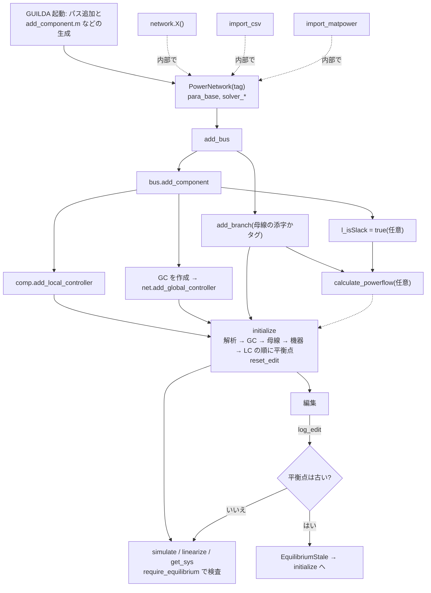

# モデル構築の現状調査: 既存クラスで系統モデルを組み立てる流れ

> 当時の調査記録です。調査の基準は `df3f709` で、以後の変更は本文に反映していません。現状は [status.md](status.md) と [v4-migration.md](v4-migration.md) を見てください。

利用者が既存クラスから `PowerNetwork` を作り、解析できる状態にするまでの現状調査です。改善案は後続の作業で作成するため、ここでは事実と問題の観察だけを記録します。新しい Component / Controller / Branch / ネットワーククラスの実装は、姉妹ノート `docs/model-building-extension` の範囲です。

## 読み方

- 調査対象: ブランチ `docs/model-building-workflow`(分岐元 `df3f709`)。ソースと HTML ドキュメントは変更していません。
- ラベル
  - **[事実]** コードを読んで確認したこと
  - **[実行]** MATLAB R2026a(26.1.0)で実行して確認したこと。付録の実験番号を添えます
  - **[推測]** 実行では確かめていない推論
  - **[未確認]** 調べていないこと
- 引用の起点: 先頭が `_GUILDAobject/`、`_GUILDAdoc/`、`@GUILDA/`、`+DebugScript/`、`.gitignore` のもの以外は `_GUILDAsystem/` からの相対パスです。
- `add_component.m` と `replace_component.m` は起動時に `.template` から生成されるので、引用は `.template` の行番号です。
- 実験スクリプトはコミットしていません。付録に使用したモデルと実測出力を載せます。

## 要点

1. **経路は4つですが、実体は1つです。** 組み込みネットワーク、CSV、MATPOWER はすべて内部で `add_bus` → `add_component` → `add_branch`(CSV は bus → branch → component)を呼びます。どの経路も最後は同じ `initialize` に合流します。
2. **`initialize` が成功しても平衡点とは限りません。** キルヒホッフ則の確認は `Method="equilibrium"` の経路にしかありません。スラック母線の第1機器が負荷の場合や、スラック母線の機器を外した場合は、残差があるまま stale が消え、`simulate` は `flag=1` で完走します **[実行 F11, S01]**。
3. **制御器は多くの編集で保存されません。** CSV へのエクスポートで AVR / PSS / GC が消え、`replace_component` は AVR を無言で落とします。制御器を外す公開メソッドはありません **[実行 C2, X02, S13]**。
4. **構築時のトポロジ検査はありません。** 孤立母線や島は、構築時には何も言われず、潮流計算で「収束しませんでした」とだけ出ます。バランスの取れた島は成功扱いで通ります **[実行 G01-G06, X04, X05]**。
5. **チュートリアルが現行 API と合っていません。** `Step2` と早見表の呼び出しは実行すると失敗します。CSV / MATPOWER の取り込みを説明するチュートリアルはありません **[実行 T_past, U01-U08]**。

## 1. 経路の一覧

| 経路 | 必要な入力 | 表現できること | 表現できないこと | 初期化 | チュートリアル |
|---|---|---|---|---|---|
| 組み込みネットワーク `network.IEEE9bus()` など | クラス名。`IEEE9bus`/`IEEE68bus` は `LocalController`、`Ishizaki6Bus` は `alpha`,`line` | 第2節の9クラス。付属データそのもの | タグ指定不可(`s_tag` は常に `"PowerNetwork"`、X12)。データの変更は構築後の編集で行う | コンストラクタが実行 | `Step1`(68bus、9bus は廃止名)、`Step3`/`Step4`/`Supplement_Tools`(Tutorial3bus) |
| CSV `PowerNetwork.import_csv(path)` | `bus/parameter.csv`(V, Varg)、`branch/parameter.csv`(Type, From, To)、任意で `component/<key>/main.csv`(Bus, P, Q)、`dynamics.csv`、`opf.csv`、`network/parameter.csv` | 全母線・ブランチ・機器のパラメータ、Hz、baseMVA、Slack、作図情報、`Network=` で既存ネットへの追加 | 制御器、OPF 関数(`set_opffcn`)、平衡点、発電機の固定 Q | `Initialize=true`(既定)で実行 | なし(`Step5` に `export_csv` の語が1回あるのみ) |
| MATPOWER `PowerNetwork.import_matpower(mpc)` | 構造体、ケース名、`.m`/`.mat`、関数ハンドル(`baseMVA, bus, gen, branch`、任意で `gencost`)。MATPOWER 本体は不要 | 潮流データ、運転制限、多項式コスト(2次まで)、停止中の設備の除外、全発電機共通のモデルとパラメータ | 発電機ごとのモデル・動特性、制御器、孤立母線(type 4)、区分線形コスト、3次以上のコスト、version 1 | `Initialize=true`(既定)で実行 | なし |
| 手動組み立て `PowerNetwork` + `add_*` | 母線・機器・ブランチの各パラメータ | すべて(制御器、GC、OPF 関数を含む) | なし | 利用者が `initialize` を呼ぶ | `Step1`(本体)、`Step2`(制御器、記述は旧 API) |

**[事実]** 「テーブルの取り込み」という経路はありません。`import_csv` の引数は文字列のフォルダーパスだけで、テーブルを渡すと引数検証で失敗します **[実行 C11]**。テーブルを受け取るのは `add_component` の `parameter` 引数だけです(`_GUILDAobject/+component/+generator/@abstract/abstract.m:41-42`)。

**[事実]** API の分類は `_GUILDAdoc/developer/api-design.html` の Per-feature API のとおりです。`import_csv` / `import_matpower` は静的メソッドで、戻り値は `net` だけです。`[result, flag, output]` にはなりません(`@PowerNetwork/import_csv.m:1`, `@PowerNetwork/import_matpower.m:1`)。

## 2. 組み込みネットワーク

**[実行 T_*]** 実測値です。`nx` は `get_sys` の状態数、`KCL` は `max|Y*V - I|` です。

| クラス | 母線 | ブランチ | 機器 | LC | 機器モデル | スラック | 所要時間 | nx | KCL |
|---|---:|---:|---:|---:|---|---:|---:|---:|---:|
| `IEEE9bus` | 9 | 9 | 6 | 3 | gen-1axis / load-impedance | 1 | 3.29 s(初回) | 24 | 6.4e-15 |
| `IEEE14bus` | 14 | 20 | 17 | 0 | gen-park / load-power | 1(自動) | 1.20 s | 30 | 5.7e-13 |
| `IEEE14bus_NoTap` | 14 | 20 | 17 | 0 | 同上 | 1(自動) | 0.80 s | 30 | 6.9e-13 |
| `IEEE14bus_lossless` | 14 | 20 | 17 | 0 | 同上 | 1(自動) | 0.61 s | 30 | 2.8e-13 |
| `IEEE68bus` | 68 | 83 | 51 | 16 | gen-1axis / load-impedance | 16 | 1.60 s | 128 | 1.6e-13 |
| `Ishizaki6Bus` | 6 | 5 | 6 | 0 | gen-classical / load-power | 1(自動) | 1.00 s | 4 | 4.0e-11 |
| `TEST31bus` | 31 | 34 | 39 | 0 | gen-park / load-power | 1(自動) | 0.75 s | 60 | 7.9e-11 |
| `Txt3Bus` | 3 | 2 | 3 | 0 | gen-1axis / load-impedance | 1(自動) | 0.24 s | 6 | 8.9e-13 |
| `Tutorial3bus` | 3 | 2 | 3 | 0 | gen-park / load-power | 1(自動) | 0.20 s | 12 | 1.2e-15 |

- `LC` は機器直下のローカル制御器の数です(PSS は AVR の下にあるので数えていません)。
- 「自動」は CSV に `Slack` 列がなく、`calculate_powerflow` が先頭母線を選んだものです。構築のたびに INFO が2行出ます。
- **[事実]** 共通の構造は `PowerNetwork.import_csv(フォルダー, Network=obj)` です(`_GUILDAobject/+network/@IEEE14bus/IEEE14bus.m:103`)。`IEEE9bus` と `IEEE68bus` は `Initialize=false` で読み、制御器を付けてから `initialize` します(`_GUILDAobject/+network/@IEEE9bus/IEEE9bus.m:94-98`)。`add_avr_pss` は2クラスで同じ内容です(`@IEEE9bus/IEEE9bus.m:104-122`, `@IEEE68bus/IEEE68bus.m` 同名関数)。
- **[事実]** `Tutorial3bus` だけは CSV を使わず `add_*` で組み立てます(`_GUILDAobject/+network/Tutorial3bus.m:27-53`)。
- **[実行 X13]** `Ishizaki6Bus` は構築のたびに追跡対象の `branch/parameter.csv` を書き換えます(`@Ishizaki6Bus/Ishizaki6Bus.m:66-67`)。既定の引数なら内容は変わりませんが、`Ishizaki6Bus(0.1, line="None")` で `git status` に変更が出ました(実験後に元へ戻しました)。

## 3. 各経路の流れ

### 3.1 全経路の共通部分



**[事実]** `@GUILDA/GUILDA.m:71-73` が起動時に `add_component.m`、`replace_component.m`、`add_branch.m` を生成します。このため起動前は、パスが通っていても `add_component` がありません **[実行 R00b]**。

### 3.2 手動組み立て

**[実行 M1]** 各段階の状態です。`flag` は `s_editFlag` です。

| 順 | 呼び出し | 変わる状態 | 実測 |
|---:|---|---|---|
| 1 | `net = PowerNetwork("F")` | `para_base`(Hz、baseMVA=100)、`solver_*` | `flag=unset, nLog=0` |
| 2 | `net.add_bus(V=1, Varg=0)` ×3 | `a_Bus` に追加、タグ `B001`… | 下行 |
| 3 | `net.add_branch("pi",[1,2],R=,X=)` ×2 | `a_Branch` に追加、端母線、タグ `EL001`… | 下行 |
| 4 | `bus.add_component("gen-park",P=)` など | `a_Component` に追加、`set_bus` で `f_*` 構築 | `flag=unset, nLog=0`、機器の `rv_Xequilibrium` は空、母線電圧は既定値 1 |
| 5 | `calculate_powerflow()`(任意) | スラックが無ければ先頭母線に設定。それ以外は結果を返すだけ | `flag=unset`、`slack: false→true`、機器の平衡点は空のまま |
| 6 | `initialize()` | 全階層の平衡点、`reset_edit` | `flag=initialized`、`PowerFlowResult`、`xeq=6`、KCL 2.9e-10 |
| 7 | `get_sys()` / `simulate([0,1])` | モデルは変えない(`f_*` の再構築と作業データを除く) | `ss`、`nx=12` / `flag=1` |

**順序の制約**

| 制約 | 守らない場合 | 根拠 |
|---|---|---|
| `add_bus` は `add_branch` / `add_component` より先 | `MATLAB:badsubscript`(`インデックスが配列範囲を超えています`) | A01, `@PowerNetwork/add_branch.m:39` |
| `add_branch` と `add_component` の順は自由 | — | M4 |
| スラック指定は機器の追加後 | `Error: Non-unit bus ' B001 ' cannot be assigned as the slack bus.`(ID なし) | F08, `@Bus/Bus.m:168-170` |
| PSS は AVR と同時か後 | `Error: You are attempting to connect a PSS even though there is no AVR.`(ID なし) | A11, `@Component/add_local_controller.m:65-71` |
| GC は対象機器の追加後に作る | `GlobalController.xml` が見つからないというエラー(第6節の問題 11) | A15 |
| `simulate` / `get_sys` は `initialize` の後 | `GUILDA:PowerNetwork:EquilibriumStale` | F01-F03 |
| イベントは最終トポロジの後に作る | 母線削除後に古いイベントで `simulate` すると `MATLAB:innerdim`(`odeEventSet.getInitialCondition:377`) | X16 |

**母線の種類の決まり方** **[事実]** `@Bus/get_pf_set.m:14-31`: スラックは `l_isSlack`、機器の Q の合計が NaN なら PV、それ以外は PQ です。母線に種類の指定はありません。発電機は常に PV 扱いで、指定した Q は捨てられます(第6節の問題 7)。

**制御器** **[実行 M2, M3]**
- ローカル: `gen.add_local_controller(controller.avr.AVR_ST1("a1"), controller.pss.PSS1("p1"))`。key で位置が決まり(`avr`/`local` は機器の下、`pss` は AVR の下)、1回呼ぶごとに `Topology` が記録されます。
- グローバル: `agc = controller.agc.broadcast_PI_AGC(net,"agc",g1,"SG1B002")` のあと `net.add_global_controller(agc)`。作成時には追加されず、`add_global_controller` で初めて stale になります。

### 3.3 CSV

**[事実]** `@PowerNetwork/import_csv.m` の順序です。

1. `network/parameter.csv` があれば Hz と baseMVA を上書き(`:59-69`)
2. `bus/parameter.csv` の行ごとに `add_bus`(`:78-92`)
3. `branch/parameter.csv` の行ごとに `add_branch`。`From`/`To` は行番号(`:102-117`)
4. `component/` の各フォルダーをキーとして `add_component`(`:129-199`)。順序は `dir` の順で、機種をまたいだ行の順は保存されません
5. `Slack` 列の最初の真の行にスラック設定(`:202-212`)
6. `Initialize=true` なら `net.initialize`(`:214-216`)

**[実行 C1]** 最小の手書きフォルダー(母線3行、ブランチ2行、`gen-park` と `load-power` の `main.csv`)で動きます。`dynamics.csv` と `opf.csv` は不要です。タグはフォルダー名になります(`tag=min`)。

**[実行 C2, C3]** `export_csv` の往復です。

| 項目 | 結果 |
|---|---|
| IEEE9bus の LC | 3 → **0**、`nx` 24 → **9** |
| GC | 1 → **0** |
| 改名した母線タグ `Bus2` | `B002` に戻る |
| 改名した母線タグ `BX` | 再読み込みが失敗(X07、第6節の問題 8) |
| `@MyNet` へのエクスポート | `MyNet.m` が生成され、`MyNet()` で構築可能 |

制御器が保存されないことは文書化されています(`@PowerNetwork/export_csv.m:11`)。ただし実行時の警告はありません。

### 3.4 MATPOWER

**[事実]** 変換規則は `@PowerNetwork/import_matpower.m:4-30` にあります。順序は母線 → 発電機 → 負荷 → スラック → ブランチ → `initialize` です(`:89-154`)。

**[実行]**
- P1: 手書きの3母線 `mpc` で構築でき、KCL 7.0e-10、`simulate` は `flag=1`、`tools.network_to_mpc` で戻せます。タグは構造体なら `PowerNetwork` です。
- P2: 母線の type は使いません。type 2 でも運転中の発電機がなければ PQ になります。**[事実]** 逆に type 1 の母線でも、運転中の発電機があれば Q=NaN で PV になります(`:17`, `:92`, `:107`)。
- P3: REF がなければ第1母線が INFO つきで選ばれます。
- P4: type 4 は `GUILDA:import_matpower:Unsupported` で停止します。
- P5: `BR_STATUS=0` で負荷母線が切り離されると、`InitializePowerflowFailed`(収束せず)になります。切り離しに関する案内は出ません。
- P7: `GeneratorModel="gen-classical", Initialize=false` は全発電機に適用されます。
- P8: 発電機と負荷がある母線では発電機が第1機器になります(`SG1B003, LPQ2B003`)。
- **[未確認]** 実際の MATPOWER ケースファイル: この環境に `case14` がなく、`GUILDA:import_matpower:CaseNotFound` になりました(P6)。IEEE14bus の説明と同じデータでの比較はしていません。

### 3.5 `initialize` と解析の要件

| 呼び出し | 要件 | 満たさない場合 |
|---|---|---|
| `calculate_powerflow` | 機器がある先頭母線かスラック | `ERROR: Failed to set BUS001...`(F05, F07, F09) |
| `initialize()` | 同上と収束 | `GUILDA:PowerNetwork:InitializePowerflowFailed`。編集ログは残ります(I03) |
| `initialize(Method="OPF")` | AC OPF の解 | KCL 0.165 のまま成功扱い(X10)。`notes/get-sys-workflow.md` の E11 と同じ |
| `initialize(Method="equilibrium")` | 既存の平衡点 | `GUILDA:PowerNetwork:InitializeNoEquilibrium`(I01)。編集後は P=0.6 のまま運転点 P=0.5 で stale を消します(X11) |
| `simulate` / `linearize` / `get_sys` | `initialized` かつ平衡点が古くない | `GUILDA:PowerNetwork:EquilibriumStale`(F01-F03) |
| `bus.get_sys` / `comp.get_sys` | 検査なし | 未初期化では `MATLAB:badsubscript` @`Jacobi_dx:22`(F04)。編集後は古い `f_*` で答える(S18) |

平衡点の配分規則は `notes/simulate-review-workflow.md` の第1章を参照してください。

## 4. 構築後の編集

### 4.1 パラメータの変更

**[実行 E_tab, E_tab2]** 3通りの書き方が動き、いずれも記録されます。

```matlab
net.a_Bus{2}.tab_parameter.powerflow.V = 1.03;   % 表の経由(set.tab_parameter)
gen.tab_parameter.dynamics.M = 7;
net.a_Branch{1}.tab_parameter.dynamics.R = 0.03;
gen.para_powerflow.P = 0.6;                      % Parameter を直接
```

- 表経由の書き込みは表の全列を代入しますが、値が同じ列は記録されません(`_auxiliary/@Parameter/callbackPostSet.m:16`)。ログは1行でした。
- 存在しない名前は `MATLAB:noPublicFieldForClass`(E_bad)です。
- 型が違う値は元に戻りますが、エラーではなく警告です(E_bad2, X06)。第6節の問題 13 を参照してください。

### 4.2 編集と stale の対応

**[実行 E_*]** `mk()` の初期化済みネットで1項目ずつ編集した結果です。`get_sys` の列はそのときの結果です。`_auxiliary/@LayerPackage/LayerPackage.m:130-159` の表と `_GUILDAdoc/developer/class-design.html#edits` に一致しました。

| 編集 | ログの tag | 平衡点 stale | `f_*` stale | `get_sys` |
|---|---|:---:|:---:|---|
| 母線 `Bshunt` / ブランチ `R` | `Parameter(dynamics)` | ○ | —(機器は対象外) | 停止 |
| 機器 `M` | `Parameter(dynamics)` | ○ | ○(その機器) | 停止 |
| AVR `kap` / GC `kP` | `Parameter(dynamics)` | ○ | 所有者のみ | 停止 |
| LQR の重み `R` | `Parameter(dynamics)` | ○ | — | 停止 |
| 母線 `V`, `V0` / 機器 `P` | `Parameter(powerflow)` | ○ | — | 停止 |
| `Vmax`, `Smax`, `Pmax` | `Parameter(operation)` | — | — | 動く |
| 機器 `HP` | `Parameter(OPF)` | — | — | 動く |
| `Xaxis`, `Marker` | `Parameter(graph)` | — | — | 動く |
| ネット `Hz` | `Parameter(base)` | — | ○(全階層) | 動く |
| ネット `baseMVA` | `Parameter(base)` | ○ | ○(全階層) | 停止 |
| スラック変更 | `Slack`(2行) | ○ | — | 停止 |
| `add_*`, `remove_*`, `replace_*` | `Topology` | ○ | — | 停止 |
| `reset_opffcn` | `OPF` | — | — | 動く |
| タグ変更 `bus.s_tag="BX"` | **記録なし** | — | — | 動く |
| `net.solver_PF.Tolerance` | 記録なし | — | — | 動く |

- **[実行 E_same]** 同じ値の代入は記録されません。
- **[実行 E_rev]** 値を元に戻しても stale は残ります(`nLog=2`)。
- **[実行 E_pre]** 最初の `initialize` の前の編集はログに残りません(`flag=unset, nLog=0`)。理由は `_auxiliary/@LayerPackage/log_edit.m:28`。
- **[事実]** `initialize` の失敗時は編集状態を保ちます(I03)。

### 4.3 構造の変更

| 対象 | 追加 | 削除 | 置換 | 指定方法 |
|---|---|---|---|---|
| 母線 | `net.add_bus` | `net.remove_bus(tags, RemoveBranches=)` | なし | タグ |
| ブランチ | `net.add_branch(type,[from,to])` | `net.remove_branch(tags)` | なし | 追加は添字かタグ、削除はタグ |
| 機器 | `bus.add_component` | `bus.remove_component(tag)` | `bus.replace_component(tag,type,para)` | タグ(その母線の中で) |
| ローカル制御器 | `comp.add_local_controller` | **公開メソッドなし**(S13) | 同じメソッドで置換(警告つき) | インスタンス |
| GC | `net.add_global_controller(obj)` | `net.remove_global_controller(tags)` | なし | タグ |

**[事実]** `replace_component` は powerflow / operation / graph / OPF の設定と番号を引き継ぎ、ヘッダーは新しいクラスのものになります(`@Bus/replace_component.template:31-49`)。**[実行 X02, X03]** `SG1B002→SG1B002`、`LPQ1B003→SG1B003`。負荷を発電機にすると Q は NaN になり、母線は PV に変わります。

### 4.4 タグと添字

| 項目 | 挙動 | 根拠 |
|---|---|---|
| 母線タグ | 接頭辞(既定 `B`)+ 使用中の最大番号 + 1。完全なタグは指定できない | `@PowerNetwork/add_bus.m:38` |
| ブランチタグ | `EL001` など(クラスのヘッダー)。指定不可 | `@PowerNetwork/add_branch.m:51,61` |
| 機器タグ | `<ヘッダー><番号><母線タグ>`。例 `SG1B001`, `LPQ1B003` | `@Bus/add_component.template:45-46` |
| 制御器タグ | ヘッダー + 指定タグ。例 `CAa1`, `CPp1`, `CLq` | M2, E_lqrQ |
| GC タグ | 指定どおり。例 `agc` | M3 |
| 削除後 | 番号は再利用されず、添字は詰まる。`B002` を消すと `a_Bus{2}` は `B003` | S16 |
| 改名 | `s_tag` への代入で可能。重複は `BX002` のように変更して Info を出す | S15, `_auxiliary/@LayerPackage/validate_tag.m:21-31` |
| 母線の改名の影響 | 機器タグは変わらない(`SG1B002` のまま)。次の機器は `SG1BX` | X08 |

**[実行 S16]** 添字は削除で意味が変わります。`remove_bus("B002")`、`add_bus` のあと `add_branch("pi",[2,3])` は `B003-B004` を結びました。

## 5. 検証と失敗

### 5.1 いつ何が検査されるか

| 時点 | 検査するもの | 根拠 |
|---|---|---|
| `add_bus` | 引数の型とサイズのみ。V が Vmax を超えても通る(X15) | `@PowerNetwork/add_bus.m:16-32` |
| `add_branch` | キー、端母線の存在、R/X/C が実数 | `@PowerNetwork/add_branch.m:17,39,44-45`, `@Branch/Branch.m:88-90` |
| `add_component` | キー、`parameter` の列 | `@Bus/add_component.template:17`, `_GUILDAobject/+component/+generator/@abstract/abstract.m:42` |
| `add_local_controller` | 型、PSS の親、`X`/`Y` の予約語 | `@Component/add_local_controller.m:31,65-71`, `@LocalController/LocalController.m:163-166` |
| `GlobalController` 作成 | 機器の存在。属するネットは見ない | `@GlobalController/GlobalController.m:97-104` |
| `l_isSlack=true` | 機器があること | `@Bus/Bus.m:168-170` |
| `remove_bus` | ブランチ接続と GC の対象 | `@PowerNetwork/remove_bus.m:24-53` |
| `calculate_powerflow` | 収束のみ。トポロジは見ない | `_auxiliary/@PowerFlowCalculation/solve.m:46-52` |
| `initialize` | 収束のみ。KCL は `equilibrium` のみ | `@PowerNetwork/initialize.m:64-67,170-176` |
| `simulate` / `get_sys` | 編集状態のみ | `@PowerNetwork/check_edit.m:17-31` |

### 5.2 よくある間違いの実際の挙動

| ケース | 発生時点 | 実際の出力 | 実験 |
|---|---|---|---|
| スラック未指定、第1母線に機器あり | `calculate_powerflow` | `INFO: Slack bus not found. Setting the first bus 'B001' as the slack bus.` のあと正常 | F06 |
| スラック未指定、第1母線に機器なし | 同上 | `ERROR: Failed to set BUS001 as the slack bus.`(ID なし)。他の母線に機器があっても失敗 | F07 |
| 機器が1つもない | 同上 | 同じ `BUS001` のエラー | F09 |
| 母線が1つもない | 同上 | 同じ `BUS001` のエラー | F05 |
| スラックの機器がない状態で指定 | 代入時 | `Error: Non-unit bus ' B001 '...` | F08 |
| 2つ目のスラック指定 | 代入時 | 前のものを解除(INFO のみ) | F10 |
| 負荷だけの母線をスラックに | なし | **無言**。KCL 0.104、`simulate` は `flag=1`、ドリフト 0.050 | F11 |
| スラックの機器を後で削除 | なし | **無言**。KCL 0.0044、`flag=1`、ドリフト 0.012 | S01 |
| スラックの母線を削除 | 次の `initialize` | スラック 0 個になり、先頭母線が自動選択 | S03 |
| 無負荷で孤立した母線 | `initialize` | `InitializePowerflowFailed`(収束せず) | G03 |
| 孤立した負荷 / 発電機 | `initialize` | 同上 | G04, G06 |
| 発電機のない島 | `initialize` | 同上 | G02 |
| ブランチなし | `initialize` | 同上(`解が見つかりませんでした`) | G05 |
| P の収支が合わない島 | `initialize` | 同上 | X04 |
| P の収支が合う島 | なし | **成功**。島は独立した角度で解かれ(`Varg4=0.0100`)、`flag=1` | G01, X05 |
| 端母線の添字が範囲外 | `add_branch` | `MATLAB:badsubscript` | A02 |
| 端母線のタグが不明 | `add_branch` | `Bus class 'X' not found.` | A03 |
| 自己ループ `[1,1]` | なし | 受理。`Y11` に足され `initialize` も成功 | A04 |
| `R=X=0` | 潮流計算 | `optimlib:commonMsgs:UsrObjUndefAtX0`(fsolve のエラー) | A05 |
| `P=NaN` | 潮流計算 | 同上 | I05 |
| 列が足りない `parameter` 表 | `add_component` | `MATLAB:table:UnrecognizedVarName`(`'D'`) | A07 |
| `parameter="NGT9"` | `add_component` | `MATLAB:table:UnequalVarLengths` | A08 |
| 負荷に AVR | なし | 受理(`nx=14`) | A10 |
| 同じ AVR を2機に | `get_sys` | `Control:combination:connect6`。追加時は無言 | A12 |
| 別ネットの GC | なし | 受理(`nx=13`)。対象は元のネットの機器 | A13 |
| GC の対象機器を削除 | `simulate` | `MATLAB:badsubscript` @`odeSimulator.initialize_index:386`。`initialize` は通る | S05 |
| 不明なタグの削除 | `remove_*` | ブランチだけ無言、他はエラー | S06-S09 |
| `net.a_Bus = {}` | 代入時 | スクリプト内では案内つきエラー、コマンド階層では `インデックスが配列要素数を超えています`(`set.a_Bus:250`) | S14, X-top |
| 収束しない潮流の `calculate_powerflow` | なし | 警告と `flag=0`、`l_success=false` | I04 |

### 5.3 CSV と MATPOWER の失敗

| ケース | 実際の出力 | 実験 |
|---|---|---|
| フォルダーなし | `GUILDA:import_csv:NotFound`(案内つき) | C6 |
| `bus/parameter.csv` なし | `MATLAB:textio:textio:FileNotFound` | C7 |
| `component/` なし | **無言**で機器 0 個。`Initialize=true` なら `BUS001` のエラー | X09 |
| `Slack` 列が機器のない母線 | `Error: Non-unit bus...`。構築の最後に発生 | C15 |
| 列名の誤り(`Bshnt`) | **無言**で無視。`Bshunt=0`、`initialize` も成功 | C4 |
| `To` / `Bus` の範囲外 | `MATLAB:badsubscript`(`import_csv:111`, `:197`) | C8, C9 |
| 不明な機器フォルダー | `MATLAB:validators:mustBeMember`(`'test-hessian-stub'` を含む一覧) | C10 |
| `main.csv` の発電機 Q | **無言**で NaN に上書き | C13 |
| `Network=` に既存ネット | 追加されるが島ができ `InitializePowerflowFailed`。**追加分は残る** [推測: 残留は失敗箇所から判断] | C12 |
| 旧 `CsvNetHandler.import` | 動く(`GUILDA:Deprecated:CsvNetHandlerImport`) | C16 |

## 6. 観察された問題と不整合

重要と判断した順です。

| # | 問題 | 種別 | 根拠 |
|---:|---|---|---|
| 1 | スラック母線の機器が負荷だと Q が配分されず、KCL 0.104 のまま `initialize` が成功し `simulate` は `flag=1` | 実行 F11 | `@Bus/set_equilibrium.m:28-34,37-40`, `@PowerNetwork/initialize.m:81-99` |
| 2 | スラック母線から機器を外せる。P 残差の行き先がなく、KCL 0.0044 で成功扱い | 実行 S01 | `@Bus/remove_component.m:17-20`, `@Bus/set_equilibrium.m:21-22`, `@Bus/Bus.m:168-170`(指定時のみ検査) |
| 3 | `replace_component` が AVR / PSS を警告なしで落とす(`LCold=1, LCnew=0`) | 実行 X02 | `@Bus/replace_component.template:56-71` |
| 4 | ローカル制御器を外す公開メソッドがない。`remove_local_controller` は非公開で Component にもない | 実行 S13 | `@LocalController/LocalController.m:135,142`, `@Component/Component.m:206-208` |
| 5 | `export_csv` で LC と GC が消える。警告はなく、`nx` が 24 から 9 に変わる | 実行 C2 | `@PowerNetwork/export_csv.m:11` |
| 6 | トポロジの検査がない。孤立・島・ブランチなしはすべて「収束せず」で、メッセージは潮流設定とソルバー設定の変更を勧める。収支の合う島は成功する | 実行 G01-G06, X04, X05 | `@PowerNetwork/initialize.m:64-67`, `_auxiliary/@PowerFlowCalculation/solve.m:20-30` |
| 7 | 発電機の `Q` 指定が無言で捨てられる(`Q=.3→NaN`)。CSV の Q 列も同じ。`Q` は必須列なのに効かない | 実行 X01, C13 | `_GUILDAobject/+component/+generator/@abstract/abstract.m:39`, `@Bus/add_component.template:20`, `@PowerNetwork/import_csv.m:121` |
| 8 | タグが往復しない。`Bus2→B002`、短いタグ `BX` は再読み込みが `MATLAB:error:invalidMessageType` で失敗 | 実行 C2, X07 | `@PowerNetwork/export_csv.m:102-103`, `@PowerNetwork/add_branch.m:45` |
| 9 | CSV の列名の誤りが無視される | 実行 C4 | `@PowerNetwork/import_csv.m:241` |
| 10 | CSV の行番号の範囲を検査しない。`Network=` 指定時に失敗すると途中まで追加された状態が残る | 実行 C8, C9, C12 / 残留は推測 | `@PowerNetwork/import_csv.m:111,197,91` |
| 11 | GC の対象が見つからないと、本来のメッセージではなく `GlobalController.xml` の読み込みエラーになる。発電機以外のオブジェクトを渡しても同じ | 実行 A15, X14 | `@GlobalController/GlobalController.m:97,103`, `_auxiliary/SystemTools/GUILDA/en/`(ファイルなし) |
| 12 | `add_global_controller` は別ネットの GC を受理する | 実行 A13 | `@PowerNetwork/add_global_controller.m:8-14`, `@GlobalController/GlobalController.m:92` |
| 13 | パラメータの型の誤りが警告に格下げされる。エラーはリスナーの中で起き、`MATLAB:callback:DynamicPropertyEventError` になる。値は戻る | 実行 X06 | `_auxiliary/@Parameter/callbackPostSet.m:13-15`, `_auxiliary/@Parameter/add_entry.m:24` |
| 14 | `BUS001` がメッセージに固定されている。原因が「母線がない」「機器がない」「第1母線だけ機器がない」のどれでも同じ文で、ID もない。`catch` が元の原因を捨てる | 実行 F05, F07, F09 | `@PowerNetwork/calculate_powerflow.m:40-46` |
| 15 | 削除の失敗の扱いが揃わない。ブランチは無言、機器は ID なしのエラー、母線と GC は ID ありのエラー | 実行 S06-S09 | `@PowerNetwork/remove_branch.m:4,9`, `@Bus/remove_component.m:14-16`, `@PowerNetwork/remove_bus.m:24-26` |
| 16 | `a_Bus` などの setter がコマンド階層で添字エラーになる。`stack(2)` が存在しない | 実行 X-top | `@PowerNetwork/PowerNetwork.m:249-252,256-259,263-266` |
| 17 | 添字が削除で変わるが、`add_branch` の数値指定は既定の書き方で、CSV の `From`/`To`/`Bus` も行番号。チュートリアルも添字を使う | 実行 S16 | `@PowerNetwork/add_branch.m:38-39`, `@PowerNetwork/import_csv.m:111` |
| 18 | 母線タグの変更が記録されず、機器タグにも伝わらない | 実行 E_tagBus, X08 | `_auxiliary/@LayerPackage/LayerPackage.m:167-170` |
| 19 | 自己ループ、負荷への AVR、同じインスタンスの共有が構築時に通る | 実行 A04, A10, A12 | `@PowerNetwork/add_branch.m:38-48`, `@Component/add_local_controller.m:38-43` |
| 20 | チュートリアルの呼び出しが動かない。`network.IEEE9bus_past`、`add_controller_global`、`add_local_controller("LQR",...)`、`add_global_controller("AGC",...)`、`power_network`、`net.information`、`set_component`、`class_dictionary` | 実行 T_past, U01-U08 | `_GUILDAtutorial/Step1_BuildNetwork.mlx`, `Step2_AddController.mlx`, `Supplement_CheetSheet.mlx`, `Supplement_Tools.mlx`, `ClassManual/Controller_*.mlx` |
| 21 | チュートリアルが組み込みネットを「68 と 9 の2つ」と説明するが、実際は9クラス | 事実 | `_GUILDAtutorial/Step1_BuildNetwork.mlx` 第1章 |
| 22 | 取り込みと編集のチュートリアルがない。`import_csv` / `import_matpower` / `remove_*` の語はどの `.mlx` にもなく、`replace_component` は `Step4` に1回だけ | 事実(全 `.mlx` を検索) | `_GUILDAtutorial/` |
| 23 | 起動前は `add_component.m` がなく、組み込みネットも作れない | 実行 R00b | `@GUILDA/GUILDA.m:71-73`, `.gitignore:40-41` |
| 24 | `add_branch.m` は `.gitignore` にあるのに追跡されている | 事実 | `.gitignore:42`, `@PowerNetwork/add_branch.m` |
| 25 | テスト専用の `test-hessian-stub` が機器キーの一覧に出る | 実行 R02, C10 | `+DebugScript/+helper/HessianStub.m`, `@GUILDA/private/update_class_signature.m:3` |
| 26 | `Ishizaki6Bus` の構築が追跡対象の CSV を書き換える | 実行 X13 | `_GUILDAobject/+network/@Ishizaki6Bus/Ishizaki6Bus.m:66-67` |
| 27 | クラスの宣言と実装の引数が違う(`add_bus(obj,s_Bus,opt)` と `add_bus(obj,opt)`) | 事実 | `@PowerNetwork/PowerNetwork.m:131-132`, `@PowerNetwork/add_bus.m:1`, `@PowerNetwork/add_branch.m:1` |
| 28 | 文書の「exactly one」スラックと実装の「at most one」が違う。削除の後はスラック 0 個の状態がありうる | 実行 S03 | `_GUILDAdoc/developer/class-design.html:166`, `@Bus/Bus.m:34` |
| 29 | `api-design.html` のルール 5(前提が満たされなければ修正方法を示すエラー)に合わないものが多い。A01, A02, A05, A07, A08, C8, C9, F04 は MATLAB や fsolve の生のエラーです | 実行 | `_GUILDAdoc/developer/api-design.html` Preconditions |
| 30 | 値を元に戻しても stale が残る | 実行 E_rev | `_auxiliary/@LayerPackage/log_edit.m:30`, `_auxiliary/@LayerPackage/reset_edit.m:6` |

**推測**
- 問題 1 の原因は、Q の配分先が Q=NaN の機器に限られるためです(`@Bus/set_equilibrium.m:37-40`)。F11 のドリフトは負荷の Q=0 と潮流解の Q の差から来ると考えますが、差を切り分ける実験はしていません。
- 負荷に AVR を付けても機器の入力と名前が一致しないので、機器に作用しないと考えます(A10)。応答は確認していません。
- 4桁番号の母線(`B1000`)は `@PowerNetwork/export_csv.m:103` の「末尾3文字を落とす」処理で接頭辞が `B1` になると考えます。実行していません。

## 7. UX 定義シートとの差

`GUILDA_主機能UX定義シート.xlsx`(リポジトリには含まれていません)をデータとして読みました。シートは「A_横断ルール」「B_機能別UX定義」の2枚が中心です。

- **モデル構築の行がありません。** `add_bus` / `add_branch` / `add_component` / 制御器 / 編集の定義はなく、関連は「平衡点設定/初期化」「CSVエクスポート」「CSVインポート」「アドミタンス行列取得」だけです。
- **決定欄は空です。** 記入例を除き、横断ルールの決定と機能別の決定はどちらも未記入です。現在の決定は `_GUILDAdoc/developer/api-design.html` にあります。

| シートの「現在」 | 実装 |
|---|---|
| `CsvNetHandler.import(path, net, options)` / `.export(...)`(net メソッド化されていない) | `PowerNetwork.import_csv` / `net.export_csv`。旧名は非推奨の互換層(C16) |
| `net.initialize("methods",...)` → `[flag, tab_PFsol, output]` | `initialize(Method=...)` → `[result, flag, output]`。`methods` は互換(`@PowerNetwork/initialize.m:44`) |
| `net.calculate_powerflow(mode,opt)` → `[tab_PFsol, flag, output]` | `PowerFlowResult` を返す。`Method` で指定 |
| 横断ルール 2「実行時 NV とプロパティ書き換えの混在」 | `api-design.html` のルール 2 で分離済み。ただし構築系は `add_*` の NV と `tab_parameter` / `para_*` の編集が併存 |
| 横断ルール 5「前提条件の失敗」 | 解析の入口は `EquilibriumStale` で統一。構築系は統一なし(問題 29) |
| シートに MATPOWER の行なし | `import_matpower` が実装済み |

## 付録: 実験

**環境** MATLAB 26.1.0.3203278(R2026a)、macOS、`-batch` で実行しました。`GUILDA` 起動後に `mk()` を使います。

```matlab
function net = mk(init, slack)   % init=true, slack=true が既定
    net = PowerNetwork("T3");
    net.add_bus(V=1.0,Varg=0); net.add_bus(V=1.0); net.add_bus();
    net.add_branch("pi",[1,2],R=0.01,X=0.085);
    net.add_branch("pi",[2,3],R=0.017,X=0.092);
    net.a_Bus{1}.add_component("gen-park",P=0);
    net.a_Bus{2}.add_component("gen-park",P=0.5);
    net.a_Bus{3}.add_component("load-power",P=-0.5,Q=0);
    if slack; net.a_Bus{1}.l_isSlack = true; end
    if init;  net.initialize(); end
end
```

`KCL` は `max(abs(Y*net.cv_Vequilibrium - net.cv_Iequilibrium))`、`ドリフト` はイベントなしの `simulate([0,1])` の最終値と初期値の差の最大値です。

| 実験 | 手順 | 実測出力 |
|---|---|---|
| R00b | 起動せずに `addpath(genpath(...))`、`add_component` | `メソッド 'add_component' はクラス 'Bus' で定義されていない...`、`add_component.m exists=false` |
| R02 | 生成された `add_component.m` のキー | `'test-hessian-stub','gen-classical','gen-droop','gen-1axis','gen-park','gen-2axis','load-impedance','load-power'` |
| T_past | `network.IEEE9bus_past` | `MATLAB:undefinedVarOrClass` |
| M1 | 第3.2節 | `empty: unset` / `built: unset, xeq=0` / `PF: slack true(before false)` / `init: initialized, xeq=6, kcl=2.8873e-10` / `ss nx=12` / `sim:1` |
| M2 | AVR+PSS | `nLog=2, EquilibriumStale`、`initialize` 後 `nx=17` |
| M3 | AGC | 作成時 `initialized, nLog=0`、追加後 `editted, nLog=1`、`nx=13`、`simflag=1` |
| M4 | 機器 → ブランチの順 | `initialized` |
| C1 | 手書き CSV | `kcl=2.8873e-10 simflag=1`、`Initialize=false` は `flag=unset` |
| C2 | 第3.3節 | `LC=3, nx=24 → LC=0, nx=9`、`GC 1->0`、`B001,Bus2,B003 -> B001,B002,B003` |
| C4 | `Bshnt`, `Xx`, `Pmaxx` 列 | `Bshunt=0, flag=initialized` |
| C12 | `import_csv(p, Network=mk())` | `InitializePowerflowFailed` |
| C13 | `main.csv` の `Q=[.1;.2]` | Q は NaN |
| C15 | `Slack` を機器なし母線に | `Error: Non-unit bus ' B003 '...` |
| P1 | 第3.4節 | `kcl=6.98e-10 simflag=1`、`back: bus=3 gen=2` |
| P5 | `BR_STATUS=0` で母線3を切り離し | `InitializePowerflowFailed` |
| F01-F03 | 未初期化で解析 | `The equilibrium of 'T3' is out of date: net.initialize() has not been run.` |
| F04 | 未初期化で `comp.get_sys` | `MATLAB:badsubscript` @`Jacobi_dx:22`(負荷は `Jacobi_I:23`) |
| F05, F07, F09 | 第5.2節 | `ERROR: Failed to set BUS001 as the slack bus.`(同文) |
| F11 | 母線3(負荷)をスラックに | `kcl=0.10378 pfP3=-0.49564 simflag=1 maxdrift=0.050168 paraP=-0.5` |
| F12 | スラックを解除して `initialize` | `slack=true`(B001 が再選択) |
| G01, X05 | 収支の合う島 | `flag=1 succ=true`、`kcl=5.08e-08`、`Varg4=0.010002 Varg5=-0.010004` |
| G02-G06, X04 | 第5.2節 | `InitializePowerflowFailed`(G05 のみ fsolve の文が「解が見つかりませんでした」) |
| A04 | `add_branch("pi",[1,1],X=.1)` | `tag=EL003 Y11=1.36519-21.6041i init ok` |
| A05, I05 | `R=X=0`、`P=NaN` | `optimlib:commonMsgs:UsrObjUndefAtX0` |
| A12 | AVR の共有 | `Control:combination:connect6` |
| A13 | 別ネットの GC | `accepted nx=13 unit same as n2 comp=false` |
| A15, X14 | 不明なタグ、負荷オブジェクト | `.../SystemTools/GUILDA/en/GlobalController.xml が見つからないか開けません` |
| I03 | `P=-100` で `initialize` | `InitializePowerflowFailed`、`flag=editted staleEq=true nLog=1` のまま |
| S01 | 第1機器を削除して `initialize` | `kcl=0.0043633 simflag=1 maxdrift=0.011947` |
| S03 | B001 を削除 | `slacks=0`、`initialize` で `B002`、次の母線は `B004` |
| S05 | GC の対象を削除 | `initialize` は成功、`simulate` は `MATLAB:badsubscript` @`initialize_index:386` |
| S13 | `gen.remove_local_controller()` | `MATLAB:noSuchMethodOrField`。`methods` の remove は該当なし |
| S14 / X-top | `net.a_Bus={}` | 関数内: `Use the method to add or remove Bus classes...`。`-batch` のトップレベル: `インデックスが配列要素数を超えています` @`set.a_Bus:250` |
| S16 | 第4.4節 | `B001,B003,B004`、`EL001:B003-B004` |
| S18 | 編集後の `comp.get_sys` | エラーなし、`A diff=0` |
| X01 | `add_component("gen-park",Q=.3)` | `Q=NaN type=PV` |
| X02 | AVR 付きを置換 | `LCold=1 LCnew=0 P=0.5 Q=NaN flag=editted` |
| X06 | `para_powerflow.V="x"` | `MATLAB:callback:DynamicPropertyEventError` の警告、`V=1, flag=initialized` |
| X07 | `BX` に改名して往復 | `MATLAB:error:invalidMessageType` @`add_branch:45` |
| X08 | 改名後に機器追加 | `SG1B002,SG2B002,SG1BX` |
| X09 | `component/` なし | `comps=0`、`Initialize=true` で `BUS001` のエラー |
| X10 | `initialize(Method="OPF",Verbose=false)` | `flag=1 kcl=0.16547 simflag=1 maxdrift=0.40598` |
| X11 | P 編集後に `Method="equilibrium"` | `flag=initialized P=0.6 Ppoint=0.5` |
| X12 | テンプレートのタグ | `PowerNetwork` |
| X13 | `Ishizaki6Bus(0.1,line="None")` | `bra=7`、`git status` に `M branch/parameter.csv` |
| X15 | `V=1.5`, `Vmax=1.1` | `V spec 1.5 > Vmax 1.1 accepted` |
| X16 | イベント作成後に母線を削除 | `MATLAB:innerdim` @`getInitialCondition:377` |
| U01-U08 | 旧 API の呼び出し | `power_network`, `add_controller_global`, `add_controller_local`, `information`, `set_component`, `class_dictionary` は未定義、`add_local_controller("LQR",...)` は `mustBeA`、`add_global_controller("AGC",...)` は `TooManyInputs` |

## 未確認

- 実際の MATPOWER ケースファイル(`case14` など)の取り込みと、`network.IEEE14bus` との数値比較
- `.mlx` の全セルの実行。旧 API の確認は、該当する呼び出しを個別に実行したものです
- GUI 経由の操作(`GUILDA.newclass`、`draw_diagram`)
- `+DebugScript` がリリースに含まれるか(問題 25 の影響範囲)。リリース用スクリプトに `DebugScript` の記述は見つかりませんでした
- `Method="OPF"` の残差の原因(`notes/get-sys-workflow.md`, `notes/simulate-review-workflow.md` の結論を引用し、再分析はしていません)
