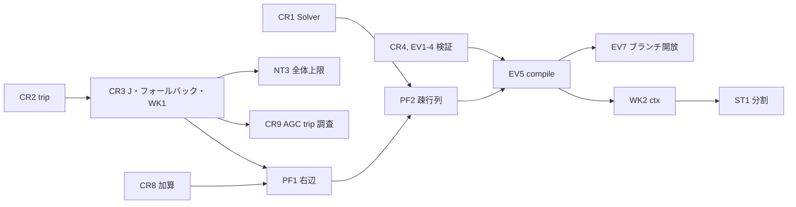

# `PowerNetwork.simulate` と周辺の改善案

調査ノート [simulate-review-workflow.md](simulate-review-workflow.md)(以下 **WF**)、[simulate-review-runtime.md](simulate-review-runtime.md)(**RT**)、[simulate-review-measurements.md](simulate-review-measurements.md)(**MS**)を基にした提案です。採否は利用者が決めます。コア実装は変更していません。

**根拠の区別**

- **[事実]** コードを読んで確認
- **[再現]** 現行コードのコピーで実行して確認
- **[試作]** コピーに試作を当てて実行(コミットなし、破棄済み)
- **[見積]** 判断による推定で、計測していない
- **[未確認]** 調べていない

**パスの略称**

| 略称 | パス |
|---|---|
| `SIM` | `_GUILDAsystem/_auxiliary/@odeSimulator/odeSimulator.m` |
| `EVT` | `_GUILDAsystem/_auxiliary/@odeEventSet/odeEventSet.m` |
| `CIC` | `_GUILDAsystem/_auxiliary/@odeSimulator/private/CalculateInitialCondition.m` |
| `MKO` | `_GUILDAsystem/_auxiliary/@odeSimulator/private/makeODE.m` |
| `GTS` | `_GUILDAsystem/_auxiliary/@odeEventSet/private/getTimeSpan.m` |
| `RES` | `_GUILDAsystem/_auxiliary/@odeSimulationResult/odeSimulationResult.m` |
| `SIMF` | `_GUILDAsystem/@PowerNetwork/simulate.m` |
| `CGD` / `LGD` | `_GUILDAsystem/@Component/get_dx_algebraic.m` / `_GUILDAsystem/@LocalController/get_dx_algebraic.m` |
| `F6` | `+DebugScript/test_F6_simulation.m` |

## 1. 結論

**推奨する方向: API の形は変えず、まず「黙って間違う経路」を止め、その後で右辺と疎行列の順に高速化します。** 通常の故障計算と編集検知は正しく動きます。問題は、誤った指定や特定の経路で、成功を示す `flag=1` のまま誤った結果が返ることです。大半は数行の修正で止められ、試作した正しさ系の修正を全部当てても既存テストは 1 件も壊れませんでした。

**今回の検討で新たに分かった重要な点**

1. **解列時のヤコビアンの誤りが、フォールバック経路に入る原因でした。** RT は影響を「収束の悪化」と推定していましたが、もっと重大です。IEEE14 の発電機解列で、誤差 6.67 が 2.8e-8 になり、`NeedBetterY0` 自体が起きなくなります。現行は `Tolerance=1e-8` の同じ計算で復帰時の `delta` が -0.2276 から -0.1330 に動き、終端で 0.828 ずれていました。修正後は差が 3.4e-5 です。**[再現][試作]**(CR3)
2. **`simulate` の入力イベントは線形化と矛盾しています。** `comp.get_sys` の説明は AVR 配下の `Vfield` 入力を「加算」とします(`_GUILDAsystem/@Component/get_sys.m:15-16`)が、`simulate` は上書きします。加算に直すと線形モデルとの相対誤差が 1.0 から 0.0037 になります。**[試作]**(CR8)
3. **疎行列は IEEE68 で約 2 倍速くなりますが、大きな系統では MATLAB の DAE 検査が誤検知します。** Ring136 と Ring272 で「DAE 指数 > 1」になりました。真の条件数 283 に対し、疎行列の `condest` は 1.18e14 を返します。密行列での再試行が必要です。**[試作]**(PF2)
4. **MS L1「`odeResults` は読むたびに作り直される」は誤りです。** 2 回目以降は約 0.05 ms で、キャッシュされています。**[再現]**

**最初に行う 5 件**

| 順 | ID | 内容 | 根拠となる結果 |
|---|---|---|---|
| 1 | CR1, CR2 | `Solver` の修正と、制御器付き trip の修正 | `Solver="ode23t"` で 193 → 363 点に変わり記録も一致。trip は 6 通りとも例外 → `flag=1`、平衡点の差 0 |
| 2 | CR3 | 解列時のヤコビアン修正と、フォールバックを同じ `ode` オブジェクトで解く変更 | J 誤差 6.67 → 2.8e-8、`MaxStep=1e-3` が 0.012 → 0.00102 で有効に |
| 3 | CR4, CR5 | イベントと `time` の検証 | 誤指定 10 通り以上が無外乱の `flag=1` や MATLAB 内部エラー → 原因を示すエラー |
| 4 | EQ1-EQ3(`notes/get-sys-improvements.md`) | `initialize` が平衡点を作らない問題 | 現行は KCL 残差 0.392 のまま `simulate` が `flag=1`、状態変動 14.8(IEEE9 OPF) |
| 5 | NT1, PF1 | 部分解の警告と、右辺の前計算 | `flag=0` が無通知 → 警告。IEEE14 は 1.25 → 0.79 s、IEEE68 は 4.55 → 3.30 s、結果は `isequaln` で完全一致 |

## 2. 調査ノートの再確認と統合

### 2.1 修正が必要な指摘

| 元の指摘 | 再確認の結果 | 根拠 |
|---|---|---|
| RT §3.6, M5「ヤコビアン不一致は収束が悪化するだけ」と推定、重要度 中 | **高に上げます。** 解列機器の V 行の誤差 6.67 が `NeedBetterY0` を起こし、下記の誤経路に入ります | `SIM:618-619`, `CGD:34` **[試作]** |
| RT H2「解列の開始区間はフォールバックに入る」 | ヤコビアンの誤りの結果であり、固有の性質ではありません。修正するとこの経路に入りません | 計装付きの比較 **[試作]** |
| RT §3.6, MS M2「大域制御器のマスク `u_connect` のヤコビアン不一致が AGC 解列停止の候補」 | **候補から外します。** 解列機器の x, u は `lg` で列ごと除かれるので、このマスクの不一致は結果に効きません。解列機器の修正後も `flag=-1`(t=1.904)のままです | `SIM:449,514,633` **[事実][試作]** |
| MS M2 の停止 | 数値的な性質が強いと考えます。現行は `Tolerance=1e-6` で完走、修正版は同条件で t=1.904 で停止し、許容誤差で結果が逆転します。**原因は未特定**です | **[再現][試作]** |
| MS L1「`odeResults` は読むたびに作り直す」 | **誤りです。** 初回 105-124 ms、2 回目以降 0.03-0.06 ms | `RES:127-132` **[再現]** |
| WF H3「結果の誤りは推測」 | 実害を確認しました。古い添字で fault を計算すると t=0.076 で `flag=-1` になり、正しい AGC 構成は `flag=1` で完走します。条件により WF の報告どおり完走もします | `SIM:386-387` **[再現]** |
| WF H2 | 再現しました。P 編集後の `"equilibrium"` は KCL 0.392、OPF は 0.392 で、どちらも `simulate` が `flag=1`(状態変動 3.26、14.8) | **[再現]** |
| RT §8.4, MS §2「結果構築の表の往復が 9-10%」 | 表の往復とシャントの読み方を直しても**全体では差が見えません**(IEEE68: 4.55 → 4.69 s、誤差内)。プロファイラが比率を大きく見せていました | §5 **[試作]** |
| RT M12「`decic` 失敗を警告のみで無視」 | そのとおりです。さらに、**例外なしに微分状態が動く経路**も実在します(上記の `delta`)。原因は緩和した `decic` と推定しますが、断定はできません | `CIC:16-23` **[再現]** |

### 2.2 問題 ID の対応表

3 本のノートの ID はそれぞれ独立しています。

| 問題 | WF | RT | MS | 本案 |
|---|---|---|---|---|
| `Solver` が効かない | — | H1 | H1, L4 | CR1 |
| 制御器付き trip の例外 | H1 | — | H2 | CR2(=EQ6) |
| 解列のヤコビアン、フォールバック | — | H2, M5, M12 | M5 | CR3 |
| イベントの誤指定を無視 | — | H3 | H3, L5 | CR4 |
| `time` の検証 | — | M2 | H4, M4 | CR5 |
| `initialize` が平衡点を作らない | H2, M5 | — | — | CR6(=EQ1-3) |
| GC の古い参照 | H3 | — | — | CR7(=ED3) |
| LC が入力を上書き | — | H4 | — | CR8 |
| AGC 対象の trip で停止 | — | — | M2 | CR9 |
| TimeLimit の通知と既定値 | — | H5 | H5 | NT1, NT2 |
| TimeLimit が区間ごと | — | §5.3 | §4 | NT3 |
| 古いイベント、他網のイベント | M2 | M3 | M3 | EV1, EV2 |
| タグ重複 | L1 | M4 | L3 | EV3 |
| スカラー `TimeSpan` | — | M1 | M1 | EV4 |
| ブランチ開放 | — | M14 | — | EV7 |
| 一時データの残留 | L4-L7 | M6 | §4 | WK1, WK2, WK3 |
| 例外で部分結果を失う | — | M7 | — | RS3 |
| `Export` の検査と内容 | — | M8, M9 | — | RS1, RS2 |
| 結果と編集の整合 | §4.2 | — | — | RS5(=ED5) |
| 密行列 | — | M10 | — | PF2 |
| 右辺の `ismember` など | — | M11 | — | PF1 |
| 未テスト領域 | — | L9, §6.3 | — | TS1 |
| 未使用コード、構造 | L5 | L4, L7, L8 | — | ST1, ST2 |
| 時変モデルの `t`、復帰の発電機限定、解列中の LC | — | L1, L2, L3 | — | ST3 |
| 表示と JSON の細部 | — | L5, L6, §5.3 | — | ST4 |
| 大域制御器の入力の説明 | — | M13 | — | ST4 |
| `operation.baseMVA` の編集 | M1 | — | — | 対象外: EQ5 |
| 同じ LC の複数接続、LC の引き継ぎ、`tab_parameter` | M3, M8, M9 | — | L2 | 対象外: 下記 |
| `net.rv_Xequilibrium` | M4 | — | — | 対象外: DF1 |
| 下位 `get_sys`、CPF の検査 | M7 | — | — | 対象外: ED1(CPF は未提案) |

**対象外の扱い:** WF M3, M8, M9、MS L2、WF M6(AVR の範囲エラーの文言)はモデル構築の問題で、`simulate` の修正とは独立です。別途、モデル構築の課題として扱ってください。CPF の編集検査は `notes/get-sys-improvements.md` にもありません。

### 2.3 `notes/get-sys-improvements.md` との関係

| ID | 関係 |
|---|---|
| EQ1-EQ3 | そのまま採用します。CR6 として優先順位だけ示します |
| EQ6 | CR2 と同じ案です。今回は IEEE14 の AVR、AVR+PSS、LQR でも確認し、案 A を支持します |
| ED3, ED5 | CR7, RS5 と同じです。CR7 は `simulate` 側の検査を追加します(多重防御) |
| DF2 | **更新します。** 「急がない」としていましたが、WK1 は試作で影響がなく、工数も小さいので CR3 と同時に行えます |
| PF1, PF3 | `simulate` の結果構築にも効きますが、今回の測定では全体に対して誤差内です(PF3) |
| **PF4 と矛盾** | PF4 は「疎行列は保留」です。これは `linearize` の話で、`dss` の制約と 2% の利得が理由です。**`simulate` では LU が支配的なので IEEE68 で 2 倍になり、結論が異なります。** 矛盾ではなく、適用先が別です |
| AR3 | `time` とイベントの部分は CR4, CR5, EV1 に統合します |

## 3. UX 定義シートとの対応

`GUILDA_主機能UX定義シート.xlsx` を読み取り専用で確認しました。`時間応答シミュレーション` 行の決定欄は空欄で、現在の戻り値も `odeResult` のままで古くなっています。横断ルールの決定欄も空です。

- **ルール 5(前提条件):** 「明示エラー」に沿って CR4, CR5 を提案します。
- **ルール 6(副作用):** `api-design.html:190,247` は `simulate` を「値を変えない」とします。WK1, WK2 で実体に近づけます。
- **ルール 7(共通オプション):** `Plot`, `Verbose`, `Progress` は既に揃っています。

記入案は §8 の Q12 にあります。シートは変更していません。

## 4. 提案一覧

**工数**は [見積] です(S: 半日以内、M: 1〜2 日、L: 3 日以上)。**破壊**は破壊的変更の有無です。

### 4.1 正しさ

| ID | 内容 | 根拠 | 効果 | 工数 | 破壊 | リスク | 依存 |
|---|---|---|---|---|---|---|---|
| CR1 | `Solver` を実際に効かせる。不一致はエラー、DAE に使えない値もエラー | `MKO:12-16`, `SIM:28,32,124` | 指定と記録が実際の動作と一致 | S | 小: 下記 | 保存値の組合せがエラーになる | なし |
| CR2 | trip 復帰時の LC 状態を保持済みの平衡点から取る | `SIM:661,669` | 同梱の IEEE9 既定構成で trip が動く | S | なし | 再接続時の過渡の妥当性は未評価 | なし |
| CR3 | 解列機器の電流項をヤコビアンから除く。フォールバックを同じ `ode` で解く。`decic` の失敗と緩和を通知 | `SIM:254,265,618-619`, `CIC:16-27` | 無視されていた全設定が有効。誤った状態の移動が消える | S | 数値が小さく変わる | 解列の結果が丸め以上に変わる(差 3.7e-7) | なし |
| CR4 | `FaultBus`, `TripUnit`, `OffsetUnit`, `OffsetState`, 個数, `TimeSpan` を検証 | `EVT:435-464,187,248,271,354` | 打ち間違いが無外乱の成功にならない | S | 小: LC タグの `TripUnit` がエラー | 既存スクリプトの誤指定が表面化(望ましい) | EV4 の判断 |
| CR5 | `time` を `[t0,tend]`(有限、昇順)か `[]` に限定 | `SIMF:42`, `GTS:13`, `EVT:165` | 黙って短くなる計算と内部エラーが消える | S | 小 | `[0,Inf]` が不可に | なし |
| CR6 | EQ1-EQ3 を実施 | `_GUILDAsystem/@Bus/set_equilibrium.m:24-34,59-64` | 平衡でない点での計算を防ぐ | M | 数値が変わる(正しくなる) | `notes/get-sys-improvements.md` 参照 | Q2(同ノート) |
| CR7 | ED3 に加え、`initialize_index` で制御対象の所属を確認 | `SIM:385-388`, `_GUILDAsystem/@Bus/remove_component.m` | 古い添字での計算を防ぐ | S | 小: エラーになる | 低 | なし |
| CR8 | LC 配下の入力を上書きから加算へ | `CGD:30`, `_GUILDAsystem/@Component/get_sys.m:15-16`, `SIM:517-518` | `simulate` と線形化が一致 | S | 数値が変わる(外部入力がある場合のみ) | 上書きに依存するスクリプト(効かない入力なので少ないと想定) | Q3 |
| CR9 | AGC 対象の trip の停止原因を調査 | MS M2 | 未特定の不具合の切り分け | M | なし | 物理的に正しい停止の可能性も残る | CR3 |

### 4.2 実行時の通知

| ID | 内容 | 根拠 | 効果 | 工数 | 破壊 | リスク | 依存 |
|---|---|---|---|---|---|---|---|
| NT1 | `flag≠1` かつ `nargout<2` で警告 | `SIM:315-317`, `SIMF:58` | `sol = net.simulate(...)` で気づける | S | なし | 警告が増える | Q4 |
| NT2 | 既定の `TimeLimit` を 10 → `Inf` | `@GUILDA/config/DefaultTimeSimulation.json:32`, `SIM:53` | 結果がマシンの負荷に依存しない | S | 小: 既定の停止が消える | 暴走時は Ctrl+C のみ | Q5, CR5 |
| NT3 | `TimeLimit` を実行全体の上限に | `_GUILDAsystem/_auxiliary/@odeProgress/odeProgress.m:137`, `notes/status.md:200-203` | 名前どおりの意味になる | S | 小: 停止が早まる | フォールバックも含めて管理が必要(CR3 が前提) | Q6, CR3 |
| NT4 | `flag` は 1/0/-1 を維持し、`output.reason` を追加 | `SIM:300-314` | 機械で判定可能 | S | なし(追加) | なし | なし |

### 4.3 イベント設計

| ID | 内容 | 根拠 | 効果 | 工数 | 破壊 | リスク | 依存 |
|---|---|---|---|---|---|---|---|
| EV1 | タグと状態数の表を実行時に作る | `EVT:102-122` | スナップショットの問題が消える | S | なし | 低 | なし |
| EV2 | `odeNetwork` と `net` の一致を検査 | `SIM:178`, `EVT:222` | 他網のイベントを防ぐ | S | 小: 動いていた偶然の例がエラー | 低 | なし |
| EV3 | タグ重複と予約名の明示エラー。後に内部名へ分離 | `EVT:178-179,207` | 原因が分かる | S | なし | 低 | なし |
| EV4 | スカラー `TimeSpan` の扱い | `EVT:29-31,189` | 無関係なイベントで継続時間が変わる問題を解消 | S | 小 | `F6` に該当なし、外部は不明 | Q7 |
| EV5 | 区間の情報を `compile` で作る内部表現に統一 | `EVT:210-386` | `setEventCondition` 等の散在を解消。WK2 の土台 | M | なし | 中: 内部の広範な書き換え | WK1 |
| EV6 | イベント型の抽象化 | RT §6.2 | 拡張が容易に | L | 大 | 共同開発者への影響 | **推奨せず** |
| EV7 | ブランチ開放(`OpenBranch`)と区間別 Y | `SIM:184` | 回線事故を模擬できる | M | なし(追加) | 投入時の過渡の妥当性は未評価 | EV5 が望ましい |

### 4.4 一時データ

| ID | 内容 | 根拠 | 効果 | 工数 | 破壊 | リスク | 依存 |
|---|---|---|---|---|---|---|---|
| WK1 | `onCleanup` で `l_isConnect`, `l_isFault`, `rv_*offset` を戻す | `SIM:180` | 実行後と例外後にモデルが元に戻る | S | なし | 低 | なし |
| WK2 | 上記と `iv_ode*` を `ctx` へ移す | `SIM:340-409`, `CGD`, `LGD` | 原則「解析はモデルを変更しない」に一致 | L | 中: `get_dx_algebraic` の引数 | 共同開発者が読む場合 | PF1, EV5, Q8 |
| WK3 | `rv_*offset` のアクセス制限、未使用の LC `l_isConnect` などの削除 | `_GUILDAsystem/@Component/Component.m:121-124` | 文書の表と一致 | S | 小 | 低 | WK1 |

### 4.5 引数と結果

| ID | 内容 | 根拠 | 効果 | 工数 | 破壊 | リスク | 依存 |
|---|---|---|---|---|---|---|---|
| RS1 | `Export` の拡張子を計算前に検査 | `SIMF:63-67` | 計算後に結果を失わない | S | なし | 低 | なし |
| RS2 | `Export` に全変数(`rm_variable`)を含める | `_GUILDAsystem/_auxiliary/@odeSimulationResult/Export.m:35-49` | 説明の「全軌道」と一致 | S | 小: 列が増える | 列位置に頼るコード | Q9 |
| RS3 | 区間内の例外で部分結果を返す | `SIM:256-259` | 完了済みの計算を失わない | M | 小: 例外 → `flag=-1` | 例外前提のコード | Q10 |
| RS4 | `get_options` の二重処理、`take_call_options` の 3 重複の整理 | `SIM:124-137`, `SIMF:92-116` | 保守性 | S | なし | 低 | なし |
| RS5 | 結果に編集の刻印(ED5) | `notes/status.md:208-210` | 結果が古いことを判別できる | M | なし(追加) | 低 | なし |

`odeResults` は既にキャッシュされているので**再構築の対策は不要**です(§2.1)。初回の 0.1 s と `rm_variable` との二重のメモリは、今は対応しません。文書の例も変更不要です。

### 4.6 性能

| ID | 内容 | 根拠 | 効果 | 工数 | 破壊 | リスク | 依存 |
|---|---|---|---|---|---|---|---|
| PF1 | 右辺の前計算 | `SIM:425-482`, `CGD:29`, `LGD:27`, `EVT:282` | IEEE14 で 37%、IEEE68 で 27%、Ring で約 10-20% 減。結果は完全一致 | M | なし | 低: `isequaln` で確認可能 | なし |
| PF2 | 疎行列と密行列での再試行 | `SIM:184,186,495,633`, `EVT:358-362,382` | IEEE68 で 53% 減 | S | 数値が許容誤差内で変わる | `F6:543-550` の固定値の更新が必要。MATLAB の誤検知 | CR3, Q11 |
| PF3 | 結果構築の表の往復と Y のシャント | `EVT:425-429`, `RES:118-120` | **全体では誤差内** | S | なし | 低 | 優先度低 |
| PF4 | 出力の間引き(`Refine` など) | `SIM:248,280` | メモリ | M | なし(追加) | 精度の定義 | **保留** |

### 4.7 テスト

| ID | 内容 | 根拠 | 工数 | 依存 |
|---|---|---|---|---|
| TS1 | §5.8 の未テスト領域を、各修正と同じコミットで追加 | RT §6.3 | 各案に含む | 各案 |
| TS2 | ヤコビアンの差分検査を F6 に常設(解列、地絡、AGC) | §5.2 の検査が有効だったため | S | CR3 |
| TS3 | 正規デモ `+DebugScript/Task_simulation.m`(UX シートの手順 C) | UX シート | S | CR1-CR5 |

### 4.8 構造

| ID | 内容 | 根拠 | 工数 | 破壊 | リスク | 依存 |
|---|---|---|---|---|---|---|
| ST1 | `odeSimulator` の分割: 区間ループ、DAE(右辺とヤコビアン)、引き継ぎの 3 つへ。`private/` の関数へ移す形を推奨 | `SIM` が 752 行に複数の責務 | M | なし | 履歴が追いにくくなる | CR, PF の後 |
| ST2 | 未使用の削除: `checkSimulationTime.m`, `mustBeVector.m`, `getSubJacobian`, `odeIteration`, `Bus.iv_odeU`, `Component.iv_odeY`, `RM` 引数 | RT §7 末尾 | S | なし | 低 | 並行作業のない時期 |
| ST3 | モデルの `t` を実時刻に(`InitialTime=t1`)、解列の復帰を全機器に | RT L1, L2, L3 | M | 小 | 入力関数の時刻の換算 | EV5 |
| ST4 | 文書の修正: `class-design.html:221`、`SIM:146-147`、GC の入力の説明、JSON の説明、`t0≠0` の待機バーなど | RT §7, L5, L6 | S | なし | なし | 各段階 |

## 5. 主な提案の詳細と試作の結果

### 5.1 CR1: `Solver`

**原因 [事実]:** `makeODE` は `Solver` の次に既定の `SolverOptions`(`ODE15s`)を設定し、`ode` が `Solver` を `ode15s` に戻します。

| 案 | 内容 | 利点 | 欠点 | 失敗する条件 |
|---|---|---|---|---|
| **A(推奨)** | `get_options` で照合。手つかずの既定は `Solver` に追従し、それ以外の不一致はエラー | 説明「Its class must match Solver」どおり。`net.solver_ODE.SolverOptions.MaxStep = x` が動き続ける | 既定値との比較という特別な規則 | `SolverOptions=ODE15s()` を保存した状態で `Solver` を変える(既定扱いで追従する。無害) |
| B | `SolverOptions` の既定を `[]` に | 意味が明快 | 上記の代入が壊れる | 共同開発者の設定コード |
| C | `Solver` を廃止し `SolverOptions` のみ | 単純 | 決定済みの共通名 `Solver` に反する | — |

```matlab
% SIM: get_options の末尾
s_options.SolverOptions = match_solver_options(s_options.Solver, s_options.SolverOptions, ...
                              any(strcmpi(string(nv(1:2:end)), "SolverOptions")));

function opts = match_solver_options(solver, opts, l_given)
    str = string(solver);
    if ~ismember(str, ["ode15s","ode23t"])
        error("GUILDA:odeSimulator:SolverNotDAE", ...);
    end
    if lower(extractAfter(string(class(opts)), "options.")) == str, return, end
    if ~l_given && isequal(opts, matlab.ode.options.ODE15s)
        opts = matlab.ode.options.ODE23t;
    else
        error("GUILDA:odeSimulator:SolverOptionsMismatch", ...);
    end
end
```

**試作の結果 [試作]**(IEEE9、fault B007、`[0,3]`)

| 指定 | 現行 | 試作 |
|---|---|---|
| `Solver="ode23t"` | 193 点、既定と完全一致、記録は ode23t | **363 点**、記録 ode23t |
| 保存 `net.solver_ODE.Solver="ode23t"` | 193 点 | **363 点** |
| `SolverOptions=ODE23t` のみ | ode23t で動き、記録は ode15s | `SolverOptionsMismatch` |
| `Solver="ode23t"` + 調整済み `ODE15s` | 3035 点、記録は ode23t(実際は ode15s) | `SolverOptionsMismatch` |
| `Solver="ode45"` | ode15s で動き、記録は ode45 | `SolverNotDAE` |
| `Solver="auto"` | `MATLAB:ode:SolverOptionsCannotBeModified` | `SolverNotDAE` |
| `Solver="ode23t"` + `ODE23t(MaxStep=0.01)` | 488 点 | 488 点、同じ |

**注意:** `Solver="ode23t"` の結果は変わります(終端の誤差は既定で 4.7e-4 と、ode15s の 4.6e-5 より大きくなります)。`SolverOptions=ODE23t` のみの呼び方は動かなくなるので、移行ガイドに載せます。

### 5.2 CR2, CR3: trip とフォールバック

**CR2 の差分:** 2 行です。`get_equilibrium` は平衡点を書き換えるので呼びません(`get-sys-improvements.md` の EQ6 案 A)。

```matlab
x0(v_LC1) = a_LC1.rv_Xequilibrium;   % SIM:661
x0(v_LC2) = a_LC2.rv_Xequilibrium;   % SIM:669
```

**結果 [試作]**(trip SG1B003、`[1,1.2]`)

| 系統 | 現行 | 試作 | 平衡点の差 | 次のイベントなし実行の変動 |
|---|---|---|---|---|
| IEEE9 既定 `[0,2]`, `[0,10]` | `TooManyOutputs` | `flag=1` | 0 | 1.3e-14 |
| IEEE9 最後まで trip | `TooManyOutputs` | `flag=1` | 0 | 1.3e-14 |
| IEEE14 AVR+PSS / AVR / LQR | `TooManyOutputs` | `flag=1` | 0 | 7e-12 |
| IEEE14 制御器なし | `flag=1` | `flag=1` | 0 | 7e-12 |

**未評価:** 再接続後の応答が物理的に妥当かは評価していません。復帰時に発電機は「電流 0 の平衡状態」、LC は「元の平衡点」から再開するので、再同期の過渡は人工的です。試作の範囲は「動き、モデルを壊さない」までです。

**CR3 の差分**

```matlab
% SIM:618 解列機器は電流を流さない(右辺 CGD:34 と揃える)
l_c = double(cj.l_isConnect);
odeJac(rv,rh) = odeJac(rv,rh) + [ Axx, Bxu, Bxv, Bxi; -l_c*Cix, -l_c*Diu, -l_c*Div, -l_c*Dii];

% SIM:254-265 同じ ode オブジェクトで解き直す
[x0r, xp0, l_failed, l_relaxed, str_why] = CalculateInitialCondition(o, options);
o.InitialValue = x0r;  o.InitialSlope = xp0;
sol = solve(o, 0, t2-t1);
o.InitialSlope = zeros(0,1);
```

`InitialSlope` は `ode` のプロパティです。`SolverOptions` にはありません。**[試作]**

**結果(IEEE14、制御器なし、trip SG1B003 `[1,1.2]`)**

| 項目 | 現行 | ヤコビアン修正のみの比較用 | 修正後(CR3 全体) |
|---|---|---|---|
| 解列区間のヤコビアン最大誤差 | **6.67** | 6.67 | **2.8e-8** |
| `NeedBetterY0` | 発生 | 発生(同じ `ode` の経路で完走) | **発生しない** |
| `MaxStep=1e-3` の解列区間の最大刻み | 0.012 | 0.0010 | 0.00102 |
| `Tolerance=1e-8` と既定の終端の差 | **0.828** | — | 3.4e-5 |
| `Tolerance=1e-8` の復帰時 `delta` | **-0.133**(既定は -0.2276) | — | -0.2276 |
| 既定設定の終端の現行との差 | — | — | 3.7e-7 |
| `TimeLimit=1e-3` | — | `flag=0`, t=0.2 | `flag=0`, t=0.1 |

表の「比較用」は CR3 のうちヤコビアンの修正だけを外したもので、同じ `ode` で解く経路が機能することの確認です(`MaxStep` が効き、`TimeLimit=1e-3` で止まります)。現行に `TimeLimit=1e-9` を与えると第 1 区間の t=0.1 で止まりフォールバック区間に届かないので、現行で `TimeLimit` が無視されることは今回は再現していません(RT §3.5 の記録を参照)。

**残る不具合:** 全発電機の trip は修正後も `PhaseFailed`(「質量行列はいくつかの非零の入力が必要です」)です。MS M5 の `UnfeasibleDAE` は今回の条件(IEEE14、制御器なし)では再現せず、現行も同じ `PhaseFailed` でした。専用のメッセージにする案は TS1 に含めます。

### 5.3 CR4, CR5, EV1-EV4: 検証

**試作の結果 [試作]**

| 入力 | 現行 | 試作 |
|---|---|---|
| `FaultBus="B999"`, `TripUnit="NOPE"` | `flag=1`、無外乱との差 2e-13 | `UnknownFaultBus`, `UnknownTripUnit` |
| `OffsetUnit`, `OffsetState` の誤り | `flag=1`、差 0 | `UnknownOffsetUnit`, `UnknownOffsetState` |
| `TimeSpan=[1.5,1]`, `[NaN,1]` | `flag=1`、差 2e-13 | `InvalidTimeSpan` |
| fault の `TimeSpan=1` | 終端まで地絡(差 32.7) | `InvalidTimeSpan` |
| `TripUnit="avr1"`(LC のタグ) | `flag=1`、差 2e-13(IEEE14) | `UnknownTripUnit` |
| 同じタグの 2 イベント | `DuplicateVarNames` | `DuplicateTag` |
| 他網のイベント | `subsassigndimmismatch` | `OtherNetwork` |
| AVR 追加前に作ったイベント | `innerdim` | **動く**(新しいイベントと完全一致) |
| `time=[0,1,2]` | **`flag=1`, t=1 で終了** | `SimulateTime` |
| `time=5`, `[3,0]`, `[1,1]`, `[0,NaN]` | MATLAB 内部エラー | `SimulateTime` |
| `time=[0,Inf]` | `flag=0`, t=1.9e8 | `SimulateTime` |
| `[0;2]`, `[-1,2]` | 正常 | 正常 |

**MS との差:** MS は AVR のタグの trip で「無外乱との差 1.06」、今回は差 2e-13 でした。今回は `avr1`、`[1,1.2]`、`[0,2]` で、終端の値だけを比べています。MS の条件の細部は照合していません。どちらにしても説明の対象外の指定なので、エラー化を支持します。この表の「差」はすべて終端の値の比較です。

**EV4(スカラー `TimeSpan`):**

| 案 | 内容 | 利点 | 欠点 | 失敗する条件 |
|---|---|---|---|---|
| **A(推奨)** | offset 以外のスカラーと `[t,t]` はエラー | 最も単純。誤解が残らない | 「最後まで」を書くには終端の指定が要る | v3 でスカラーの fault を書いたスクリプト |
| B | スカラーは「終端まで」と定義 | 書きやすい | 地絡を切り忘れても動く | 誤記に気づかない |
| C | 現状 | 変更なし | 他のイベントで長さが変わる | — |

`odeEventSet("none", net, "TimeSpan", 1)` のような効果のないイベントは許可します(`F6:703`、`+DebugScript/+helper/noop_event.m`)。`[]` の時間(`GTS:6-11`)は `[0,Inf]` を拒否しても残します。

**互換 [見積]:** スカラーの fault が v3 で一般的だった場合は、`_VersionSupport/` に警告付きの解釈を置けます。同梱のコードとテストに該当はありません **[事実]**(`+DebugScript/archive/` の例は offset のみ)。

### 5.4 CR8: LC 配下の入力

```matlab
% CGD:30
u(lv_U2Y) = y_LC(iv_Y(lv_U2Y)) + u(lv_U2Y) - obj.rv_Uequilibrium(lv_U2Y);
```

**線形モデルとの比較 [試作]**(IEEE14 AVR+PSS、SG1B003 に大きさ 1e-3 のステップ、`[0,10]`、相対誤差は `omega` の 2 ノルム。線形側は `get_sys(Algorithm="Kron")` を台形則で積分)

| 入力 | 現行: 非線形の最大変化 / 線形 / 相対誤差 | 試作: 同 |
|---|---|---|
| `Vfield`(AVR が駆動) | 4.3e-14 / 6.75e-8 / **1.0** | 6.73e-8 / 6.75e-8 / **0.0037** |
| `Pmech`(駆動なし) | 9.54e-5 / 9.54e-5 / 6.8e-5 | 同じ |

| 案 | 内容 | 利点 | 欠点 |
|---|---|---|---|
| **A(推奨)** | 加算 | 線形化と既存のヤコビアン(`SIM:517-518`)の両方に合う。式が 1 行 | 上書きで「効かない」前提のコードの数値が変わる |
| B | 検出してエラー | 安全 | 線形化と矛盾が残る。AVR 付きで Vfield を動かす手段がなくなる |
| C | 文書化のみ | 変更なし | 黙って無効な入力が残る |

### 5.5 NT: 通知と TimeLimit

**NT1 の差分 [試作]:**

```matlab
if flag ~= 1 && nargout < 2
    warning('GUILDA:PowerNetwork:SimulationIncomplete', '%s', output.message);
end
```

1 出力では警告が出て、`[r,f]` では出ないことを確認しました。

| 案 | 内容 | 利点 | 欠点 | 失敗する条件 |
|---|---|---|---|---|
| **A(推奨)** | `nargout<2` のときのみ | `flag` を受ける人を煩わせない | `nargout` に依存 | `[r,~]` と書く人 |
| B | 常に警告 | 単純 | ループでうるさい | パラメータ掃引 |
| C | 部分解で例外 | 確実 | 決定済みの flag=0 と矛盾 | — |

**NT2(既定の `TimeLimit`):**

| 案 | 内容 | 利点 | 欠点 | 失敗する条件 |
|---|---|---|---|---|
| **A(推奨)** | `Inf` | 同じ呼び出しは同じ結果(MS H5)。NT1 の警告も不要になる場面が増える | 非常に長い計算は手で止める | 発散に近い計算。中止ボタンがない(RT §5.3) |
| B | 60 s など大きめに | 暴走を止める | 大きな系統で再現性の問題が残る | 系統サイズ次第 |
| C | 10 s のまま + NT1 | 変更なし | IEEE68 `[0,30]` が低負荷でも t=19.5 で止まる(MS) | 通常の利用 |

**NT3:** 全体の上限を推奨します。`odeProgress.start_time` を `init` のたびに更新しないだけで実現できます **[事実]**(`_GUILDAsystem/_auxiliary/@odeProgress/odeProgress.m:137`)。CR3 の後ならフォールバック区間も含まれます。**試作していません。**

### 5.6 EV5, EV7, WK: イベントの内部表現と一時データ

**EV5:** `odeEventSet` の公開 API はそのまま、`solve` の冒頭で 1 回だけ内部表現を作ります。

```matlab
phase = compile(c_events, net, time);   % struct 配列。1 要素が 1 区間
% phase(k): t1, t2, lv_keep, iv_keep, lv_connect, lv_fault, rv_Xoffset(加算先の添字と値),
%           c_Uoffset, Ymat, str_events
```

| 判断 | 推奨 | 理由 |
|---|---|---|
| イベント型のクラス階層(EV6) | **作らない** | 利用者の入口を増やす利点がない。種類の追加は `compile` の 1 か所で済む。共同開発者の影響を避ける |
| 生成時のスナップショット | **持たない**(EV1) | 実行時に作ると古いイベントが動く [試作] |
| 実施時期 | PF1, CR の後 | 動作が固定された後なら `isequaln` で確認できる |

**EV7 [試作]:** `OpenBranch` と区間別 `Y` を約 20 行で試作しました(IEEE14 AVR+PSS、EL003)。

| 確認 | 結果 |
|---|---|
| `[1,1.2]` 開放して再閉路 | `flag=1`, 最大 `|V|` 変化 0.037、終端の `|V|` 差 2.1e-4、`omega` は 2.7e-3 → 7.8e-5 |
| 開放区間の I と Y | 回線を除いた網の Y との差 2.9e-15、元の Y との差 1.83 |
| 既存の結果 | 影響なし(F1-F10 すべて合格) |

インピーダンス地絡も、同じ仕組みで母線シャントの変更として実現できると考えます [見積]。

**WK1 [試作]:** `onCleanup` で戻すと、trip と地絡で終わった後も `l_isConnect=1`, `l_isFault=0`, オフセットは空になります。既存テストに影響はありません。

**WK2 の案**

| 案 | 内容 | 利点 | 欠点 | 失敗する条件 |
|---|---|---|---|---|
| **A(推奨: 段階的)** | まず WK1 のみ。EV5 で `l_isConnect`, `l_isFault`, `rv_*offset` を `phase` へ。`iv_ode*` は当面モデルに残す | 外から見た振る舞いは WK1 で達成。`api-design.html` は「内部キャッシュは例外」とし、`iv_ode*` はその範囲 | 構造の完全な解決ではない | 並列実行(別の網なら問題なし、同じ網は不可) |
| B | すべて `ctx` へ | 同じ網の並列実行が可能。原則に完全に合う | `get_dx_algebraic`、結果生成、`get_variable_map` 系の広い書き換え | `iv_odeX` を読む外部コード |
| C | WK1 もしない | 変更なし | 例外時の残留が残る | — |

`get_dx_algebraic` の実装は `Component` と `LocalController` だけで、モデル側の上書きはありません **[事実]**。これが案 B の主な難所を小さくしますが、`iv_ode*` は結果生成(`RES:286-296`)でも読まれます。

**RS3(部分結果):** `PhaseFailed` の例外を `flag=-1` に統一する案を推奨します。入力関数のエラーのようにコードの誤りが原因の例外まで隠さないよう、「`ode` の数値的な失敗」と「利用者の関数の例外」を区別する必要があります。別案は例外を維持して `me.partialResult` を添える方法ですが、`MException` に任意のデータを載せる標準の手段がないと考えるので採りません [未確認]。**試作していません。**

### 5.7 PF: 性能

**測定の条件:** R2026a、`-batch`、現行と各案を別プロセスで交互に 3 周実行。各周はウォームアップ後 3 回の中央値で、Ring272 は 2 周各 1 回です。外乱は先頭母線 `[1,1.05]`。IEEE14 と IEEE68 は `[0,10]`、Ring は `[0,5]`。**測定中の load average は 4〜10 で、他のセッションと同じマシンです。** 系統はすべて AVR+PSS 付きです(Ring は発電機とインピーダンス負荷を交互に配置した人工系統)。

| 系統 (変数数) | 現行 | R: 右辺(PF1) | S: 疎行列(PF2) | B: 結果(PF3) | S+R+B |
|---|---|---|---|---|---|
| IEEE14 (122) | 1.25 / 1.24 / 1.25 | 0.78 / 0.81 / 0.78 | 1.18 / 1.21 / 1.19 | 1.24 / 1.23 / 1.23 | 0.70 / 0.73 / 0.72 |
| IEEE68 (382) | 4.71 / 4.55 / 4.47 | 3.44 / 3.30 / 3.27 | 2.13 / 2.17 / 2.15 | 4.92 / 4.69 / 4.51 | **1.12 / 1.14 / 1.13** |
| Ring136 (1360) | 8.27 / 7.01 / 8.27 | 6.22 / 6.09 / 6.30 | **失敗** | 6.85 / 7.71 / 7.59 | **失敗** |
| Ring272 (2720) | 22.2 / 22.3 | 20.1 / 19.7 | **失敗** | — | **失敗** |

単位は秒です。外乱なしの固定費は IEEE68 で 0.39 → 0.27 s(S+R+B)です。

**S+R+B に密行列の再試行を加え、CR と合わせた版**(`ALL`、2 周)

| 系統 | 現行 | ALL |
|---|---|---|
| IEEE14 | 1.26 / 1.24 | 0.72 / 0.72 |
| IEEE68 | 4.55 / 4.56 | 1.15 / 1.13 |
| Ring136 | 6.92 / 7.02 | 6.01 / 5.75 |

**結果の一致 [試作]**

| 案 | 一致 |
|---|---|
| R, B | 全系統で `isequaln` 完全一致(`rm_variable` と `rv_t`) |
| S | 一致しない(丸めの差で刻みが変わる)。IEEE14 は 919 → 912 点、終端差 5.1e-4。IEEE68 は 702 点のまま、終端差 1.7e-5 |

**S の精度 [試作]:** 同じ `Tolerance=1e-10` の基準に対する既定の設定の終端の誤差は、許容誤差の範囲で同等です。

| 系統 | 密 | 疎 | 基準同士の差 |
|---|---|---|---|
| IEEE14 | 4.3e-4 | 5.5e-4 | 6.6e-10 |
| IEEE68 | 1.8e-3 | 1.9e-3 | 3.1e-10 |

**PF1 の内容**(いずれも結果を変えません)

- `EM*x` を添字代入に(`x(lg) = x_reduced`)
- 母線の残差と丸めをループの外でベクトル化(`SIM:471-480`)
- 機器のリストと `ue`、添字を実行前に用意
- `ismember` を実行開始時の 1 回に(`CGD:29`, `LGD:27`)
- 入力イベントがない機器は `rv_Uoffset` のクロージャを呼ばない(`EVT:282`)
- 大域制御器がなければ `y_GC` の添字を読まない

**LC の照合結果の置き場所:** 試作は `lv_uFromLC`, `iv_yToU` を作業データとして機器と LC に置きました。WK2 を進めるなら `ctx` へ移せます。

**PF2 の内容と判断**

```matlab
ctx.Ymat = sparse(tools.complex2matrix(...));            % SIM:184
odeJac   = sparse(odeJac(lg,lg));                        % SIM:633(組み立ては密のまま)
EM = speye(n); RM = speye(n);                            % EVT:358-359
M0 = sparse(blkdiag(rm_M, zeros(nB*4, nB*4)));           % EVT:382
```

**ヤコビアンと質量行列の両方が疎でないと速くなりません。** 片方だけでは IEEE68 で 5.5-5.7 s と改善しません(負荷の条件が異なる参考値)。Y と EM だけでも同様です。ode15s は片方が密だと密の LU になるためと考えます [事実: 測定 / 理由は未確認]。

**失敗の原因 [試作]:** ode15s の初期値の計算 `daeic12` は `eps*nnz(J)*condest(J) > 1` で指数を判定します(`toolbox/matlab/funfun/private/daeic12.m:71`)。Ring136 の代数ブロックでは、**真の条件数 283、密の `condest` 386 に対し、疎の `condest` は 1.18e14** で、誤検知します。

試した回避策のうち、効かなかったものは次のとおりです。

- ヤコビアンの微小要素の除去(`< 1e-13`): 変わらず
- 自前の初期値計算で `InitialSlope` を渡す: なお同じエラー(理由は未確認)

| 案 | 内容 | 利点 | 欠点 | 失敗する条件 |
|---|---|---|---|---|
| **A(推奨)** | 疎行列で解き、`IndexGTOne` なら密に切り替えて同じ区間を解き直す。以後の区間も密 | 動作を保証しつつ中規模で 2 倍。本当に指数が高い場合は密でも同じエラーになり正しく報告される | 大規模では最初の失敗の分だけ遅く、効果がない(Ring136 で確認、差は現行に対し 15% 減で主に PF1 の分) | 誤検知しないが LU が不正確な場合(未確認) |
| B | `Sparse` オプションを追加し既定は密 | 既定の数値が不変で最も安全 | 既定で速くならない。テストが 2 通り必要 | — |
| C | 今は導入しない | 変更なし | IEEE68 の 2 倍を逃す | — |
| D | 自前の積分器 | MATLAB の検査に依存しない | 大工事 | — |

**F6 の固定値:** `F6:543-550` は「点数 189、値の差 1e-9」を固定しています。S で 184 点になり不合格になります(§6)。値を変えない PF1 は影響しません。Q11 で案 A を採るときは、固定値を許容誤差相当に緩めるか、基準値を更新します。

**効果の大きさの見方:** Ring で S の効果を確認できていません。**数千変数以上で疎行列が本当に効くかは [未確認]** です。Ring では R の効果も小さく、残りは密の LU と `getODEJacobian` の組み立てと考えられますが、分解はしていません。

### 5.8 TS1: 追加するテスト

| テスト | 対応 |
|---|---|
| `Solver` で点数が変わる、`F6:151` を実動作の確認に変更 | CR1 |
| AVR, AVR+PSS, LQR の trip、最後まで trip、平衡点が不変 | CR2 |
| 解列、地絡、AGC の各区間でヤコビアンと差分の一致 | CR3, TS2 |
| `MaxStep` と `TimeLimit` が解列区間で有効、`Tolerance` で復帰時の `delta` が変わらない | CR3 |
| 誤指定、`TimeSpan`、`time` の表の各行がエラー | CR4, CR5, EV |
| 古いイベントが動く、他網がエラー、タグ重複 | EV1-EV3 |
| AVR 配下の `Vfield` のステップと `get_sys` の一致 | CR8 |
| `flag≠1` の警告の有無 | NT1 |
| trip と地絡で終わった後の作業データ、例外後の後片付け | WK1 |
| `Export` の拡張子、`.xlsx`、LC 状態の有無 | RS1, RS2 |
| `t0≠0`、`Progress="disp"`、`Progress="dialog"` | ST4 |
| 同一母線に複数機器を持つ系統の trip | CR3 |
| `decic` 失敗(全発電機 trip)のメッセージ | CR3 |

## 6. 既存テストへの影響

`DebugScript.run_all`(R2026a)の結果です。テストは追加していないので、**合格は既存の動作を壊していないことだけを示します。**

| 版 | 内容 | 合計 | PASS | FAIL | SKIP |
|---|---|---:|---:|---:|---:|
| 現行 | `5eba486` | 234 | 233 | 0 | 1 |
| C | CR1, CR2, CR3, CR4, CR5, CR7(検査), CR8, NT1, EV1-EV4(A 案), EV7, WK1, RS1 | 234 | **233** | **0** | 1 |
| ALL | C + PF1, PF2(案 A), PF3 | 234 | 232 | **1** | 1 |

SKIP は MATPOWER の比較(F4)です。ALL の不合格は `AVRAndPSSResponseIsUnchangedByNameWiring`(`F6:543` の点数の固定値が 184 になる)です。`:543` を外しても続く値の固定値(差 1e-9)で不合格です。原因は S の丸めの差で、精度は §5.7 のとおり同等です。

**重要な不足 [事実]:** 上の合格は、既存テストが CR の対象を調べていないことも意味します。たとえば `F6:151` は `Solver` の記録値しか見ていません。

## 7. ロードマップ

### 7.1 依存関係



### 7.2 段階とサブセッション

`CLAUDE.md` の規則(並行するセッションは同じファイルを触らない)に従います。`odeSimulator.m` は多くの案で共有するので、**段階ごとに 1 ブランチだけが触ります。** テストは `F6` を共有せず、**ブランチごとに新しいファイル**を作ります。`run_all` の既定 `"F" + (1:10)`(`+DebugScript/run_all.m:32`)に載らない名前は統合時にコーディネーターが登録します。

| 段階 | ブランチ案 | 案 | 触るファイル | 並行 | 前提 |
|---|---|---|---|---|---|
| 0 | — | §8 の判断 | なし | — | — |
| 1A | `fix/simulate-phase` | CR1, CR2, CR3, CR7(検査), WK1 | `SIM`, `MKO`, `CIC`, `+DebugScript/test_F11_simulate_phase.m` | ○ | Q1, Q2 |
| 1B | `fix/simulate-events` | CR4, EV1, EV3, EV4 | `EVT`, `GTS`, `_GUILDAsystem/_auxiliary/SystemTools/GUILDA/en/odeEventSet.xml`, `+DebugScript/test_F12_simulate_events.m` | ○ | Q7 |
| 1C | `fix/simulate-arguments` | CR5, NT1, RS1 | `SIMF`, `_GUILDAsystem/_auxiliary/SystemTools/GUILDA/en/PowerNetwork.xml`, `+DebugScript/test_F13_simulate_arguments.m` | ○ | Q4 |
| 1D | `fix/simulate-input-under-controller` | CR8 | `CGD`, `+DebugScript/test_F14_simulate_input.m` | ○ | Q3 |
| 1E | `fix/initialize-equilibrium` | CR6(EQ1-3) | `notes/get-sys-improvements.md` の段階 1A のファイル | ○ | 同ノート Q2 |
| 2A | `fix/simulate-time-limit` | NT2, NT3, NT4, EV2 | `@GUILDA/config/DefaultTimeSimulation.json`, `_GUILDAsystem/_auxiliary/@odeProgress/odeProgress.m`, `SIM`, `EVT` | ○ | 1A, 1B, Q5, Q6 |
| 2B | `feature/simulate-export` | RS2, RS5 | `_GUILDAsystem/_auxiliary/@odeSimulationResult/Export.m`, `_GUILDAsystem/_auxiliary/@AnalysisResult/` | ○ | Q9 |
| 2C | `fix/simulate-agc-trip` | CR9 | 調査。修正があれば別途 | ○(読み取り中心) | 1A |
| 3A | `perf/simulate-rhs` | PF1 | `SIM`, `EVT`, `CGD`, `LGD`, `Component.m`, `LocalController.m` | 直列 | 1 全部 |
| 3B | `perf/simulate-sparse` | PF2 | `SIM`, `EVT`, `F6` | 直列 | 3A, Q11 |
| 4A | `refactor/simulate-compile` | EV5, WK3 | `EVT`, `SIM` | 直列 | 3B |
| 4B | `feature/simulate-open-branch` | EV7 | `EVT`, `SIM` | 直列 | 4A, Q13 |
| 4C | `fix/simulate-partial-result` | RS3 | `SIM`, `RES` | 直列 | 4A, Q10 |
| 5A | `refactor/simulate-cleanup` | ST1, ST2, ST3, RS4, (WK2) | `SIM`, `private/` | 直列 | 4, Q8 |
| 5B | `docs/simulate-v4` | ST4, TS3, `v4-migration.md`, 更新ログ | `_GUILDAdoc/`, `notes/`, `+DebugScript/Task_simulation.m` | ○(5A と) | 各段階 |

**注意**

- 段階 1 の 5 本は共有ファイルがなく、同時に進められます。1A と 1E は `set_equilibrium` と `odeSimulator` で分かれます。
- `notes/get-sys-improvements.md` の段階 1B は EQ6, DF2 で `SIM` を触ります。**本案の 1A に統合してください。** 両方を進めると衝突します。
- `v4-migration.md` はサブセッションで編集せず、文案を報告させて統合時に反映します。

**移行ガイドの silent change 欄に載せる項目:** CR1(`Solver` の結果が変わる)、CR3(解列の数値がわずかに変わる)、CR6(OPF 初期化の数値)、CR8(LC 配下の入力が効くようになる)、NT2(既定で止まらなくなる)、PF2(許容誤差内で刻みが変わる)。

## 8. 利用者に判断をお願いする事項

| # | 質問 | 推奨 | 理由 |
|---|---|---|---|
| Q1 | `Solver` の不一致の扱い(CR1) | **案 A: 手つかずの既定は追従、他はエラー** | `MaxStep` を設定するコードが動き続ける |
| Q2 | 解列中に LC の状態を保持する扱いを、平衡点からの再開とするか(CR2) | **平衡点から再開** | モデルに書かない。発電機の扱いと揃う。物理的な妥当性は別途評価 |
| Q3 | LC 配下の入力は加算にするか(CR8) | **加算** | `get_sys` の説明と一致 |
| Q4 | 部分解の警告の条件(NT1) | **`nargout<2` のときのみ** | `flag` を受ける人を煩わせない |
| Q5 | 既定の `TimeLimit`(NT2) | **`Inf`** | 同じ呼び出しは同じ結果に |
| Q6 | `TimeLimit` を全体の上限にするか(NT3) | **全体** | `notes/status.md` の未決事項。名前どおり |
| Q7 | スカラー `TimeSpan` の fault / trip / input(EV4) | **エラー** | 無関係なイベントで長さが変わる |
| Q8 | `iv_ode*` まで `ctx` に移すか(WK2) | **段階的: `iv_ode*` は残す** | `l_isConnect` などの論理状態の移動で原則に沿う |
| Q9 | `Export` の CSV に制御器の状態を加えるか(RS2) | **加える** | 説明と一致。列は名前で読む |
| Q10 | 数値的な失敗を例外から `flag=-1` へ(RS3) | **`flag=-1` に統一、利用者関数の例外は例外のまま** | 完了済みの計算を失わない |
| Q11 | 疎行列を既定にするか(PF2) | **案 A: 既定で疎、誤検知時は密で解き直し** | IEEE68 で 2 倍。数値差は許容誤差内 |
| Q12 | UX シート「時間応答シミュレーション」行をどう埋めるか | 下の案 | シートは利用者のもの |
| Q13 | ブランチ開放イベントをいつ入れるか(EV7) | **EV5 の後** | 試作は動くが、複数の種類が揃う時に内部表現を固めたい |

### 利用者の決定（2026-11-02）

- Q1 `Solver` の不一致(#49): 保留。`Solver` の実装は行わない
- Q2 平衡点から再開(#50)
- Q3 加算(#58)
- Q4 案 B: 常に警告(#55。推奨の `nargout<2` は不採用)
- Q5 既定の `TimeLimit` は `Inf`(#55)
- Q6 `TimeLimit` は全体の上限(#55)
- Q7 案 A: エラー(#53)
- Q9 CSV に制御器の状態を加える(#63)
- Q10 数値的な失敗は `flag=-1` に統一し、利用者関数の例外は例外のまま(#62)
- Q11 案 A: 既定で疎、誤検知時は密で解き直し(#64)
- `notes/get-sys-improvements.md` Q2: 案 1(#56)
- `notes/model-building-improvements.md` Q4: 案 A(#67)
- 未回答: #59 の提案、Q8、Q12、Q13

**Q12 の記入案**

| 列 | 案 |
|---|---|
| メソッド名 / 置き場所 | `net.simulate()` のまま |
| 入力 | `time` = `[t0,tend]`(または `[]`)、イベント `odeEventSet`、Name-Value: `Solver`, `SolverOptions`, `Tolerance`, `AbsoluteTolerance`, `TimeLimit`, `Progress`, `Verbose`, `Plot`, `Export`。既定は `net.solver_ODE` |
| 出力 | `[odeSimulationResult, flag, output]`。`flag` = 1 完了, 0 TimeLimit, -1 ソルバ停止 |
| 副作用 | なし(WK1 の後。`f_*` 再構築と `iv_ode*` は内部キャッシュ) |
| 前提条件 | 平衡点が最新。そうでなければ `EquilibriumStale`。イベントはこの網のもの |
| 正規デモ | `Task_simulation.m` |

## 9. 計測と試作の範囲

- **環境:** MATLAB R2026a、`-batch`、macOS、論理 12 コア。依頼は作業ツリーでの試作でしたが、現行との交互測定のためスクラッチパッドのコピー(`git archive` の展開)に試作しました。ワークツリーのコードは変更していません。コピーは破棄済みです。
- **基準コミット:** `5eba486`。調査の `951800e` から `_GUILDAsystem`, `_GUILDAobject`, `+DebugScript` に差分はありません。
- **試作していないもの:** CR6(`get-sys-improvements.md` の試作を参照し、問題の再現のみ実施)、CR9、NT2, NT3, NT4、EV5, EV6、WK2, WK3、RS2-RS5、PF4、ST。これらの効果と工数は [見積] です。
- **CR7:** `initialize_index` の検査のみ試作しました(`remove_component` の検査は ED3 に残ります)。
- **試作の限界:** エラーの文言は仮で、`msg()` の辞書に載せていません。C の版には計測用のフック(環境変数で有効になるヤコビアン検査)が入っています。テストに影響しないことは C の 233 件で確認しました。
- **未確認:** 再接続後の物理的な妥当性(CR2)、AGC 対象の trip の原因(CR9)、Progress `"dialog"` / `"disp"` の下での試作の動作、同一母線に複数機器のある系統、チュートリアル(`_GUILDAtutorial/*.mlx`)への影響、共同開発者のスクリプト、数千変数以上の疎行列の効果。
