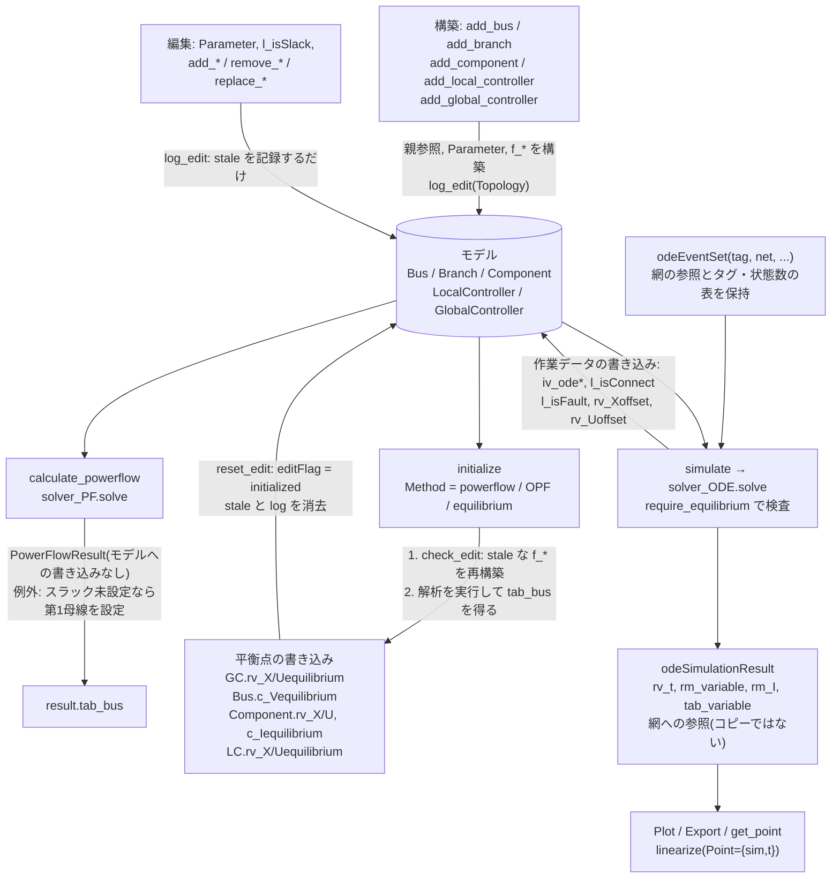

# simulate レビュー: ワークフロー・データ管理・編集時の対応(現状調査)

> 当時の調査記録です。調査の基準は `951800e` で、以後の変更は本文に反映していません(周波数と `f_*` の状態の名前だけは、現在の `get_Hz()` と `sct_edit.str_odefcn` に置き換えて書いています(当時は Dependent プロパティと論理値のフラグでした))。現状は [status.md](status.md) と [v4-migration.md](v4-migration.md) を見てください。

`PowerNetwork.simulate` の精査に向けた現状把握です。改善案の統合は後続の作業で担当するため、
解決策は 1 行の方向性までにとどめています。

- 基準コミット: `951800e`(`refactor/design-alignment` の先端)
- 実測環境: MATLAB R2026a。使い捨てのプローブを実行しただけで、コア実装は変更していません。
- 証拠の区分:
  - **[実測]** MATLAB で動作を確認した
  - **[コード]** コードを読んで確定できる(実行はしていない)
  - **[推測]** コードからの推論で、確定していない
  - **[未確認]** 調べ切れていない
- パスの省略: `PN/` = `_GUILDAsystem/@PowerNetwork/`、`LP/` = `_GUILDAsystem/_auxiliary/@LayerPackage/`、
  `SIM` = `_GUILDAsystem/_auxiliary/@odeSimulator/odeSimulator.m`、
  `EVT` = `_GUILDAsystem/_auxiliary/@odeEventSet/odeEventSet.m`、`DOC` = `_GUILDAdoc/developer/class-design.html`

## 結論

編集追跡の骨格(stale の表、`simulate` での停止、`f_*` の再構築)は設計どおり実装されています。問題は、
その仕組みの外側にある経路です。上位 3 件は次のとおりです(詳細は [7 章](#7-気づいた問題点))。

1. **AVR 付き発電機の trip で `simulate` が必ず落ちる経路がある**。trip 中の相から次の相へ移るときに
   `TooManyOutputs` になります(`SIM:661`)。**[実測]**
2. **`initialize` の結果が平衡点にならないのに、成功扱いで stale が消える**。`Method="equilibrium"` と
   `Method="OPF"` で発生します。KCL 残差が 0.392 のまま `simulate` が `flag=1` で完走します。**[実測]**
3. **`remove_component` / `replace_component` で GlobalController の参照が残る**。過去に実行した系では
   古い `iv_ode*` のまま `flag=1` で完走し、無言で誤った結果になる可能性があります。**[実測(完走と添字)/推測(結果の誤り)]**

## 1. ワークフロー



| 段階 | 書き込み先 | 次段階への渡し方 | 根拠 |
|---|---|---|---|
| `add_bus` | `Bus`(親参照 + `para_*` 4 種)、`net.a_Bus`、Topology ログ | `a_Bus` | `PN/add_bus.m:42-45`, `@Bus/Bus.m:69-87` |
| `add_branch` | `Branch`、端母線 `a_Bus`(親ではなく関連)、`net.a_Branch` | `get_admittance_matrix` | `PN/add_branch.m:61-67` |
| `add_component` | `Component`、`a_Bus`。`set_bus` が `f_*` を再構築 | `bus.a_Component` | `@Bus/add_component.template:54-59`, `@Component/set_bus.m:5-6` |
| `add_local_controller` | `a_LocalController`、親、`iv_obsY/X`、`f_*`、`l_hasController` | 同左 | `@Component/add_local_controller.m:36-88`, `@LocalController/LocalController.m:148-153` |
| `add_global_controller` | `net.a_GlobalController`、`a_PowerNetwork`、`f_*` | 同左 | `PN/add_global_controller.m:12-14`, `@GlobalController/GlobalController.m:178-182` |
| `calculate_powerflow` | 結果のみ(例外: スラック未設定なら `a_Bus{1}.l_isSlack`) | `result.tab_bus` | `PN/calculate_powerflow.m:38-50` |
| `initialize` | GC → 各 Bus → Component → LC の順に平衡点を書き込み、最後に `reset_edit` | 平衡点 | `PN/initialize.m:47-99`, `@Bus/set_equilibrium.m:17,59-65`, `@Component/set_equilibrium.m:12-21` |
| `simulate` | 検査 → 作業データ → 積分 → 結果 | 結果オブジェクト | `PN/simulate.m:53-58`, `SIM:166-319` |

`set_equilibrium` の配分規則は 3 章・7 章の問題に直結するので、明記しておきます(`@Bus/set_equilibrium.m:24-65`)。
母線の P/Q を配分するとき、基準になるのは**機器の `para_powerflow`** です。スラック母線の第 1 機器だけが解析結果の P を受け取り、
Q は NaN の機器にだけ配分されます。それ以外の機器は設定値の P/Q をそのまま使い、そこから電流を計算します。
渡された `c_I` は既定の P/Q の計算にしか使いません(同 `:15-16`)。

## 2. データ管理

### 2.1 所有者一覧

| 所有者 | プロパティ | 保持 / Dependent | 書き込む者 | 根拠 |
|---|---|---|---|---|
| PowerNetwork | `a_Bus`, `a_Branch`, `a_GlobalController` | 保持(setter が呼び出し元を `dbstack` で検査) | `PN/` 内のメソッド | `PN/PowerNetwork.m:48-50,248-268` |
| | `para_base`(`Hz`, `baseMVA`) | 保持 | ユーザー(`tab_parameter` 経由を含む) | `:97,121-123,237-247` |
| | `solver_PF/OPF/CPF/ODE/LIN` | 保持(`SetAccess=protected`、中身は公開プロパティ) | `reset_solver`。設定値はユーザー | `:52-89`, `PN/reset_solver.m:8-12` |
| | `cv_Vequilibrium`, `cv_Iequilibrium`, `rv_Xequilibrium` | Dependent | なし(下位層から集約) | `:91-93,222-233` |
| | `str_editFlag`, `tab_editLog`, `l_staleEquilibrium` | 保持(`LayerPackage` から継承) | `log_edit`, `reset_edit` | `LP/LayerPackage.m:40,46,61` |
| Bus | `l_isSlack` | 保持(公開) | ユーザー、`calculate_powerflow`、`handle_edit`、`release_slack` | `@Bus/Bus.m:34,162-182` |
| | `c_Vequilibrium` | 保持。**初期値 1** | `Bus.set_equilibrium` | `:43`, `@Bus/set_equilibrium.m:17` |
| | `c_Iequilibrium`, `str_bustype`, `tab_parameter` | Dependent | なし | `:29-31,118-136` |
| | `iv_odeX`, `iv_odeI`, `iv_odeU` | 作業データ(`SetAccess={?odeSimulator,?Component}`) | `odeSimulator` | `:56-60`, `SIM:392-394` |
| | `l_isFault` | 作業データ(`Access={?odeSimulator,?odeEventSet}`) | `odeEventSet` | `:36-38`, `EVT:333` |
| Branch | `para_dynamics/operation/graph` | 保持 | ユーザー | `@Branch/Branch.m:69-71` |
| | `cv_Vequilibrium`, `cv_Iequilibrium` | Dependent(`Y*V`) | なし | `:130-136` |
| Component | `f_Mass/dx/I/Y/JacobiDx/I/Y` | キャッシュ(`SetAccess=protected`) | `set_odefcn` | `@Component/Component.m:78-86,169-196` |
| | `rv_Xequilibrium`, `rv_Uequilibrium`, `c_Iequilibrium` | 保持 | `Component.set_equilibrium` | `:87-91`, `@Component/set_equilibrium.m:15-17` |
| | `c_Vequilibrium`, `rv_Xequilibrium_all` | Dependent(`c_V` は母線から読む) | なし | `:100-103,234-245` |
| | `iv_odeX/U/Y` | 作業データ(`{?odeSimulator,?Component}`) | `odeSimulator` | `:92-96` |
| | `l_isConnect`, `l_hasController` | 作業データ + モデル状態が同じブロックに混在 | `odeEventSet`, `add_local_controller` | `:117-120`, `EVT:497` |
| | `rv_Xoffset`, `rv_Uoffset` | **公開で書き込み可能**(`Hidden` のみ) | `odeEventSet` | `:121-124`, `EVT:245,282` |
| LocalController | `f_*`, `rv_X/Uequilibrium` | キャッシュ、保持 | `set_odefcn`, 各サブクラスの `get_equilibrium` | `@LocalController/LocalController.m:65-72,101-104`, `_GUILDAobject/+controller/+avr/@AVR_ST1/AVR_ST1.m:92-93` |
| | `iv_ode*`, `rv_X/Uoffset`, `l_isConnect` | 作業データ(`{?odeSimulator,?odeEventSet}`) | `odeSimulator`。LC の offset と `l_isConnect` は**参照のみで実質未使用**(`EVT:498` は既定値を読む) | `:73-83`, `EVT:490-507` |
| | `iv_obsY/X`, `sv_uRequest` | 接続時に解決 | `resolve_observe` | `:84-95,155-201` |
| GlobalController | `f_*`, `rv_X/Uequilibrium` | キャッシュ、保持(`SetAccess={?PowerNetwork}`) | `set_odefcn`, `initialize` | `@GlobalController/GlobalController.m:45-52,69-72`, `PN/initialize.m:83-86` |
| | `controlledUnits` | ハンドルのコピーを保持 | コンストラクタのみ | `:56-58,106` |
| | `iv_ode*`, `l_isConnect` | 作業データ | `odeSimulator` | `:59-68`, `SIM:379-387,418` |
| Parameter | 動的プロパティ | 保持。値の単一の所有者 | ユーザー。PreSet/PostSet で検知 | `_GUILDAsystem/_auxiliary/@Parameter/add_entry.m:18-24` |

データ単一所有の設計(`Bus=V`、`Component=I`、`Hz/baseMVA=PowerNetwork`)は**実装と一致**しています。**[コード]**

### 2.2 `f_*` キャッシュ

- `set_odefcn` がパラメータ値を**その時点のコピー**としてハンドルに閉じ込めます(`@Component/Component.m:171-194`)。
  したがって、rebuild するまではパラメータ編集が反映されません。
- rebuild する契機は 2 つです。接続時の `rebuild_odefcn_tree`(`@Component/set_bus.m:6`、`@LocalController/LocalController.m:152`、
  `@GlobalController/GlobalController.m:181`)と、`check_edit`(`LP/check_edit.m:13-16`)です。
- `check_edit` を呼ぶのは `initialize`(`PN/initialize.m:47`)と、`require_equilibrium` を通した
  `odeSimulator.solve` / `odeLinearizer.solve`(`SIM:167`, `_GUILDAsystem/_auxiliary/@odeLinearizer/solve.m:22`)だけです。**[コード: grep で全呼び出しを確認]**
- 例外: `local_LQR` の `f_*` はゲイン `K` に依存し、`get_equilibrium` の中で再構築します
  (`_GUILDAobject/+controller/local_LQR.m:157`)。

### 2.3 ソルバ設定

- 永続設定 + 実行時 Name-Value という設計は**実装と一致**しています。`get_options` は値を struct にコピーし、ソルバを変更しません
  (`SIM:124-137`)。**[コード]**
- `o.SolverOptions.OutputFcn` への代入(`SIM:202`)は保存側に波及しません。`SolverOptions` はハンドルではなく、実行後も
  `OutputFcn` は空でした。**[実測]**
- `reset_solver` は 5 つのソルバすべてを作り直します。ログや平衡点には影響しません(`PN/reset_solver.m:8-12`)。**[コード]**
- `solver_*` の変更は編集ログの対象外です。これは設計どおりです。

### 2.4 親参照

| 子 | プロパティ | 設定 | 解除 | 根拠 |
|---|---|---|---|---|
| Bus | `a_PowerNetwork` | コンストラクタ | `remove_bus` | `@Bus/Bus.m:69,94-97`, `PN/remove_bus.m:57` |
| Branch | `a_PowerNetwork`, `a_Bus` | `add_branch` | `remove_branch` | `PN/add_branch.m:64-65`, `PN/remove_branch.m:17-18` |
| Component | `a_Bus` | `add_component`, `replace_component` | `remove_component`, `replace_component` | `@Component/set_bus.m:5`, `@Bus/remove_component.m:20`, `@Bus/replace_component.template:71` |
| LocalController | `a_Component` | `add_local_controller` | 置き換え時 | `@Component/add_local_controller.m:42,50-58` |
| GlobalController | `a_PowerNetwork` | `add_global_controller` | `remove_global_controller` | `PN/add_global_controller.m:13`, `PN/remove_global_controller.m:27` |

重複接続の検査はありません。同じ LocalController を 2 台に接続できます(7 章 M3)。**[実測]**
LocalController を単に取り外す公開 API もありません。`remove_local_controller` はアクセス制限付きで、置き換え経由でしか使えません
(`@LocalController/LocalController.m:135,142-146`)。**[コード]**

## 3. パラメータ変更時の対応

### 3.1 仕組み

1. `Parameter` の値を変えると PostSet が新旧を比較し、変化があれば `log_edit("edit <name>", "Parameter(<group>)")` を呼びます
   (`_GUILDAsystem/_auxiliary/@Parameter/callbackPostSet.m:13-19`)。型違いは元に戻してエラーにします。この巻き戻しでログや stale は**残りません**(P は復元、ログ 0 行)。**[実測]**
2. `log_edit` は `edit_effect` で影響を判定します(`LP/log_edit.m:17-18`, `LP/LayerPackage.m:130-159`)。
   - `f_*` が stale になる編集は、所有者の `str_odefcn` を立てます。`base` の場合は全子孫に立てます(`LP/log_edit.m:19-25`)。
   - ログ行は親へ順に伝わり、途中の層は `str_editFlag="editted"` になります(`:37-39`)。
   - `PowerNetwork` で `l_staleEquilibrium` とログを更新します。ただし `unset` の間は記録しません(`:27-33`)。
   - 最後に `handle_edit` がスラック母線を 1 つに保ちます(`:36`, `PN/PowerNetwork.m:182-199`)。
3. `check_edit` は全層を辿って stale な `f_*` を再構築し、`editFlag ~= "unset" && ~l_staleEquilibrium` を返します(`LP/check_edit.m:13-17`)。
4. `PowerNetwork.check_edit` は `RequireEquilibrium=true` のとき、理由つきの `GUILDA:PowerNetwork:EquilibriumStale` で停止します(`PN/check_edit.m:17-32`)。
5. `reset_edit` はフラグ・stale・ログを再帰的に消去します(`LP/reset_edit.m:5-8`)。呼ぶのは `initialize` の末尾だけです(`PN/initialize.m:99`)。

補足: `LocalController.children` は `para_dynamics` を含まないため(`@LocalController/LocalController.m:286-288`)、`reset_edit` は LC の `Parameter` に届きません。
その `str_editFlag` は `editted` のまま残りますが、判定に使うのはネットワークの値だけなので実害はありません。**[コード]**

### 3.2 編集の種類ごとの影響

| 編集 | `f_*` | 平衡点 | `simulate` の動作 | 根拠 |
|---|---|---|---|---|
| dynamics(Component / LC / GC) | stale | stale | `f_*` を再構築してから停止 | `LP/LayerPackage.m:152-153`, P10 **[実測]** |
| dynamics(Bus shunt / Branch) | 実質なし | stale | 停止。`Y` は実行ごとに計算(`SIM:184`) | **[コード]** |
| `baseMVA`(網) | 全層 stale | stale | 停止 | `LP/LayerPackage.m:150-151` **[実測]** |
| `Hz`(網) | 全層 stale | なし | 再構築して続行(`flag=1`) | **[実測]** |
| powerflow(`V`, `Varg`, `P`, `Q`, `V0`, `Varg0`) | なし | stale | 停止 | `:154-155`。`V0` で **[実測]** |
| Topology(`add_*` / `remove_*` / `replace_*`、LC 追加・置換) | なし(接続時に構築) | stale | 停止 | 各メソッドの `log_edit` **[コード]** |
| Slack | なし | stale | 停止 | `@Bus/Bus.m:177-181` **[コード]** |
| operation / OPF / graph | なし | なし | 続行(ログには残る) | `LP/LayerPackage.m:156-157`。`Vmax` で **[実測]** |
| `set_opffcn` / `reset_opffcn` | なし | なし | 続行 | **[コード]** |
| `local_LQR` の `Q`, `R`, `V0` | フラグなし | stale | 停止(`initialize` で再設計) | `_GUILDAobject/+controller/local_LQR.m:203-207` **[コード]** |
| `solver_*`, `reset_solver` | なし | なし | 対象外 | **[コード]** |

背景で示された設計表は `edit_effect` と**完全に一致**しています。Hz が stale にしないという判断も、`get_equilibrium` に `Hz` の参照がないことと整合します(`get_Hz()` の全参照を grep で確認)。**[コード]**

### 3.3 検知漏れの調査

| 経路 | 判定 | 結果 | 区分 |
|---|---|---|---|
| `comp.tab_parameter.dynamics.X = ...` | 検知する | setter が `Parameter` へ代入(`@Component/Component.m:270-281`) | **[コード]** |
| `comp.para_dynamics.X = ...` | 検知する | PostSet が動く。`avr.para_dynamics` も 1 行記録 | **[実測]** |
| `avr.tab_parameter.dynamics.X = ...` | **使えない** | `MATLAB:class:noSetMethod`。LC と GC には setter がない | LC は **[実測]**、GC は **[コード]** |
| 機器の `operation.baseMVA` | **漏れ** | Q 配分が変わるのに stale にならない。g1 の Q が -0.02087 → -0.03130 | **[実測]** |
| `Qmin` / `Qmax` | 影響なし | 使う規則 `"Qmax"` に `initialize` から到達できない(`PN/initialize.m:95`) | **[コード]** |
| `initialize(Method="OPF")` 後の operation / OPF / `set_opffcn` 編集 | **漏れの可能性** | 平衡点の前提が変わるが stale にならない。実行した `Method` を覚えていない | **[推測]** |
| `Method="equilibrium"` で P を編集した後 | **stale が誤って消える** | 7 章 H2 | **[実測]** |
| `remove_component` / `replace_component` と GC | **参照が残る** | 7 章 H3 | **[実測]** |
| `replace_component` と LC | **LC が引き継がれない** | 新機器の LC は 0 個、ドキュメント記載なし | **[実測]** |
| 同じ LC を 2 台に接続 | **検査なし** | 接続は通り、`simulate` は DAE 指数エラー | **[実測]** |
| 同じ GC を 2 つの網に追加 | **検査なし** | `set_parent` は上書きのみ(`@GlobalController/GlobalController.m:178-182`) | **[コード]**(動作は **[未確認]**) |
| `str_tag` の変更 | **ログなし** | `LP/LayerPackage.m:167-170`。作成済みイベントと食い違う | **[実測]** |
| イベント作成後の Topology 変更 | **再検証なし** | `MATLAB:innerdim`(`EVT:377`) | **[実測]** |
| 他の網のイベント | **検査なし** | 内部エラーで停止 | **[実測]** |
| `comp.rv_Xoffset` への直接代入 | 影響なし | 公開だが、次回 `setEventCondition` が上書き(`EVT:245`) | **[コード]** |
| `simulate` 自身による変更 | ログなし | ログ 0 行のまま | **[実測]** |
| `comp.get_sys` / `bus.get_sys` / `gc.get_sys` | **古い `f_*` を使う** | D を 3 倍にしても `A` が不変。再構築後に変化 | `comp` は **[実測]**、他は **[コード]** |
| `calculate_continuation_powerflow` | **検査なし** | `f_*` を読むが `check_edit` を呼ばない(`.../@ContinuationPowerFlow/private/pf_equation.m`) | **[コード]**(結果への影響は **[未確認]**) |

## 4. simulate の副作用

### 4.1 実行後にモデルに残るもの

| 残るもの | 所有者 | 実行間の影響 | 根拠 |
|---|---|---|---|
| `iv_odeX/U/Y/I` | Bus, Component, LC, GC | 毎回上書き。ただし**系から外れた機器の値はそのまま残る**(H3) | `SIM:340-409` |
| `l_isConnect` | Component | **trip が最後まで続くと `false` のまま**。次回の実行で復帰 | P02 **[実測]** |
| `l_isConnect` | GC | `onCleanup` で必ず復帰 | `SIM:180` |
| `l_isFault` | Bus | 最終相の値のまま。次回の実行で更新 | `EVT:333` |
| `rv_Xoffset`, `rv_Uoffset` | Component | 次回で上書き。クロージャがイベントの値を保持し続ける | `EVT:245,282` |
| `odeIteration` | odeEventSet | 実行のたびに書き換わる(イベントも実行で変化する) | `EVT:286-288`, **[実測]** 値 2 |
| `f_*` | Component, LC, GC | stale なら再構築。エラーで止まる場合でも再構築は済む | `PN/check_edit.m:16`, P10 **[実測]** |

GC だけ `onCleanup` で片付けており、Component の `l_isConnect` には同等の処理がありません(`SIM:180`)。エラー終了後は `false` のまま残ることを確認しました。**[実測]**
残った値を実行外で読む箇所は見つかりませんでした(`get_dx_algebraic` と `simulate` 系のみ)。**[コード: grep]**

### 4.2 変わらないもの・独立性

- 同じイベントで 2 回実行すると軌跡は**完全に一致**します(`isequaln`)。機器の平衡点とログも不変です。**[実測]**
- `solver_ODE` は書き換えられません。**[実測]**
- trip 後に 2 回目をイベントなしで実行しても `flag=1`、`omega` は 1.7e-18 で平衡を保ちました。**[実測]**
- 結果は網への**参照**を保持します(`_GUILDAsystem/_auxiliary/@AnalysisResult/AnalysisResult.m:49-53,78-80`)。`rm_variable` と `tab_variable` は実行時の値ですが、編集後に結果を使うと網の現状と食い違う可能性があります。
  結果が編集済みかどうかを判別する手段がないことは `notes/status.md:208-210` にも記録されています。**[コード]**
- LC の `get_equilibrium` はオブジェクトの平衡点を**書き換える**メソッドです(`AVR_ST1.m:92-93`)。`getNextPhase` が実行中に呼ぶ設計(`SIM:661,669`)なので、H1 を出力引数だけ直すと `simulate` が平衡点を書き換える副作用が表に出ます。**[コード + 推測]**
  今は H1 の例外で先に止まるため、実測では平衡点は不変でした。

## 5. 文書と実装の乖離

| # | 文書の記述 | 実装 | 区分 |
|---|---|---|---|
| 1 | 作業データに `rv_odeX0`, `l_isNonUnit` がある(`DOC:221`) | 実装に存在しない(grep 0 件) | **[コード]** |
| 2 | 作業データは解析クラスだけが書ける(`DOC:221`) | `Component.rv_Xoffset/rv_Uoffset` は公開(`@Component/Component.m:121-124`)。`iv_ode*` は `?Component` も書ける | **[コード]** |
| 3 | `GlobalController.PowerNetwork`(`DOC:228`) | プロパティ名は `a_PowerNetwork`(`@GlobalController/GlobalController.m:54`) | **[コード]** |
| 4 | ネットワークはスラックを**ちょうど 1 つ**保つ(`DOC:166`) | 「高々 1 つ」。全解除もでき、`calculate_powerflow` が補う(`PN/PowerNetwork.m:183`, `@Bus/Bus.m:34`)。OPF はスラックなしで通る | **[実測]** |
| 5 | `Owns` のソルバに `solver_LIN` がない(`DOC:166`) | `solver_LIN` もある(`PN/PowerNetwork.m:88`) | **[コード]** |
| 6 | 派生値に `rv_Xequilibrium` がある(`DOC:167`) | `net.rv_Xequilibrium` は**常にエラー**(7 章 M4) | **[実測]** |
| 7 | operation 編集は「nothing」(`DOC:265`) | 同じ文書が機器の `baseMVA` は Q 配分に使うと記載(`DOC:191`)。実際に Q が変わる | **[実測]** |
| 8 | `baseMVA` 編集で「per-unit values change」(`DOC:260`) | 自動再換算はない。`para_base.baseMVA` の数値利用は MATPOWER 入出力などのみで、`f_*` の再構築に効果なし | **[コード: grep]** |
| 9 | 解析は開始時にフラグを確認(`DOC:155,271-273`) | `simulate` / `linearize` / `get_sys` / `initialize` のみ。`comp.get_sys`、`bus.get_sys`、CPF は確認しない。`comp.get_sys` は `Component` のドキュメント例にある(`@Component/Component.m:26`) | **[実測]** |
| 10 | 親参照は親だけが書く、子は上へ書かない(`DOC:230-232`) | `log_edit` は `Parameter` から親の `str_odefcn` を書く(`LP/log_edit.m:21,23`)。通知の範囲とも読める | **[コード]** |
| 11 | イベントはタグで識別(`DOC:238`) | `odeEventSet` はタグと状態数の表を作成時に固定(`EVT:118-122`)。後から変わると破綻 | **[実測]** |
| 12 | `initialize`: `"OPF"` は完全な AC 動作点を与える(`PN/initialize.m:13-14`) | 平衡点は OPF の P を反映しない(H2) | **[実測]** |
| 13 | `initialize`: `"equilibrium"` は保存値を再設定する(`PN/initialize.m:15-16`) | 検査は保存値で行うが、再設定は `para_powerflow` を使う(H2) | **[実測]** |
| 14 | `initialize`: 失敗時は以前の平衡点とログを保つ(`PN/initialize.m:23-26`) | 解析段階の失敗に限る。`set_equilibrium` 中の失敗は部分的に書き込む(M5) | **[実測]** |
| 15 | `class-design.html` の表に Hz / baseMVA の行がない(`notes/status.md:41-43`) | **解消済み**(`DOC:260-261`)。`status.md` の記述が古い | **[コード]** |

**一致を確認した設計**: データ単一所有、stale の対応表、停止時のエラー、ソルバの永続設定と呼び出し単位の上書き、結果を網に保存しないこと。

## 6. 再現手順の抜粋

```matlab
% H1: AVR 付き発電機の trip(IEEE9bus の発電機は AVR を持つ)
net = network.IEEE9bus(); net.initialize();
ev = odeEventSet("trip", net, "TimeSpan", [1,1.2], "TripUnit", "SG1B003");
net.simulate([0,2], ev, Progress="none", TimeLimit=120);   % MATLAB:TooManyOutputs (getNextPhase:661)

% H2: Method="equilibrium" が stale を消す(build_3bus は DebugScript.helper)
[net, gen] = DebugScript.helper.build_3bus("gen-1axis"); net.initialize();
gen.para_powerflow.P = 0.9;
net.initialize(Method="equilibrium");                      % 通る。ログは 0 行
Y = net.get_admittance_matrix; Y = Y{:,:};
max(abs(Y*net.cv_Vequilibrium - net.cv_Iequilibrium))      % 0.392

% H2: Method="OPF"(スラックなしだと残差はさらに大きく 0.335)
[net, ~] = DebugScript.helper.build_3bus("gen-1axis"); net.a_Bus{1}.l_isSlack = true;
r = net.initialize(Method="OPF", Solver="fmincon");        % r の P = 0.5069、モデルの P = 0.5

% M1: 機器の baseMVA を編集しても stale にならない(同一母線に Q=NaN の機器 2 台)
g1.para_operation.baseMVA = 300;   % 以後の simulate は古い Q 配分のまま通る
```

## 7. 気づいた問題点

重要度: **H** = 誤った結果または主要機能の停止、**M** = 分かりにくい失敗または条件付きの誤り、**L** = 整理事項。

### H(高)

**H1. AVR 付き発電機の trip で `simulate` が落ちる。** **[実測]**
- `getNextPhase` は `[x0(v_LC1), ~] = a_LC1.get_equilibrium(...)` と 2 出力で呼びます(`SIM:661`、PSS は `:669`)が、AVR の `get_equilibrium` は出力を持ちません
  (`AVR_ST1.m:66`、`_GUILDAobject/+controller/+avr/abstract.m:28`、`_GUILDAobject/+controller/+pss/@PSS1/PSS1.m:67`)。
- IEEE9bus で trip が相の途中で終わる条件(`[1,1.2]`、`tend=2`)で `MATLAB:TooManyOutputs` になりました。例外後も `l_isConnect=false` が残ります。
- 方向性: `get_equilibrium` の呼び方を統一し、実行中は平衡点を書き換えない経路(値を返す純関数など)に分ける。回帰テストも追加する。

**H2. `initialize` の結果が平衡点にならないのに、成功扱いで stale が消える。** **[実測]**
- 原因は共通で、`set_equilibrium` が解析結果ではなく `para_powerflow` の P/Q から機器電流を作ることです(`@Bus/set_equilibrium.m:24-34,59-64`)。
- `Method="equilibrium"`: P 編集後に呼ぶと、保存値での KCL 検査(`PN/initialize.m:170-176`)を通過してから編集後の P で再配分します。KCL 残差 0.392、ログ 0 行で、`simulate` は `flag=1`。編集検知そのものをすり抜けます。
- `Method="OPF"`: スラックなしで P=[0.5024, 0.5069, -1] に対しモデルは [0, 0.5, -1](残差 0.335)。スラックありでも第 2 母線は 0.5 のまま(残差 0.0046)で、`simulate` は `flag=1`。
- 既存テストがすり抜ける理由: OPF のテストは電圧の一致だけを確認し(`+DebugScript/test_F3_initialize.m:200`)、equilibrium のテストは編集なしの再設定だけを確認しています(`:210-213,224-235`)。**[コード]**
- 方向性: 解析結果の機器別 P/Q を `set_equilibrium` に渡し、書き込み後に KCL を検査する。

**H3. `remove_component` / `replace_component` で GC の参照が残る。** **[実測(完走と添字)/推測(結果の誤り)]**
- `remove_bus` は GC の制御対象を検査します(`PN/remove_bus.m:32-42`)が、`@Bus/remove_component.m` と `replace_component` は検査しません。
- 一度も実行していない系では `initialize_index` が `MATLAB:badsubscript` で落ちます(`SIM:386`)。
- **実行済みの系では、古い `iv_odeX/U` をそのまま読んで `flag=1` で完走します**(`iv_odeU=[2 12]`, `iv_odeY=[4 14]`)。再採番後は別の変数を指している可能性があり、無言の誤りになり得ます。
- 方向性: GC の制御対象を保持する構造を見直すか、`remove_bus` と同じ検査を入れ、`initialize_index` でも所属を検証する。

### M(中)

**M1. 機器の `operation.baseMVA` 編集を検知しない。** **[実測]** Q 配分に使う値なのに、`operation` は「影響なし」に分類されています(`@Bus/set_equilibrium.m:52`, `LP/LayerPackage.m:156-157`)。方向性: `baseMVA` を equilibrium stale に分類するか、配分の所有を見直す。

**M2. イベントが作成時の網に固定され、検証されない。** **[実測]** Topology 変更後は `MATLAB:innerdim`(`EVT:377`)、他の網は内部エラー、タグ変更後は `UnfeasibleDAE`。いずれも原因を示しません。`solve` は `net` とイベントの網を比較しません(`SIM:178`)。方向性: 実行時にイベントの表を作り、網の一致を検査する。

**M3. 同じ LC を複数の機器に接続できる。** **[実測]** 親は最後の接続先になり、最初の機器も保持し続けます。`simulate` は「DAE 指数が 1 より大きい」となり原因が分かりません。方向性: 接続時に既存の親を検査する。

**M4. `net.rv_Xequilibrium` が常にエラー。** **[実測]** `Bus` に `rv_Xequilibrium_all` がなく(`PN/PowerNetwork.m:229`)、`Branch` にも `rv_Xequilibrium` がありません(`:230`)。公開プロパティで、テストにも現れません。方向性: `get_variable_map` の順序に合わせて実装し、テストを追加する。

**M5. `initialize` の書き込みが原子的でない。** **[実測]** AVR の範囲エラーで停止すると、V の一部と先行する機器の X が新しい値、残りが古い値になりました。stale が既に立っていれば `simulate` は止まるので実害は限定的です。ただし編集なしの再実行(ソルバ設定の変更など)で同じことが起きると stale が立たない可能性があります。**[推測]** 方向性: 計算と代入を分ける。

**M6. AVR の範囲エラーのメッセージ自体が壊れている。** **[実測]** `AVR_ST1.m:83` の呼び出しが `The ID specification is invalid`(`_GUILDAsystem/_auxiliary/SystemTools/msg.m:45`)になり、本来の案内が出ません。AVR_ST1 が AVR_DC1 の ID を参照している点も確認が必要です。方向性: ID を辞書に登録し、エラー経路のテストを追加する。

**M7. 階層の下位の `get_sys` と CPF が編集検査を通らない。** `comp.get_sys` は **[実測]**、`bus.get_sys`、`gc.get_sys`、CPF は **[コード]**。編集直後でも古い `f_*` で計算し、警告も出ません。方向性: 公開の解析入口で `check_edit` 相当を行う。

**M8. `replace_component` が LC を引き継がない。** **[実測]** 新機器の LC は 0 個で、警告も文書の記載もありません(`@Bus/replace_component.template:4-6`)。方向性: 引き継ぐか、明示的に警告する。

**M9. LC / GC の `tab_parameter` に書けない。** LC は **[実測]**、GC は **[コード]**。他の層と API が非対称で、`DOC` の「`tab_parameter` で設定する」方針とも一致しません。方向性: setter を追加する。

### L(低)

- **L1.** `str_tag` の変更がログに残りません(**[実測]**、`LP/LayerPackage.m:167-170`)。保存データやイベントの識別子なので、変更を禁止するか Topology 相当にする。
- **L2.** `V0`, `Varg0`(初期値)の編集でも平衡点が stale になります(**[実測]**)。解は変わらないので過剰な可能性があります。編集の影響を分類し直す。
- **L3.** `baseMVA` と Bus / Branch の dynamics は `f_*` を再構築しますが、数値には効きません。**[コード]** 無害。分類を整理する。
- **L4.** Component の `l_isConnect` は例外時に復帰しません(GC のみ `onCleanup`)。現状は次回実行で上書きされ、実害は確認していません。**[実測]** 片付けを統一する。
- **L5.** LC の `rv_Xoffset`, `rv_Uoffset`, `l_isConnect` は実質未使用です。**[コード]** 作業データを整理する。
- **L6.** `Component.rv_Xoffset/rv_Uoffset` が公開です(`@Component/Component.m:121-124`)。アクセスを制限する。
- **L7.** 作業データをモデルに置く構造のため、実行が網の状態に依存します。`ctx` へ移せば M2 や H3 の系統の失敗を減らせる可能性があります。**[推測]**

### 未解決・調べ切れていない点

- **[未確認]** AVR なしの発電機 trip の正常系。3 母線の試験系では `flag=-1`(`t=1.06` で積分が停止)となり、モデル上の必然か不具合かは切り分けていません。
- **[未確認]** H3 で古い添字が具体的にどの変数を指し、結果がどれだけ変わるか。
- **[未確認]** 同じ GC を 2 つの網に追加したときの動作。
- **[未確認]** 実験的な機器(`component/未+GFM`, `未+farm`)の `get_equilibrium` は `Hz` を参照しないことのみ確認し、動作は確認していません。
